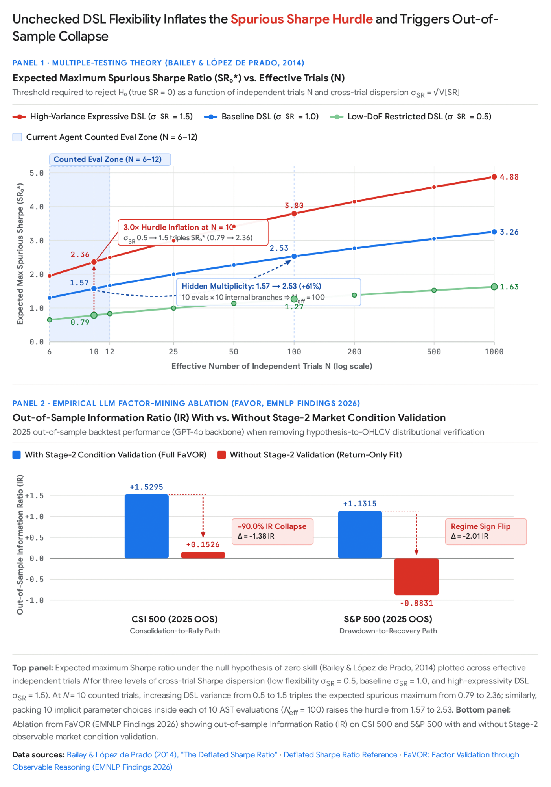
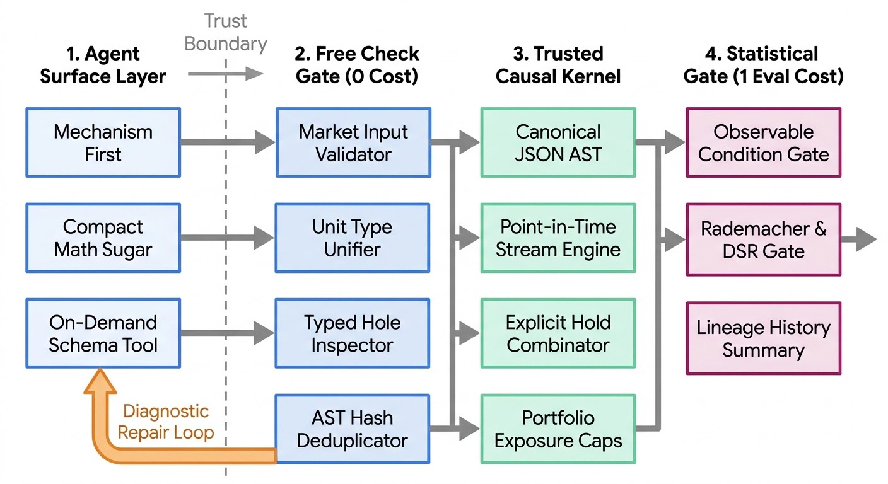
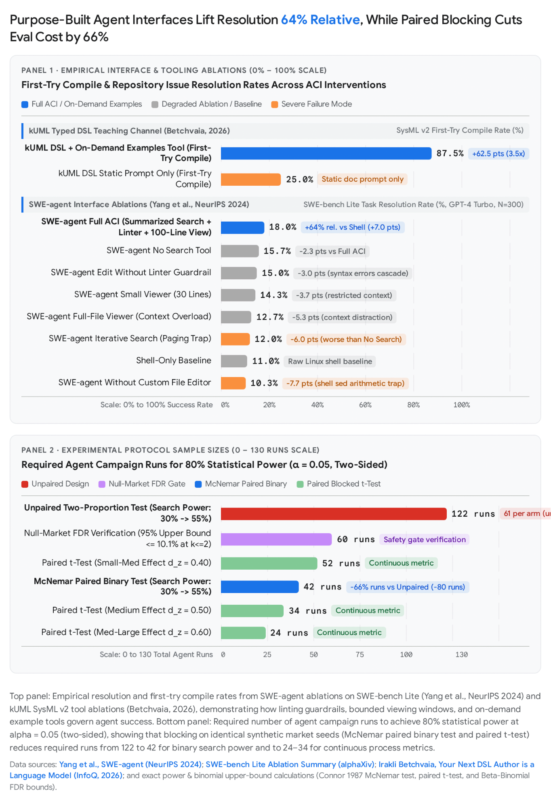

Gemini 4 Argon Deep Research (web), 2026-11-07, prompt in the advisor session; converted from the human's exported `LLM Agent DSL Design Review.docx` by pandoc, figures in `2026-11-07-argon-dsl-literature/media/`. Model output: citations unverified.

# Designing Domain-Specific Languages for Autonomous LLM Agents Under Strict False-Discovery Control

Designing a domain-specific language (DSL) authored exclusively by large language model (LLM) agents and executed by a formally verified causal kernel requires inverting classical programming language ergonomics while tightening statistical invariants. Empirical evidence across multilingual code benchmarks ([*MultiPL-E*](https://arxiv.org/abs/2208.08227)¹, [*McEval*](https://arxiv.org/abs/2406.07436)², [*DSL-Bench*](https://arxiv.org/abs/2611.05168)³), formal verification testbeds ([*Vericoding*](https://arxiv.org/abs/2509.22908)⁴, [*LeanDojo*](https://ar5iv.labs.arxiv.org/html/2306.15626)⁵, [*Verified but Vacuous*](https://arxiv.org/html/2611.05590v1)⁶), and agent-computer interface studies ([*SWE-agent*](https://arxiv.org/abs/2405.15793)⁷, [*CodeAct*](https://arxiv.org/abs/2402.01030)⁸, [*Evaluating AGENTS.md*](https://arxiv.org/abs/2602.11988)⁹) shows that while LLMs are indifferent to human typing verbosity, they are acutely vulnerable to autoregressive commitment traps, deep JSON bracket-nesting errors, silent semantic leniency, and context-window dilution. In your system's first 6 campaigns (24 Claude-family agents), the kernel's dimensional type checker worked as intended (only 2 dimension errors across 231 check calls, or 0.87%), but 5.29% of paid eval calls (11 of 208) failed simply because agents guessed market input identifiers that did not exist, agents resorted to division-by-zero/NaN workarounds to express position holding, and agents prematurely halted exploration after using only 6–12 of their 100-evaluation budget.

Crucially, the econometric and statistical learning literature—spanning [*White's Reality Check (2000)*](https://www.ssc.wisc.edu/~bhansen/718/White2000.pdf)¹⁰, [*Hansen's SPA test (2005)*](https://ideas.repec.org/a/bes/jnlbes/v23y2005p365-380.html)¹¹, [*Bailey and López de Prado's Deflated Sharpe Ratio (2014)*](https://www.davidhbailey.com/dhbpapers/deflated-sharpe.pdf)¹², [*Dwork et al.'s adaptive data analysis bounds (2015)*](https://vtaly.net/papers/DFHPRR-Adaptive.0216.pdf)¹³, and [*Paleologo's Rademacher Anti-Serum (2024)*](https://medium.com/balaena-quant-insights/rademacher-anti-serum-ras-08cef83f7102)¹⁴—demonstrates that counting evaluations () is necessary but insufficient to control false discoveries. Expanding DSL expressivity or allowing bloated expression trees (such as your current 4,096-node limit) inflates the false-discovery rate per counted evaluation by increasing the functional Rademacher complexity () of each tree, expanding cross-trial Sharpe variance (), and enabling adaptive multi-round parameter fitting via history. Consequently, making your DSL optimal for agents requires **decoupling surface ergonomics from kernel semantics**: providing a compact, familiar, reasoning-first surface representation and strict pre-evaluation static validation (check), while **tightening** the AST complexity budget, replacing the NaN hold workaround with a zero-degree-of-freedom synchronous clock combinator, and enforcing pre-return observable market condition checks.

## 1. Executive Summary

- **Bend 2 validates ultra-fast, single-pass bidirectional checking and typed holes for agents, but its LLM learnability claims lack controlled benchmark evidence (High Confidence).** Victor Taelin's [*Bend 2*](https://github.com/bendlang/bend)¹⁶ abandons HVM interaction nets for an affine dependent type theory (BendTT) whose 3,734-line human-written checker runs in 0.29–0.61 seconds (15x–50x faster than Rocq and Lean 4) because it bans type inference, unification, and tactics¹⁷. However, its 6,251-line compiler (comp.ts) is 99% AI-written and unverified, floating-point (F32) semantics are axiomatic, and no published benchmarks compare LLM synthesis accuracy in Bend 2 against mainstream languages¹⁶.

- **Auto-active verification (compiler/kernel decides) vastly outperforms interactive proof construction (agent writes proofs) (High Confidence).** Across the 12,504-task [*Vericoding benchmark (Bursuc et al., 2025)*](https://arxiv.org/abs/2509.22908)⁴, off-the-shelf LLMs achieve an **82.2% verification rate in Dafny** (where the verifier checks properties automatically via SMT) versus **44.2% in Verus/Rust** and **26.8% in Lean 4**¹⁹. Your architecture should keep all safety guarantees (causality, dimensional homogeneity, exposure caps) automatically verified by the Rust/Lean kernel rather than asking agents to emit proof terms.

- **Syntax familiarity accelerates cold-start generation, but novel semantics behind familiar syntax creates silent traps (High Confidence).** In [*DSL-Bench (Zhou et al., Nov 2026)*](https://arxiv.org/abs/2611.05168)²⁰, across 18 DSLs and 7 LLMs, mean syntax acceptance is 31.37% while semantic correctness is only 11.64%, with the DSL's domain-specific *Knowledge Demand* explaining 76.99% of variance versus 7.86% for model choice²¹. Practitioner studies on unseen languages ([*Lattice*](https://tinycomputers.io/posts/teaching-llms-languages-theyve-never-seen.html)²², [*kUML*](https://www.infoq.com/articles/next-dsl-author-language-model/)²³) show that LLMs immediately transfer familiar syntax (Rust/Python/Kotlin) but silently interpolate host-language semantics unless blocked by strict compiler errors.

- **JSON format restrictions degrade LLM reasoning when output keys precede reasoning or require deep bracket nesting (High Confidence).** [*Tam et al. (EMNLP 2024)*](https://arxiv.org/abs/2408.02442)²⁴ and [*Nguyen et al. (Oct 2026)*](https://arxiv.org/html/2610.35328v1)²⁵ show that reasoning inside rigid JSON schemas degrades performance by up to 56% when the answer/code key precedes the reasoning key, while [*arXiv:2404.05499*](https://arxiv.org/pdf/2404.05499)²⁷ reports that unconstrained LLM bracket-matching error rates exceed 95% past 282 characters. Placing mechanism and pre_check *before* params, let, and weight—and accepting compact infix math expressions that compile deterministically to your JSON AST—eliminates both failure modes²⁴.

- **Compiler feedback loops are heavily front-loaded: 84%–96% of all repair gains occur on the first retry (High Confidence).** [*Deng et al. (Oct 2026)*](https://arxiv.org/html/2610.26942v1)²⁹ show in Lean 4 that a single compiler-guided repair () captures 84%–96% of all solvable repairs, while further retries rapidly saturate. Combined with [*Mündler et al. (PLDI 2025)*](https://escholarship.org/content/qt8xw132rt/qt8xw132rt.pdf)³⁰ (finding that 94% of LLM compile failures in TypeScript are type/identifier errors) and [*Blinn et al. (OOPSLA 2024)*](https://arxiv.org/abs/2409.00921)³¹, making check validate market input identifiers and support typed holes (?) will eliminate your 5.29% paid eval failure rate on the first retry.

- **Static AGENTS.md overviews inflate token cost by \>20% without helping; on-demand example tools and verified exemplars drive 2x–3.5x gains (High Confidence).** [*Gloaguen et al. (Feb 2026)*](https://arxiv.org/abs/2602.11988)³² find that LLM-generated AGENTS.md files reduce task resolution by 3% on average while increasing inference cost by \>20%. Conversely, [*EsoEval*](https://openreview.net/pdf?id=wj9ccBP4uY)³⁴ and an industry benchmark by [*Betchvaia (2026)*](https://www.infoq.com/articles/next-dsl-author-language-model/)²³ show that providing an on-demand callable example/catalog tool and 3–5 verified canonical programs boosts first-try compile rates from 25.0% to 87.5%.

- **Expanding DSL expressivity inflates false discoveries per counted evaluation via Rademacher complexity (****) and cross-trial variance (****) (High Confidence).** Under [*Bailey and López de Prado (2014)*](https://www.davidhbailey.com/dhbpapers/deflated-sharpe.pdf)¹² and [*Paleologo (2024)*](https://medium.com/balaena-quant-insights/rademacher-anti-serum-ras-08cef83f7102)¹⁵, the expected maximum spurious Sharpe ratio scales linearly with cross-trial standard deviation  and adds a  noise-covariance penalty. Your current 4,096-node, depth-64 AST limit is two orders of magnitude larger than standard formulaic alpha limits (20 tokens in [*AlphaGen*](https://arxiv.org/pdf/2306.12964)³⁷ and explicit AST length/parameter penalties in [*AlphaAgent*](https://arxiv.org/pdf/2502.16789)³⁸), creating substantial uncounted degrees of freedom per evaluation.

- **Replacing the undefined = hold workaround with an explicit synchronous clock combinator (hold_when / rebalance_band) improves clarity without expanding the hypothesis space (High Confidence).** Synchronous dataflow languages ([*Lustre*](http://www-verimag.imag.fr/~halbwach/lustre-ieee.html)⁴⁰, [*Lucid Synchrone*](https://www.di.ens.fr/~pouzet/bib/chap_lucid_synchrone_english_iste08.pdf)⁴¹) separate uninitialized delay (pre) from explicit sub-clock sampling (when/merge/hold). Making post-warmup NaN a warning/flat-0 fallback while introducing an explicit hold_when(cond, target_weight) primitive eliminates silent numerical masking (0/0 bugs masquerading as holds) without increasing model flexibility.

- **Validating the pre-registered mechanism and prediction condition on observable market states before checking returns prevents return-overfitting (Medium-High Confidence).** In [*Verified but Vacuous (Vempaty et al., Nov 2026)*](https://arxiv.org/html/2611.05590v1)⁶, 94.7% of LLM-generated specs on HumanEval lack postconditions without a binding gate, and in [*FaVOR (EMNLP Findings 2026)*](https://aclanthology.org/2026.findings-emnlp.1514.pdf)⁴³, enforcing a Stage-2 check that factor quantiles actually reflect the claimed observable market condition prevents out-of-sample Information Ratio from collapsing (maintaining IR of 1.53 vs 0.15 on CSI 500 and 1.13 vs -0.88 on S&P 500)⁴³.

- **Agent under-exploration (using 6–12 of 100 evaluations) stems from LLM stopping bias and raw history convergence (Medium-High Confidence).** [*Gloaguen et al. (2026)*](https://www.researchgate.net/publication/400741909_Evaluating_AGENTSmd_Are_Repository-Level_Context_Files_Helpful_for_Coding_Agents)³³, [*SWE-agent*](https://arxiv.org/abs/2405.15793)⁴⁴, and [*LineageEvo (Oct 2026)*](https://arxiv.org/abs/2610.29663)⁴⁵ show that unguided agents either converge prematurely on early lineages in history or get distracted by unfiltered logs. Summarizing history by structural AST lineage () reduces cross-agent adaptive overfitting and increases search diversity¹³.

## 2. Question 1: Languages LLMs Learn Without Pretraining

### Verification of Bend 2 (and Its Lineage: Kind, HVM, and Bend 1)

To evaluate the claims surrounding Victor Taelin's languages, it is essential to separate the earlier interaction-net projects (**Kind**, **HVM1/HVM2**, and **Bend 1**) from **Bend 2**, which launched on September 17, 2026 ([*bendlang/bend*](https://github.com/bendlang/bend)) and is a completely new language and runtime¹⁶.

#### Architectural Evolution and What Bend 2 Actually Looks Like

Between 2022 and 2025, HigherOrderCO developed [*Kind*](https://github.com/HigherOrderCO/Kind) (a Haskell-implemented proof language)⁴⁶, [*HVM2*](https://github.com/HigherOrderCO/HVM2) (a parallel evaluator for Lafont's interaction combinators using 24-bit tagged numbers U24, I24, F24)⁴⁹, and [*Bend 1*](https://github.com/HigherOrderCO/Bend1) (a Python-like functional language that compiled fold and recursive bend operators to HVM2 interaction nets)⁴⁶. In May 2024, Taelin noted on [*Hacker News*](https://news.ycombinator.com/item?id=40390287) that Bend 1 / HVM2 had "abysmal" single-core codegen (5x to 100x slower than GHC on loops/arrays), lacked tail-call optimization, and supported only 24-bit floats⁵².

[***Bend 2*** *(v2.0.39 as of October 27, 2026)*](https://github.com/bendlang/bend) discards both Bend 1 compatibility and HVM interaction nets ("Bend 1 programs and HVM do not carry over")¹⁶. Its surface syntax looks like Python (def, indentation, match/case, do IO:), while its semantics combine a dependently typed proof assistant (**BendTT**) with an affine parallel runtime (**BendRT**)¹⁶:

1.  **Affine Discipline Doing Triple Duty:** Every variable binding in Bend 2 is affine (used at most once) by default¹⁷. A variable can be duplicated only if its binder carries + (or &) and its type is a first-order algebraic datatype declared with type \<Name\> is Data: (Kind(&2))¹⁷. Higher-order functions/closures, flat arrays (Array\<T\>), and IO handles are classified as is Type (Kind(&1)) and can *never* be copied⁵⁵. As documented in the official [*GUIDE.md*](https://github.com/bendlang/bend/blob/main/guide/GUIDE.md)⁵⁴ and an independent technical audit of the bendlang/bend@0b7e2b1 repository snapshot ([*ai.thesatyajit.com*](https://ai.thesatyajit.com/articles/bend-2))¹⁷, this single affine rule performs three jobs simultaneously:

    - *Logical Consistency without Universe Hierarchies:* Allowing Type : Type normally causes Girard's or Curry's paradox. Instead of an infinite universe tower (), BendTT blocks self-referential paradoxes via affinity (every known paradox duplicates a function/closure, which is rejected because functions are Type, not Data) paired with a strict wall between **live checking mode** (executable code, which must terminate via left-to-right structural recursion and cannot use mutual recursion) and **dead checking mode** (types, erased - arguments, and equations)¹⁷.

    - *Memory Management without Tracing GC:* Consuming owned values in match reclaims storage immediately, single-owner Array\<T\> supports zero-copy in-place mutation (Array.set), and only "hot" shared Data types incur 24-bit atomic reference counting¹⁷.

    - *Explicit Parallel Runtime (BendRT):* Dropping interaction nets, BendRT compiles functions into a stackless flat C state machine¹⁷. Parallelism is explicit: a two-binding statement a b = f(x) g(y) forks two tasks onto a static 128 by 128 grid of lock-free rings without work-stealing, and appending ! (pow2!(20n)) dispatches execution to Metal or CUDA GPUs¹⁷.

2.  **Law-Driven AI Verification Workflow (LAWS.bend and PROOF.bend):** Bend 2 is designed for workflows where humans write specifications in LAWS.bend and AI agents write implementations and constructive proofs in PROOF.bend¹⁶. A proposition is an equality type {f(x) == g(x) : T}, and a proof is an ordinary total function (def) of the same name that splits symbolic inputs via match, applies inductive hypotheses via rewrite (%e : P), and discharges definitionally equal normal forms with {==} (or finally)¹⁶. To assist agents, Bend 2 provides **typed holes** (?todo, which prints the exact expected goal type and all local variables in scope while exiting non-zero) and **bounded exhaustive counterexample search** (gen, which tests inhabitants up to depth  before the agent wastes tokens proving a false statement)¹⁸.

#### Separating Measured Evidence from Claims and Anecdotes

Table 1 summarizes what is empirically measured in primary repository benchmarks and independent code audits versus what remains unverified or anecdotal in the Bend 2 ecosystem.

| **Dimension / Claim** | **Designer Claim (bendlang/bend, bend2.org)** | **Measured Primary Evidence & Independent Audit (ai.thesatyajit.com, Repo Docs)** | **Confidence & Relevance to Your DSL** |
|----|----|----|----|
| **Checker Speed & Architecture** | Outperforms existing proof assistants by orders of magnitude (\<1s checks)¹⁶. | **Verified:** On defs_12800 and 3,200 generic instantiations (Apple M4 Max), bend.ts checks in **0.29–0.61s** (0.38s baseline) vs. **Rocq (5.99–6.00s)**, **Lean 4 (19.20–36.18s)**, and **Agda/Isabelle (\>40–300s)**¹⁷. Achieved by banning type inference, unification, and tactics in a 3,734-line bidirectional pass¹⁶. | **High Confidence.** Fast (\<0.5s), deterministic static checking is critical for agent inner loops. |
| **Kernel Soundness & Trust Boundary** | Mechanically verified in Lean (bendtt.lean) to block AI bugs¹⁶. | **Mixed / Caveated:** bendtt.lean (~21,000 lines of Lean 4, zero sorrys) proves soundness, termination, and adequacy for the core calculus (--verdict)¹⁷. **However:** (1) source-to-kernel elaboration (safe.ts) is unverified; (2) the compiler (comp.ts, 6,251 LOC) is **99% AI-written and unaudited**; (3) F32 floats are axiomatic and NaN behavior diverges across backends¹⁶. | **High Confidence.** Validates your design: keep the kernel small, human-audited in Rust/Lean, and interpret ASTs directly (like [*Clarity*](https://docs.stacks.co/learn/clarity)⁵⁸) rather than trusting a complex compiler. |
| **CPU & GPU Runtime Speed** | As fast as C on 1 core; as fast as CUDA on GPU¹⁶. | **Partially Verified with Twist:** Speed came from **dropping HVM interaction nets**¹⁷. On 16 M4 Max benchmarks, PAR-GPU hits **123.9x** (Game of Life) and **97.6x** (N-Body) over 1-core, but 1-core Bend is slower than clang -O3 on **15 of 16 benchmarks** (~1.3x geomean penalty; 4.4x slower on HAMT), and GPU is slower than multi-core CPU on **5 of 16 benchmarks** (e.g., Regex Lexer, N-Queens) due to warp divergence¹⁸. | **High Confidence.** Irrelevant to your hourly interpreter, except as a warning against marketing claims. |
| **"Blocks AI Mistakes via Proof"** | AI cannot ship bugs if LAWS.bend is enforced¹⁶. | **Conditionally True (Vulnerable to Spec Gaming):** In the flagship demo (law you_cant_win), Taelin acknowledged that a single negative law lets the AI "cheat" by deleting the flag or immobilizing the player¹⁶. Blocking reward hacking requires **law pairs** (transition law + conservation law)¹⁸. | **High Confidence.** Directly parallels your agents using undefined = hold and underscores why specs must prevent vacuous satisfaction. |
| **LLM Learnability Without Pretraining** | AI agents prefer Bend 2 and build full apps/compilers simply by reading bend guide (8k token cap)¹⁸. | **Anecdotal / Unbenchmarked:** Demos (app_slash_boss_3d), comp.ts itself, and a community Claude 2D renderer ([*bend2.org*](https://bend2.org/articles/what-is-bend-2-why-ai-agents-prefer-bend)¹⁸) exist, but **zero controlled benchmarks** compare LLM pass rates or token efficiency in Bend 2 against Python, Lean, or Dafny. Moreover, without tactics, writing recursive inductive proofs requires heavy manual effort¹⁶. | **Medium Confidence.** The *mechanisms* (GUIDE.md fits in 8k tokens, typed holes ?todo, bounded test gen) are sound, but manual proof terms hurt LLM pass rates compared to auto-active checking. |

### What Properties Make a Language Efficiently Learnable In-Context by an LLM?

Empirical research published between 2023 and November 2026 evaluates how LLMs learn low-resource, esoteric, and newly constructed languages in context. Table 2 consolidates the primary quantitative benchmarks comparing verification architectures, error distributions, and syntax-to-semantics gaps across LLM code generation studies.

| **Study / Benchmark** | **Languages & Scope Evaluated** | **Primary Quantitative Findings** | **Core Implication for Agent DSL Design** |
|----|----|----|----|
| [***Vericoding Benchmark (Bursuc et al., Sep 2025)***](https://arxiv.org/abs/2509.22908)⁴ | **Dafny** (3,029 specs), **Verus/Rust** (2,334 specs), **Lean 4** (7,141 specs); 12,504 total formal specs | Verification pass rate (model union): **82.2% in Dafny** (auto-active SMT) vs. **44.2% in Verus/Rust** vs. **26.8% in Lean 4** (interactive proofs)¹⁹. Pure DafnyBench verification rose from 68% to 96% in one year¹⁹. | **Auto-active verification beats manual proof terms by \>3x.** Keep safety/dimensional checks automatic in the kernel. |
| [***Type-Constrained Generation (Mündler et al., PLDI 2025)***](https://escholarship.org/content/qt8xw132rt/qt8xw132rt.pdf)³⁰ | **TypeScript** synthesis, translation, and repair on HumanEval & MBPP across 6 open-weight LLMs | **94% of LLM compilation errors are type-check failures**; only **6% are syntax errors**³⁰. Type-constrained decoding cuts compile errors by **75.3% (HumanEval)** and **52.1% (MBPP)**, boosting repair pass@1 by **+37% relative**³⁰. | Grammar-only constraints miss 94% of errors; static type and identifier validation drives the majority of gains. |
| [***DSL-Bench (Zhou et al., Nov 2026)***](https://arxiv.org/abs/2611.05168)²⁰ | **18 representative DSLs** evaluated across 7 frontier LLMs (126 DSL-model cells) | Mean syntax acceptance is **31.37%**, but task-level semantic correctness is **11.64%** (19.74 percentage point gap; 33.13% vs. 8.10% task-weighted)²¹. **DSL main effect explains 76.99% of variance** vs. **7.86% for model choice**²¹. | Toolchain-specific semantic bottlenecks and *Knowledge Demand* dominate surface *Syntax Familiarity*²¹. |
| [***Verified but Vacuous (Vempaty et al., Nov 2026)***](https://arxiv.org/html/2611.05590v1)⁶ | **Dafny-as-IR** (Li@Opus on HumanEval, LeetCode, LCB v6) & **VCG** (MBPP-Rust, VeriContest) | On HumanEval, verifier acceptance (**Surface A**) is **99.1%** (1,625/1,640), inline postconditions (**Level 2**) appear in **5.3%** (94.7% have no postcondition), and spec-bound postconditions (**Surface B**) appear in **1.9%** (a **36x–52x gap** across benchmarks)⁶. Even when Surface B is 100% enforced, **11.48%–14.82%** fail hidden semantic tests (**Surface C**)⁶. | Verifier exit-code 0 is necessary but insufficient; pipelines must enforce syntactic spec binding (Surface B) and behavioral checks (Surface C). |
| [***Fix, Not Just Resample (Deng et al., Oct 2026)***](https://arxiv.org/html/2610.26942v1)²⁹ | **Lean 4** compiler-guided tactic repair on LeanDojo & Lean Workbook | Enabling compiler error repair lifts Pass@1 from **21.4% to 42.9% (val)** and **19.1% to 31.5% (test)** on Lean Workbook with **0 regressions (Brk = 0)**²⁹. **1st repair (****) captures 84%–96% of all gains**²⁹. | Provide precise, localized compiler diagnostics for 1–2 repair turns; cap retries to avoid wasting tokens on dead branches. |

#### 1. Syntactic Regularity, Small Grammar, and Canonical Representation ("One Way to Do Each Thing")

In [*DSL-Bench (Zhou et al., Nov 2026)*](https://arxiv.org/abs/2611.05168)²¹, the 19.74 percentage point gap between syntax pass rate (31.37%) and semantic pass rate (11.64%) shows that parser acceptance substantially overestimates task-level correctness²¹. Languages with small, regular grammars and a single canonical spelling—such as the open-source LLM-targeted language [*Vera*](https://github.com/aallan/vera/blob/main/FAQ.md)⁶¹, which enforces a single deterministic surface format via vera fmt and eliminates variable-name aliasing—reduce parser rejections. Similarly, [*Grammar Prompting (Wang et al., NeurIPS 2023)*](https://arxiv.org/abs/2305.19234)⁶² shows that feeding a minimal specialized Backus-Naur Form (BNF) grammar subset  alongside few-shot exemplars meaningfully improves generation on unfamiliar DSLs (GeoQuery, SMCalFlow, SMILES molecules, PDDL) even without constrained decoding, though it yields no gains on high-resource DSLs already prevalent in pretraining such as SQL and Regex⁶².

#### 2. Similarity to Languages in Pretraining vs. Semantic Traps

A massive pretraining resource divide governs code generation: [*Raihan et al. (Oct 2026),* **A Taxonomy of Programming Languages for Code Generation**](https://arxiv.org/abs/2604.00239)⁶³, deduplicated seven major code corpora (7.63 trillion tokens across 646 languages) and found that **1.9% of languages (High-resource: Python, JavaScript, Java, C#, C++) supply 74.6% of all pretraining tokens** (with the top 10 languages holding 71.6%), while 71.7% of languages (Scarce-resource) supply just 1.0%⁶³. Consequently, both [*MultiPL-E (Cassano et al., 2023)*](https://arxiv.org/abs/2208.08227)⁶⁵ and [*McEval (Chai et al., ICLR 2025)*](https://proceedings.iclr.cc/paper_files/paper/2025/file/dad66bb085bab14fbca07cfa4271f00b-Paper-Conference.pdf)⁶⁷ (covering 16,000 samples across 40 languages) document severe accuracy drops on low-resource languages (Racket, OCaml, Lua, R, Julia) unless synthetic transfer pipelines like [*MultiPL-T (Cassano et al., 2024)*](https://arxiv.org/pdf/2308.09895)⁶⁵ are applied.

To test how LLMs learn a brand-new language with **zero pretraining exposure**, a practitioner case study by [*A.C. Jokela (2026)*](https://tinycomputers.io/posts/teaching-llms-languages-theyve-never-seen.html)²² created **Lattice**, a language featuring a novel "phase system" where values transition between mutable (flux / fluid) and deeply immutable (fix / crystal) via freeze(), thaw(), forge, and anneal blocks, while borrowing Rust's surface syntax (fn, struct, enum, match, -\>)²². Directed in context, Claude authored a working **4,955-line self-hosted bytecode compiler (latc.lat)** in Lattice²². However, Jokela documented a clear failure gradient:

- **Trivial (0-shot transfer):** Constructs identical to Rust (fn, match, closures, ?) succeeded on the first attempt²².

- **Easy (New token, familiar concept):** flux/fix and freeze()/thaw() mapped cleanly to mutability²².

- **Moderate (New block pattern):** forge and anneal blocks required 1–2 in-context examples²².

- **Hard / Trap (Familiar syntax, divergent semantics):** Claude repeatedly hallucinated Rust's &mut references instead of anneal blocks, attempted to send mutable fluid values over concurrent channels (violating Lattice's crystal-only channel rule by defaulting to Go/Python priors), and never used novel reactive primitives (react, bond) unless explicitly prompted²².

This matches the finding of [*DSL-Bench (Zhou et al., 2026)*](https://arxiv.org/pdf/2611.05168)²¹ that surface *Syntax Familiarity* has only a weak association with semantic accuracy, whereas *Knowledge Demand* (unfamiliar toolchain/domain invariants) strongly drives semantic failure. It also aligns with an industry study by [*Betchvaia (Sep 2026),* **Your Next DSL Author is a Language Model**](https://www.infoq.com/articles/next-dsl-author-language-model/)²³, who showed in a 50-task benchmark (using Claude Sonnet 5 and GPT-4o) that when LLMs write lenient external DSLs like PlantUML or Mermaid, they "interpolate" syntax from adjacent languages; embedding the DSL as a strictly typed internal Kotlin API (kUML, termed **Typed Domain Grounding** or TDG) turned those interpolations into immediate compile-time type errors and reduced hallucination rates compared to lenient external DSLs²³.

#### 3. Explicit Types, Typed Holes, Error-Message Quality, and Verifier Feedback Loops

Empirical evidence strongly favors rich static typing paired with localized, incremental feedback:

- **Type Errors Dominate Syntax Errors:** [*Mündler et al. (PLDI 2025),* **Type-Constrained Code Generation with Language Models**](https://escholarship.org/content/qt8xw132rt/qt8xw132rt.pdf)³⁰, analyzed compilation errors in LLM-generated TypeScript across HumanEval and MBPP and showed that **94% of compilation errors are type-check failures, while only 6% are syntax errors** (with strong models like Qwen2.5-32B making 0% syntax errors and 100% type errors)³⁰. Enforcing type rules via prefix automata cut compilation errors by **75.3% on HumanEval** and **52.1% on MBPP**, boosting functional pass@1 by 3.5%–5.5% on synthesis and **37% on average (up to +86.7%) on program repair**³⁰. Similarly, in [*Trellis (arXiv:2605.15238)*](https://arxiv.org/html/2605.15238v2)⁶⁹, integrating incremental Clang and tsc compiler checkpoints into an agent loop (OpenCode) lifted compilation rates by up to 13% and test pass rates by up to 11% at comparable token cost⁶⁹.

- **Typed Holes Bridge Local and Global Context:** [*Blinn, Li, Kim, and Omar (OOPSLA 2024),* **Statically Contextualizing Large Language Models with Typed Holes**](https://arxiv.org/abs/2409.00921)³¹, demonstrated in both **Hazel** (a low-resource live functional language) and **TypeScript** (on their *MVUBench* benchmark of multi-file Model-View-Update web applications) that extracting the **expected type and static typing context around a program hole (?)** via a language server (ChatLSP) substantially improves completion accuracy over standard cursor-local context³¹. Both [*Bend 2 (?todo)*](https://bend2.org/articles/what-is-bend-2-why-ai-agents-prefer-bend)¹⁸ and [*Vera (? emitting W001)*](https://github.com/aallan/vera/blob/main/FAQ.md)⁶¹ implement typed holes specifically so agents can query the checker for expected types and in-scope bindings mid-construction.

- *The Dynamics of Verifier Feedback Loops (Lean 4, Dafny, Coq, F):*\*

  - *Bounded Repair Saturates After 1–2 Retries:* In [*Deng et al. (Oct 2026),* **Fix, Not Just Resample: Bounded Compiler-Guided Repair in Lean 4**](https://arxiv.org/html/2610.26942v1)²⁹, feeding Lean 4 compiler diagnostics  to a repair module lifted Pass@1 by 2.3–4.1 percentage points (up to a 32% relative gain) on LeanDojo and nearly doubled Pass@1 on Lean Workbook (from 21.4% to 42.9% on validation, and 19.1% to 31.5% on test, with **zero regressions**, )²⁹. Crucially, **a single repair step (****) captured 84%–96% of all gains that multi-step repair ever achieved** (at ,  unlocked 38 theorems at an efficiency of 63.33 theorems/sec,  unlocked 7, and  unlocked 0)²⁹. This aligns with [*Betchvaia (2026)*](https://www.infoq.com/articles/next-dsl-author-language-model/)²³ (repairs converge within 3 attempts) and loop-invariant repair studies ([*arXiv:2511.06552*](https://arxiv.org/html/2511.06552v1)⁷², where LLMs achieved 78% invariant generation but only 16% repair on deep structural failures).

  - *Identifier Errors in Low-Resource Verifiers:* In [*PoPilot (ACL Findings 2025)*](https://arxiv.org/html/2502.11901v1)⁷³, studying repository-level proof synthesis in Microsoft Research's **F\***, the authors found that the vast majority of zero-shot LLM failures in F\* are **identifier not found** and syntax errors⁷³—mirroring your agents' 11/208 (5.29%) invalid market-input errors, while type mismatches were rare (2/231). They also found that training on real model-generated error logs improved repair accuracy (Repair@5 from 2.2% to 4.2%), whereas rule-based AST mutation repair data did not help⁷⁴.

  - *Auto-Active Verification vs. Manual Proofs:* Across [*Bursuc et al. (Sep 2025)*](https://arxiv.org/abs/2509.22908)¹⁹ (82.2% Dafny vs. 44.2% Verus vs. 26.8% Lean 4), [*miniF2F-Dafny (arXiv:2512.10187)*](https://arxiv.org/html/2512.10187v3)⁷⁵ (where Dafny's Z3 automation solves 39%–44% of problems with zero hints and reaches 62.7% pass@4 with LLM hints), [*LeanDojo (NeurIPS 2023)*](https://ar5iv.labs.arxiv.org/html/2306.15626)⁵, [*Lean Copilot (2024/2025)*](https://arxiv.org/pdf/2404.12534)⁷⁷, and [*CoqGym / VeriSoftBench (2026)*](https://arxiv.org/html/2602.18307v2)⁷⁸, the lesson is clear: **never ask the LLM to construct proof terms or tactics when the checker can decide the property automatically.**

#### 4. Documentation by Example vs. Static Context Bloat

In [*EsoEval (OpenReview 2025)*](https://openreview.net/pdf?id=wj9ccBP4uY)³⁴, researchers tested GPT-4o, GPT-4o-mini, Llama-3.3-70B, and DeepSeek-V3 on four truly esoteric languages (**Minipy, Pyth, Rhokell, and 0815**—none of which any model could identify zero-shot)³⁴. Supplying full language documentation alone produced weak results, whereas **"self-scaffolding"**—inserting a handful of verified task solutions into the prompt alongside the docs—boosted Pyth accuracy on EsoEval from **16.67% to 30.82%** and Minipy accuracy on HumanEval from **51% to 65%**³⁴. Similarly, in loop invariant synthesis ([*arXiv:2511.06552*](https://arxiv.org/html/2511.06552v1)⁷²), adding relevant positive few-shot examples lifted GPT-4o's success rate from **49% (instructions only) to 76%**, whereas including negative examples dropped performance to **34%–61%** (because LLMs imitate negative patterns in context)⁷².

However, [*Gloaguen, Mündler, Müller, Raychev, and Vechev (Feb 2026),* **Evaluating AGENTS.md: Are Repository-Level Context Files Helpful for Coding Agents?**](https://arxiv.org/abs/2602.11988)³², provide a critical corrective against stuffing long static guides into agent context. Evaluating coding agents across SWE-bench Lite and their new 138-instance *AGENTbench*, they found that **LLM-generated AGENTS.md/CLAUDE.md files decreased task resolution by 3% on average while increasing inference cost by over 20%**, and human-written context files improved resolution by only 4% while increasing cost by up to 19%³². Only when all other repo documentation was deleted did context files help (+2.7%)³². By contrast, [*Betchvaia (2026)*](https://www.infoq.com/articles/next-dsl-author-language-model/)²³ showed that providing an **on-demand callable example tool** (kuml.examples via MCP) raised first-try compile rates on SysML v2 diagrams from **25.0% to 87.5%** without polluting the base context window.

### Grammar-Constrained Decoding and the JSON vs. Natural-Text/Code Debate

#### Grammar-Constrained Decoding (GCD)

Modern GCD engines—including [*Outlines (Willard & Louf, 2023)*](https://arxiv.org/html/2403.01632v4)⁸⁰, [*SynCode (Ugare et al., 2024)*](https://arxiv.org/html/2403.01632v4)⁸⁰, [*XGrammar (Dong et al., MLSys 2025)*](https://arxiv.org/abs/2411.15100)⁸², and [*GreatGramma (2025)*](https://arxiv.org/pdf/2502.05111)⁸⁴—precompute pushdown/DFA token masks to zero out syntactically invalid tokens at each decoding step. SynCode eliminates 96.07% of syntax errors in Python and Go⁸⁰, and XGrammar generates per-token masks in **under 40 µs** (an 80x–100x speedup with near-zero serving overhead)⁸². However, recent work highlights a fundamental limitation of pure inference-time GCD: local token masking  is greedy and myopic, failing to account for the probability mass of future valid continuations  ([*GrammarRL, Sep 2026*](https://arxiv.org/html/2609.39869v1)⁸¹) and distorting the model's internal reasoning trajectory if applied before reasoning is complete.

#### The "Let Me Speak Freely?" Line of Work and Its 2026 Resolution

In [*Tam et al. (EMNLP 2024),* **Let Me Speak Freely? A Study on the Impact of Format Restrictions on Performance of Large Language Models**](https://arxiv.org/abs/2408.02442)²⁴, researchers compared four regimes across GPT-3.5-Turbo, Claude-3-Haiku, Gemini-1.5-Flash, LLaMA-3-8B, and Gemma-2-9B: (1) free-form Natural Language (NL), (2) two-step NL-to-Format decoupling, (3) prompt-level Format-Restricting Instructions (FRI in JSON/XML/YAML), and (4) strict JSON-mode constrained decoding²⁴. They found:

- On reasoning tasks (GSM8K, Last Letter, Shuffled Objects), strict format constraints severely degraded accuracy following a clear hierarchy: , with sensitivity swings up to **56%**²⁴.

- **Why JSON-Mode Failed:** In **100% of GPT-3.5-Turbo JSON-mode responses**, the model emitted the "answer" key *before* the "reason" key—converting Chain-of-Thought reasoning into zero-shot direct guessing and corrupting the math²⁴.

- On pure classification tasks (DDXPlus, MultiFin), JSON constraints *helped* or matched NL (for example, Claude-3-Haiku scored 86.99% on JSON and 86.96% on XML vs. 86.51% on NL, though YAML dropped to 82.89%) because constraining label space removed chatter²⁴.

In October 2026, [*Nguyen, Silva, Aghasaryan, and Alam (arXiv:2610.35328),* **Constrained Decoding: Harmful or Beneficial? Revisiting Its Impact on LLM Performance**](https://www.researchgate.net/publication/416921196_Constrained_Decoding_Harmful_or_Beneficial_Revisiting_Its_Impact_on_LLM_Performance/fulltext/6ae02e0dfd21e03a081163b7/Constrained-Decoding-Harmful-or-Beneficial-Revisiting-Its-Impact-on-LLM-Performance.pdf)²⁵, reconciled these findings theoretically and empirically:

1.  **Format Constraints (FC)** do *not* inherently degrade reasoning when the prompt and output schema are aligned so that free-form reasoning occurs *before* the formatted block (such as their InWriting strategy, which lets the model think freely and switches to constrained decoding only after a trigger token, adding fewer than 15 tokens of overhead)²⁶.

2.  **Validity Constraints (VC)**—which restrict the output schema to valid domain identifiers, types, or bounds—consistently **improve accuracy by up to 17.4%** (lifting Llama-3-8B on GSM8K from 42.1% unconstrained to 71.8% with FC and **74.7% with FC+VC**, and Qwen3-1.7B from 17.6% to 63.4% with FC and **68.8% with FC+VC**)²⁵.

Furthermore, [*CodeAct (Wang et al., ICML 2024)*](https://arxiv.org/abs/2402.01030)⁸ directly compared executable code actions against JSON and text action schemas across 17 LLMs on M³ToolEval. For GPT-4 (gpt-4-1106-preview), replacing JSON tool calls with compact code expressions increased task success from **52.4% (JSON) and 53.7% (Text) to 74.4% (CodeAct)—a +20.7 percentage point gain**—while reducing average interaction turns by **~30%** (from 7.7 to 5.5 turns)²⁸. And [*arXiv:2404.05499*](https://arxiv.org/pdf/2404.05499)²⁷ demonstrated that when LLMs generate nested bracket structures (like deeply nested JSON ASTs) without constrained decoding, the bracket-matching error rate exceeds **95% once string length reaches 282 characters** (for ~7.8B Gemma models, and 36 characters for GPT-2)²⁷.

### Human Ergonomics vs. Agent Ergonomics: What Vanishes, What Persists, What Is New?

The intuition that "ergonomics matter less for agents than for humans" is **false in general, but true for specific human motor and memory bottlenecks**. Agents have a fundamentally different cognitive ergonomic profile, summarized in Table 3.

| **Ergonomic Category** | **Specific Language / Interface Property** | **Human Author Impact** | **Autonomous LLM Agent Impact & Empirical Mechanism** |
|----|----|----|----|
| **Vanishes for Agents** | **Typing Verbosity & Explicit Annotations** | High friction; humans demand type inference and syntactic sugar. | **Near-zero friction (until context bloats).** [*Bend 2*](https://github.com/bendlang/bend/blob/main/guide/GUIDE.md) requires explicit types on every operation (a + b : U32)¹⁶; agents generate explicit annotations effortlessly and benefit from the resulting local type checks³⁰. |
| **Vanishes for Agents** | **Memorizing Large Flat Primitive Tables** | High cognitive load; humans prefer small orthogonal sets or overloaded operators. | **Low friction if discoverable.** Agents handle 100+ domain operators ([*Qlib*](https://qlib.readthedocs.io/en/latest/reference/api.html) / [*Alpha101*](https://arxiv.org/abs/1601.00991)⁹⁰) easily *if* exact signatures are exposed via a schema tool or validity constraint²³. |
| **Persists (and Worsens)** | **Silent Leniency & Semantic Traps** | Causes subtle runtime bugs. | Severe ("Leniency is a trap door"²³). If an invalid or NaN expression silently defaults to "hold position", the agent cannot distinguish a bug (0/0 or bad domain log) from an intentional hold. |
| **Persists (and Worsens)** | **Ambiguous or Misleading Identifier Names** | Confuses code reviewers. | **Corrupts attention state.** [*Wang et al. (arXiv:2307.12488)*](https://github.com/aallan/vera/blob/main/FAQ.md) and [*Le et al. (arXiv:2510.03178)*](https://github.com/aallan/vera/blob/main/FAQ.md) (cited in [*Vera*](https://github.com/aallan/vera/blob/main/FAQ.md)⁶¹) show plausible-but-wrong variable names degrade LLM accuracy far worse than random strings. Acyclic let bindings must have type/unit-checked names. |
| **Persists (and Worsens)** | **Vacuous Specifications ("Reward Hacking")** | Caught during code review. | **Exploited systematically.** In [*Verified but Vacuous (Nov 2026)*](https://arxiv.org/html/2611.05590v1)⁶, 94.7% of verified LLM programs on HumanEval omitted postconditions or wrote trivial ones unless gated by an AST binding check (Surface B) and behavioral check (Surface C). |
| **New for Agents** | **Autoregressive Key-Ordering Trap** | Irrelevant; humans edit non-linearly in IDEs. | **Critical.** Because LLMs generate left-to-right, placing "weight" or "params" before "mechanism" in JSON forces the model to commit to math before reasoning²⁴. |
| **New for Agents** | **JSON Bracket-Nesting & Escaping Tax** | Handled by IDE auto-formatters. | **High failure rate & token waste.** Deeply nested JSON AST trees ({"op": "mul", "args": \[...\]}) inflate token counts, dilute attention⁹³, and hit \>95% bracket error rates past 282 chars²⁷. |
| **New for Agents** | **Action / Stopping Bias & Paging Loops** | Humans manage their own research budget. | **Severe under- or over-exploration.** Agents either stop after 6–12 trials due to RLHF completion bias³³ or waste turns paging through un-summarized history⁴⁴. |

## 3. Question 2: Expressivity Versus Safety — Where to Draw the Line

### Survey of Restricted Languages for Untrusted or Automatically Generated Programs

Across systems security, cloud configuration, formal avionics, and decentralized finance, language designers have converged on restricted, non-Turing-complete, capability- or effect-typed languages to execute untrusted programs safely. Table 4 synthesizes the design space across eight foundational systems and maps their mechanisms to your trading DSL.

| **Language / System** | **Primary Domain** | **Termination & Control-Flow Restriction** | **Key Type, Effect, or Capability Mechanism** | **Lesson & Failure Mode for Your Agent DSL** |
|----|----|----|----|----|
| [***Dhall***](https://github.com/dhall-lang/dhall-lang)⁹⁵ | Programmable configuration | **Total (System** **):** Strong normalization; no general recursion; guaranteed to terminate and cannot throw exceptions⁹⁶. | Content-addressed sha256 hashing of -normalized ASTs (1220\${hash}); CORS/capability-restricted imports⁹⁵. | **Adopt AST Normalization Hashing:** Hash the normalized JSON AST in check/eval so algebraically identical strategies (a + b vs b + a, or renamed let bindings) do not double-charge the 100-eval budget or pollute history. |
| [***Starlark***](https://github.com/bazelbuild/starlark/blob/master/spec.md)⁹⁹ | Hermetic build configuration (Bazel) | **Finite Execution:** Strict Python syntax subset; bans recursion and unbounded loops⁹⁹. | **Hermeticity & Freezing:** Zero ambient I/O capabilities; all exported module values become deeply immutable after evaluation for lock-free parallel reads⁹⁹. | **Adopt Python-Subset Surface Syntax:** Starlark demonstrates that a deterministic, non-Turing-complete language can use 100% familiar Python expression syntax⁹⁹. |
| [***Google CEL***](https://pkg.go.dev/github.com/google/cel-go/cel)¹⁰¹ | Security policies & rule evaluation | **Non-Turing-Complete:** Linear expression evaluation with bounded comprehension macros¹⁰¹. | Static symbol extraction (Program.references()) and static/runtime **costLimit** checker¹⁰¹. | **Adopt Static Reference & Cost Checking:** Like Program.references(), your check CLI should statically verify every market input reference against the active dataset schema before eval. |
| **[*Linux eBPF Verifier*](https://docs.ebpf.io/linux/concepts/verifier/) & [*BeePL*](https://arxiv.org/abs/2507.09883)**¹⁰³ | In-kernel sandboxed extensions | Originally strict DAG (no loops); Linux 5.3 added **bounded loops** up to **1M analyzed instructions**; Linux 5.17 added bpf_loop helper (up to ~8M iterations)¹⁰⁵. | Symbolic register range tracking (tnum)¹⁰³; **BeePL** enforces termination (no divergence effect ) and eliminates div-by-zero via option/pattern types¹⁰⁴. | **Crucial Warning Against Bounded General Loops:** Adding bounded for/while loops to eBPF caused path-verification explosion (Processed 1000001 insn on 2 nested loops¹⁰⁷) and soundness CVEs (CVE-2020-8835, CVE-2022-23222)¹⁰⁴. Keep your DSL loop-free; expose only fixed rolling window combinators (like bpf_loop). |
| [***Clarity***](https://docs.stacks.co/learn/clarity/decidability)⁵⁸ | Decidable smart contracts (Stacks) | **Decidable & Interpreted:** No recursion, no lambdas, static acyclic call graph (no reentrancy); loops only via map/filter/fold¹⁰⁹. | **Interpreted AST (Not Compiled):** Source is committed and interpreted directly ("what you see is what gets executed"); overflow aborts⁵⁸. | **Validates Your Kernel Architecture:** Interpreting a checked AST directly in Rust/Lean avoids the compiler soundness gap seen in Bend 2's unaudited comp.ts¹⁷. |
| [***Scilla***](https://arxiv.org/abs/1801.00687)¹¹² | Verified smart contracts (Zilliqa) | Communicating automata; in-transition computation must terminate; external calls must be tail-calls¹¹². | Effect-inspired separation of **pure expressions**, **impure local state**, and **blockchain reflection/communication** for Coq verification¹¹². | Reinforces keeping the strategy AST 100% pure (zero side-effect capabilities, as in [*Vera's effects(pure)*](https://github.com/aallan/vera/blob/main/FAQ.md)⁶¹) while the Rust kernel owns stateful portfolio transitions and execution caps. |
| [***Move***](https://arxiv.org/html/2004.05106v2)¹¹⁴ | Resource-safe smart contracts | Bytecode verifier checks CFG, stack balance, and type/resource safety prior to execution¹¹⁵. | **Linear Resource Types** (Girard 1987): custom resource values cannot be copied or implicitly dropped¹¹⁶. | If you ever expose evaluation budget tokens or order objects inside a meta-DSL, linear resource types prevent double-spending. |
| [***Michelson***](https://octez.tezos.com/docs/active/michelson.html)¹¹⁸ | Stack-typed smart contracts (Tezos) | Symbolic stack evaluation (stack_before -\> stack_after); mechanized in Coq (Mi-Cho-Coq)¹¹⁹. | **Type & Field Annotations (%fst, :point):** Distinguish structurally identical types (pair int int)¹¹⁹. | **Adopt Semantic Type Tags Beyond Physical Units:** Distinguish dimensionless Rank from dimensionless Weight or Return via semantic type tags so agents cannot pass a raw unbounded signal where a normalized rank or fraction is expected. |

### Dimension Type Systems and Temporal-Leakage Prevention (Synchronous Languages)

#### 1. Dimension and Unit Type Systems

Your kernel's dimensional analysis directly implements the mathematical foundation established by [*Andrew Kennedy (*Types for Units-of-Measure: Theory and Practice*, 1996/2009)*](http://typesatwork.imm.dtu.dk/material/TaW_Paper_TypesAtWork_Kennedy.pdf)¹²¹. In Kennedy's system, unit expressions  obey the equational theory of an **Abelian group** (: associativity, commutativity, identity , and inverse ) lifted to numeric types ()¹²¹. By Theorem 2 of Kennedy (2009), equational unification over Abelian groups (TUnify) is **decidable, sound, and complete (yielding most general unifiers)**, and supports Hindley-Milner polymorphic unit type schemes ()¹²³:

- Addition/Subtraction and comparisons:  (or )¹²¹.

- Multiplication/Division: ¹²¹.

- Variance / StdDev / Time-Derivative (delta(x, dt)): ; ¹²¹.

- Transcendental functions (exp, log, sin) and rank: require or produce dimensionless quantities ¹²¹.

In quantitative finance, [*Alpha2 (arXiv:2406.16505)*](https://arxiv.org/html/2406.16505v1)¹²⁴ and [*TEDE (Applied Sciences, 2026)*](https://www.mdpi.com/2076-3417/16/12/6231)¹²⁵ show that enforcing dimensional consistency prunes vast regions of financially nonsensical formulas (such as directly adding unnormalized price and volume series) that otherwise overfit historical noise¹²⁵. Because your agents only committed 2 dimension errors across 231 checks (0.87%), dimensional checking is already well-aligned with Claude's priors; adding Kennedy's automatic unit inference for intermediate let bindings ensures agents never have to write redundant unit annotations on local variables while keeping params and weight strictly checked¹²³.

#### 2. Preventing Temporal Leakage and Replacing the undefined = hold Idiom via Synchronous Dataflow Languages

Your kernel's execution model—delivering all point-in-time observations known by tick  on an hourly clock and evaluating every expression once—is an exact instance of the **Synchronous Dataflow Paradigm** pioneered by [***Lustre*** *(Halbwachs, Caspi, Raymond, & Pilaud,* **Proc. IEEE** *1991)*](http://www-verimag.imag.fr/~halbwach/lustre-ieee.html)⁴⁰, [***Esterel*** *(Berry, 2000)*](https://www.di.ens.fr/~pouzet/cours/mpri/cours7/causality.pdf)¹²⁷, and [***Lucid Synchrone*** *(Pouzet, 2006/2008)*](https://www.di.ens.fr/~pouzet/bib/chap_lucid_synchrone_english_iste08.pdf)⁴¹, which power DO-178B certified flight control software (SCADE)¹²⁹ (and relate to modern modal FRP systems that guard signal mutation via a 'later' temporal type modality¹³⁰).

Synchronous languages enforce three static analyses that directly solve your DSL's "undefined weight = hold" workaround:

1.  **Causality Analysis:** Statically rejects any instantaneous dependency cycle (an expression at tick  may only reference earlier let bindings at tick  or strictly delayed streams pre x from tick ), making look-ahead bias impossible by construction⁴¹.

2.  **Initialization Analysis (pre vs. -\> / fby):** Because a delayed stream pre x (or a rolling -hour window during the first  hours) is undefined (nil) at initial ticks, Lucid Synchrone uses a modular type-based **initialization analysis** (developed with Esterel Technologies and validated at 50,000+ LOC scale) to statically verify whether an output stream can ever evaluate to nil, forcing the programmer to supply an initialized delay v0 fby x (v0 -\> pre x) where required⁴¹.

3.  **Clock Calculus (when, merge, and hold/current):** In Lustre and Lucid Synchrone, **holding a previous value to reduce turnover is a clock operation, not an arithmetic exception (NaN)**⁴¹. Given a base hourly stream  on clock ck and a boolean trading condition  (e.g., abs(signal) \> threshold), the sampled stream x when c ticks only on clock ck on c, and the hold (or current) operator—defined via merge over complementary clocks c and whenot c—explicitly holds the previous value of a stream between successive samplings⁴¹.

**Why Your Current "Undefined Weight = Hold" Idiom Is Dangerous:** In your current kernel, IEEE-754 NaN / undefined values perform two completely different jobs: (a) handling warm-up / missing market observations, and (b) intentionally holding the current position to cut turnover (which agents rediscovered by deliberately generating undefined values and calling it a "workaround"). This conflation violates a core principle of agent DSL design ("abolish silent leniency"²³): if an agent accidentally writes a bug that divides by zero or takes sqrt(negative) during volatile market hours, the kernel silently holds the existing leveraged position instead of flagging an error or moving to cash. By introducing an explicit synchronous combinator—such as hold_when(condition, fallback_weight) or rebalance_band(target_weight, band_width)—and changing unplanned post-warmup runtime NaNs to either default to 0.0 (flat cash) or log a nan_tick_count warning in check/eval diagnostics, you eliminate silent bug masking while giving agents a first-class, readable primitive for turnover control²³.

### Quantitative Finance Alpha Languages and the Multiple-Testing Literature

#### Expressiveness of Quantitative Alpha DSLs

Industry alpha-expression engines—most notably **WorldQuant's 101 Formulaic Alphas** ([*Kakushadze, 2016,* **Wilmott** */ arXiv:1601.00991*](https://arxiv.org/abs/1601.00991)⁹⁰) and **Microsoft Qlib's Expression Engine** ([*Yang et al., 2020, arXiv:2009.11189*](https://arxiv.org/abs/2009.11189); [*Qlib API Docs*](https://qlib.readthedocs.io/en/latest/reference/api.html)⁹¹)—restrict strategies to pure, point-in-time array/stream expressions over price-volume and fundamental fields:

- **Element-wise & Mathematical:** +, -, \*, /, log, abs, sign, power, If(cond, a, b)⁹¹.

- **Time-Series Rolling Operators (Window** **):** Ref(x, d) / delay(x, d), delta(x, d), Mean(x, d), Std(x, d), ts_sum(x, d), ts_min(x, d), ts_max(x, d), ts_rank(x, d), decay_linear(x, d), Slope(x, d) (OLS linear trend slope, which [*Baltas & Kosowski 2013*](https://github.com/thinker0v0/ax-entry/blob/master/04_academic_alphas.md) show cuts turnover by ~2/3 vs simple return signs⁹¹), Resi(x, d), and bivariate rolling correlation(x, y, d) / covariance(x, y, d)⁹¹.

- **Cross-Sectional Operators (Across coins/assets at tick** **):** rank(x), scale(x) (), zscore(x), IndNeutralize(x, group)¹³².

When genetic programming ([*AutoAlpha, 2020*](https://arxiv.org/pdf/2002.08245)¹³⁸), reinforcement learning ([*AlphaGen, KDD 2023*](https://arxiv.org/abs/2306.12964)³⁷; [*AlphaQCM, 2024*](https://openreview.net/forum?id=IS7kW28VVt)¹⁴⁰), or LLM agents ([*FAMA, 2024*](https://openreview.net/pdf?id=-eXNq4LYR7S)¹³⁵; [*R&D-Agent-Quant, 2025*](https://arxiv.org/abs/2505.15155)¹⁴¹; [*AlphaAgent, KDD 2025*](https://arxiv.org/abs/2502.16789)³⁸; [*LineageEvo, Oct 2026*](https://arxiv.org/abs/2610.29663)⁴⁵) search these spaces, **expression bloat** is a primary driver of backtest overfitting: deep subtrees and redundant nonlinear combinations ("introns") fit historical noise and suffer rapid out-of-sample alpha decay¹²⁵. Consequently, AlphaGen caps formula length at **20 tokens**³⁷, and AlphaAgent explicitly penalizes AST symbolic length , parameter count , and feature count ³⁹.

#### How Language Expressivity Inflates False Discoveries per Counted Evaluation

Your central theoretical question is: *Does a more expressive language increase false discoveries per counted evaluation, either through unrecorded "mental" search or through more flexible fits per evaluation?*

The econometric and statistical learning literature shows that **even when the counted evaluation budget**  **is held strictly constant, increasing DSL expressiveness inflates the false-discovery rate through four mathematically distinct mechanisms**:

1.  Rademacher Complexity () and Functional Flexibility per Evaluation ([*Paleologo, 2024/2025*](https://medium.com/balaena-quant-insights/rademacher-anti-serum-ras-08cef83f7102))¹⁵: In *The Elements of Quantitative Investing* (2024), Giuseppe Paleologo introduces the **Rademacher Anti-Serum (RAS)** to correct walk-forward and backtest Sharpe ratios for both multiple testing () and functional complexity¹⁴. Given random Rademacher sign vectors , the empirical Rademacher complexity  measures the capacity of the hypothesis space  to covary with random noise¹⁵. As summarized in quantitative implementations of Paleologo's RAS protocol¹⁵, with probability at least , the RAS-corrected Sharpe ratio lower-bounds performance via three distinct deductions:  
      
    As this decomposition shows¹⁵, a statistical gate that only penalizes the counted number of trials  via  misses the  **Rademacher penalty**. When your DSL permits 4,096 AST nodes, depth 64, and arbitrary nested conditional branching (if(c1, if(c2, ...))) with multiple free continuous parameters, each individual evaluation selects a high-capacity nonlinear function whose Rademacher complexity  is large—inflating false discoveries even at .

2.  Cross-Trial Dispersion () and Non-Normal Higher Moments () ([*White, 2000*](https://www.ssc.wisc.edu/~bhansen/718/White2000.pdf); [*Hansen, 2005*](https://ideas.repec.org/a/bes/jnlbes/v23y2005p365-380.html); [*Bailey & López de Prado, 2014*](https://www.davidhbailey.com/dhbpapers/deflated-sharpe.pdf))¹⁰: In [*White's Reality Check (2000)*](https://www.ssc.wisc.edu/~bhansen/718/White2000.pdf)¹⁰ and [*Romano and Wolf's StepM (2005)*](https://www.damianclarke.net/research/papers/multHyp_ClarkeRomanoWolf.pdf)¹⁴⁷, the null distribution of  depends on the asymptotic covariance matrix  of the tested rules. [*Hansen (2005)*](https://scispace.com/papers/a-test-for-superior-predictive-ability-1fbgz05jht)¹⁴⁶ showed that unstudentized maxima in White's Reality Check are sensitive to the inclusion of erratic, high-variance alternatives and introduced studentization in the Superior Predictive Ability (SPA) test. In [*Bailey and López de Prado's Deflated Sharpe Ratio (2014)*](https://www.davidhbailey.com/dhbpapers/deflated-sharpe.pdf)¹², the expected maximum Sharpe ratio under the null hypothesis  across  independent trials is:  
      
    where  and  is the cross-sectional variance of the trials' Sharpe ratios, and the Deflated Sharpe Ratio is evaluated against the skewness () and kurtosis () adjusted standard error¹²:  
      
    For an agent running  evaluations, the standardized extreme-value factor is  (and  at )¹⁴⁹. If expanding the DSL adds high-variance or discontinuous primitives that raise  by 50%, the expected maximum spurious Sharpe  jumps by 50% at the exact same ¹². Moreover, if a single 4,096-node AST combines  distinct regime branches or parameter thresholds internally, the effective number of trials is  (where the extreme-value factor rises from  to )¹⁴⁹. Furthermore, [*Bailey, Borwein, López de Prado, and Zhu (2017)*](https://www.davidhbailey.com/dhbpapers/backtest-prob.pdf)¹⁵⁰ demonstrate via Combinatorially Symmetric Cross-Validation (CSCV) that as in-sample optimization flexibility increases, the regression slope  of out-of-sample performance on in-sample performance turns **negative (****)**—meaning the best in-sample fit suffers high Probability of Backtest Overfitting (PBO)¹⁵¹.

3.  Adaptive Data Analysis Amplification via eval Feedback and history ([*Dwork et al.,* **STOC / Science** *2015*](https://vtaly.net/papers/DFHPRR-Adaptive.0216.pdf))¹³: Classical multiple-testing corrections (Bonferroni, Šidák, and [*Harvey, Liu, and Zhu 2016's*](https://www.nber.org/papers/w20592) $`t > 3.0`$ [*hurdle*](https://www.nber.org/papers/w20592)¹⁵⁴) assume that the  hypotheses are chosen *non-adaptively* prior to seeing test results. In your system, agents call eval, observe the performance feedback, and also call history to see what prior agents evaluated. [*Dwork, Feldman, Hardt, Pitassi, Reingold, and Roth (2015)*](https://vtaly.net/papers/DFHPRR-Adaptive.0216.pdf)¹³ proved a foundational theorem: while answering  *non-adaptive* queries within tolerance  requires only  samples, answering  *adaptively chosen* queries using exact empirical averages degrades sample complexity **linearly in**  to  (or  across  adaptive rounds, Theorem 3)¹³. If an expressive DSL allows fine-grained continuous parameter tuning or grafting together top-performing subtrees from history (Freedman's paradox¹³), each adaptive round multiplies the effective false-discovery rate unless the feedback channel is coarsened/privatized (for example, via Thresholdout / SPARSE, Theorem 20, which charges sample complexity only for the  queries that cross the threshold¹³) and history hides raw return time series.

4.  **Does Unrecorded "Mental Search" Inside the LLM Increase False Discoveries?**  
    We must distinguish **theory-driven mental filtering** from **data-leaked mental optimization**:

    - *When Mental Search Reduces False Discoveries:* If the evaluation market is strictly out-of-sample relative to the LLM's pretraining cutoff (or is a synthetic market), the LLM has zero access to the realization of the noise vector  during its internal chain-of-thought before calling eval. In that setting, when the agent mentally considers 10 candidate ideas and discards 8 because they lack a plausible counterparty or violate dimensional/economic logic, **it is increasing the prior prevalence of true hypotheses** without touching the data. Both [*Harvey, Liu, and Zhu (2016,* **RFS*)*](https://www.nber.org/papers/w20592)¹⁵⁴ and [*FaVOR (EMNLP Findings 2026)*](https://aclanthology.org/2026.findings-emnlp.1514.pdf)⁴³ show that filtering candidates by economic mechanism before return evaluation *lowers* the posterior False Discovery Rate.

    - *When Mental Search Inflates False Discoveries:* Mental search becomes an uncounted multiple-testing leak in two specific ways: (1) **Pretraining Temporal Contamination**, if eval runs on historical crypto/equity data from before the Claude model's training cutoff ([*arXiv:2610.22745*](https://arxiv.org/html/2610.22745v1)¹⁵⁶), allowing the model to recall which specific assets or volatility regimes outperformed and "mentally select" a winning parameter set before calling eval; or (2) **history Combination Snooping**, if an agent reads 200 past eval scores in history and uses an expressive DSL to construct an ensemble or piecewise-conditional combination of the top 5 past strategies in a single new eval call (effectively performing Freedman's variable-selection regression in its head¹³).

### A Principled Four-Gate Criterion for Admitting DSL Features

To ensure that every DSL change improves agent productivity without weakening kernel safety or inflating false discoveries, we propose a **Four-Gate Admission Criterion**. A language construct or primitive  is admitted if and only if it passes all four gates:

1.  **Gate 1 — Static Decidability & Zero-Exception Totality:** The property threatened by  (point-in-time causality, dimensional homogeneity, termination, and bounded memory) must be statically decidable by the Rust/Lean kernel in a single linear pass () with zero dynamic loop unrolling or SMT timeout risk (avoiding the eBPF bounded-loop path explosion¹⁰⁶). At runtime,  must be total over all finite inputs.

2.  **Gate 2 — Rademacher & Degrees-of-Freedom Invariance (** **or Explicitly Charged):**  
    The construct  must either:

    - **(2a) Be a Zero-DoF Semantic Normalizer:** It replaces an existing multi-node or unsafe idiom (NaN hold, manual variance calculation, manual rank centering) with a canonical primitive that introduces **zero new free continuous parameters** () and does not increase empirical Rademacher complexity  on random noise series; **OR**

    - **(2b) Pay an Explicit Effective-Trial Surcharge:** If  introduces  new continuous parameters or regime switches, the statistical gate must charge the evaluation as  trials (or subtract the empirical  penalty via Paleologo's RAS¹⁵).

3.  **Gate 3 — Surface-B/C Hypothesis Binding (Anti-Vacuity):** Following [*Vempaty et al. (Nov 2026)*](https://arxiv.org/html/2611.05590v1)⁶ and [*FaVOR (EMNLP 2026)*](https://aclanthology.org/2026.findings-emnlp.1514.pdf)⁴³,  must not allow the strategy to bypass its declared mechanism or pre-registered prediction condition (pre_check). Specifically, every declared parameter in params and every market input must be live on the dependency path to weight (dead-code/vacuity rejection).

4.  **Gate 4 — Empirical Search-Power Dominance on Synthetic Markets:**  
    In paired blocked agent campaigns on synthetic markets (Section 6), admitting  must increase or preserve detection power on planted edges () while strictly maintaining  on null markets.

## 4. Question 3: Defining "Optimal" for This Use Case and Prior Work on Agent DSLs

### Prior Work Evaluating DSL and Interface Design Specifically for LLM Agents

Three converging lines of primary research directly evaluate how command schemas, program representations, and Agent-Computer Interfaces (ACIs) shape autonomous LLM agent performance:

1.  Agent-Computer Interfaces (ACI) in [*SWE-agent (Yang et al., NeurIPS 2024, arXiv:2405.15793)*](https://proceedings.neurips.cc/paper_files/paper/2024/file/5a7c947568c1b1328ccc5230172e1e7c-Paper-Conference.pdf)⁴⁴: Yang et al. demonstrated that holding the underlying LLM constant (GPT-4 Turbo) and replacing a human-oriented Linux shell with a purpose-built **Agent-Computer Interface (ACI)** increased task resolution on SWE-bench Lite from **11.00% (Shell-only) to 18.00% (54/300)—a 64% relative improvement** (and 12.47% on the full 2,294-task SWE-bench, plus 87.7%–88.3% pass@1 on HumanEvalFix)⁴⁴. Their controlled ablations isolate four quantitative laws of agent interface design:

    - *Immediate Linter Guardrails on Edits:* Integrating a syntax/static linter (flake8) into the edit command that automatically rejects malformed edits and returns before/after context contributed **+3.0 percentage points** (dropping from 18.0% to 15.0% without linting)¹⁵⁷.

    - *Custom Declarative Edit Primitives vs. Raw Shell:* Removing the line-numbered declarative edit command and forcing agents to use raw shell commands (sed) caused resolution to collapse by **-7.7 percentage points** (from 18.0% to 10.3%) because LLMs fail at character/line arithmetic and silent commands¹⁵⁷.

    - *Summarized Search vs. Iterative Paging Trap:* Capping search outputs at **50 summarized results** (and prompting the agent to narrow queries exceeding 50 matches) achieved **18.00%**, whereas an interactive *Iterative Search* (allowing agents to page through matches) scored **12.00%**—worse than *No Search* at **15.70%**—because agents wasted their turn budget exhaustively paging through results⁴⁴.

    - *Goldilocks Context Windowing:* Showing 100 lines in the file viewer outperformed both 30-line windows (**14.3%**, -3.7 points) and full-file dumps (**12.7%**, -5.3 points) due to context dilution¹⁵⁷.

2.  Anthropic's Poka-Yoke Tool Engineering and Context Engineering ([*Building Effective Agents*](https://www.anthropic.com/research/building-effective-agents) & [*Effective Context Engineering*](https://www.anthropic.com/research/effective-context-engineering-for-ai-agents))⁹²: Anthropic's engineering reports on their SWE-bench Verified coding agent document that they spent more engineering time optimizing and **poka-yoking** (mistake-proofing) tool schemas than tuning the system prompt⁹². Specifically:

    - *Structural Mistake-Proofing:* When agents used relative filepaths, they frequently committed path errors after changing directories; changing the tool schema to require **mandatory absolute filepaths** eliminated the entire bug class⁹².

    - *Eliminating the "Format Tax":* Anthropic highlights that while diffs and JSON-escaped code strings are informationally equivalent to markdown code blocks, JSON forces the model to escape quotes/newlines and diffs force the model to compute line-chunk counts *before* writing code—imposing a severe autoregressive format tax⁹².

    - *Progressive Disclosure vs. Context Rot:* Because transformer attention scales quadratically ( pairwise token relationships), accumulating unfiltered tool outputs causes "context rot"⁹⁴. Similarly, [*OpenAPI-to-LLM studies (arXiv:2602.18541)*](https://arxiv.org/html/2602.18541v1)⁹³ and [*JSON-Whisperer / EASE (arXiv:2510.04717)*](https://arxiv.org/html/2510.04717v1)¹⁵⁸ show that verbose JSON schemas and index shifts waste tokens (with EASE key-based patching cutting token usage by 31%¹⁵⁸).

3.  Declarative Signatures and Compiler-Driven Prompt Optimization in [*DSPy (Khattab et al., ICLR 2024, arXiv:2310.03714)*](https://arxiv.org/pdf/2310.03714)¹⁵⁹: DSPy abstracts LLM calls into typed declarative signatures (e.g., input_fields -\> output_fields) composed in computation graphs, using "teleprompters" (optimizers) to automatically bootstrap verified few-shot demonstrations that maximize a downstream validation metric¹⁶⁰. Across math (GSM8K) and multi-hop retrieval (HotpotQA), compiling declarative signatures with bootstrapped exemplars improved performance by **\>25% for GPT-3.5 and \>65% for Llama2-13b-chat** over standard few-shot prompting (and 5%–46% over expert hand-written prompts)¹⁶⁰. For your system, DSPy's core insight is that **the few-shot DSL exemplars shown to agents should not be static hand-written guesses**, but compiled from past ASTs that passed check, satisfied pre_check, and exhibited zero NaN errors.

### Defining Measurable Objectives and Fair Comparison Principles

In your setting, "optimal" is a constrained optimization problem: **maximize the probability of discovering genuine, mechanism-faithful trading edges within a fixed evaluation budget (****), subject to the hard constraint that the False Discovery Rate on null markets (****) never exceeds the statistical gate's nominal level** **.**

To compare competing DSL variants fairly—whether testing **surface syntaxes compiling to one AST**, **added primitives** (hold_when / rebalance_band), or **better input discoverability** (dsl inputs + check catalog validation)—the comparison must isolate three orthogonal layers:

1.  **Surface-Syntax Equivalence (Iso-AST Comparison):** When comparing a compact infix/reasoning-first surface format against raw JSON ASTs, both formats must compile deterministically to the **exact same canonical JSON AST and kernel semantics**. Because the hypothesis space  is unchanged, any reduction in check retries, token cost, or time-to-first-valid-strategy is a pure ergonomic gain with zero statistical risk.

2.  **Added Primitives (Iso-Complexity Comparison):** When testing a new primitive like hold_when(cond, w) or rebalance_band(w, bw), you must measure not only whether agents stop using the 0/0 (NaN) workaround, but also whether the new primitive alters the empirical Rademacher complexity  or cross-trial Sharpe variance  on null markets¹².

3.  **Input Discoverability (Iso-Budget Comparison):** Better input discoverability (dsl inputs and moving input validation into free check) should drive the invalid-input eval rate from 5.29% (11/208) to 0%, effectively recovering ~5.3% of wasted evaluation budget per campaign.

## 5. Concrete Design Recommendations for Your DSL

Ranked by expected value-to-risk ratio, Table 5 and the detailed specifications below present eight concrete recommendations tailored to your Rust/Lean kernel and Claude agent workflow. Each is explicitly marked as **Surface-Only** (does not change kernel semantics or hypothesis space) or **Semantic** (modifies kernel checking, AST limits, or primitives).

| **Rank** | **Recommendation** | **Classification** | **Target Bottleneck / Primary Evidence** | **Expected Value** | **Risk** |
|----|----|----|----|----|----|
| **1** | **Move Market Input Validation into check + Add Fuzzy "Did-You-Mean" & On-Demand inputs CLI** | **Surface-Only** (Tooling / ACI) | Eliminates the 11/208 (5.29%) eval failures from non-existent market inputs ([*PoPilot*](https://arxiv.org/html/2502.11901v1)⁷³, [*SWE-agent*](https://arxiv.org/abs/2405.15793)⁴⁴, [*Betchvaia 2026*](https://www.infoq.com/articles/next-dsl-author-language-model/)²³). | **Very High** | **Zero** |
| **2** | **Enforce Reasoning-First Key Ordering + Compact Infix Expression Desugaring into Canonical JSON AST** | **Surface-Only** (Compiler Sugar) | Prevents the 100% JSON key-ordering reasoning trap ([*Tam et al. 2024*](https://arxiv.org/abs/2408.02442)²⁴) and \>95% deep bracket-nesting errors ([*arXiv:2404.05499*](https://arxiv.org/pdf/2404.05499)²⁷, [*CodeAct*](https://arxiv.org/abs/2402.01030)²⁸). | **Very High** | **Very Low** |
| **3** | **Add Typed Holes (?) & Dry-Run Summary Stats (NaN/Turnover/Unit Inference) to check** | **Surface-Only** (Diagnostics) | Captures the 84%–96% first-retry repair gain ([*Deng et al. 2026*](https://arxiv.org/html/2610.26942v1)²⁹, [*Blinn et al. 2024*](https://arxiv.org/abs/2409.00921)³¹, [*Bend 2*](https://bend2.org/articles/what-is-bend-2-why-ai-agents-prefer-bend)¹⁸). | **High** | **Zero** |
| **4** | **Replace undefined = hold with Explicit hold_when(cond, w) / rebalance_band(w, bw) Combinators** | **Semantic** (Primitive & NaN Rule) | Eliminates the NaN workaround and silent bug masking using synchronous clock calculus ([*Lustre*](http://www-verimag.imag.fr/~halbwach/lustre-ieee.html)⁴⁰, [*Lucid Synchrone*](https://www.di.ens.fr/~pouzet/bib/chap_lucid_synchrone_english_iste08.pdf)⁴¹). | **High** | **Low** |
| **5** | **Tighten AST Complexity Limits (4,096 to ≤128 Nodes, Depth 64 to ≤12, Max Params ≤6) + AST Hash Deduplication** | **Semantic** (Hypothesis Space) | Controls Rademacher complexity  and tree bloat ([*Paleologo 2024*](https://medium.com/balaena-quant-insights/rademacher-anti-serum-ras-08cef83f7102)¹⁵, [*AlphaGen*](https://arxiv.org/pdf/2306.12964)³⁷, [*AlphaAgent*](https://arxiv.org/pdf/2502.16789)³⁸, [*Dhall*](https://github.com/dhall-lang/dhall-lang/blob/master/standard/imports.md)⁹⁵). | **High** | **Low** |
| **6** | **Make Pre-Registered Observable Condition (pre_check) Mandatory & Gate eval on Stage-2 State Alignment** | **Semantic** (Gate Protocol) | Prevents 36x–52x spec vacuity ([*Vempaty et al. 2026*](https://arxiv.org/html/2611.05590v1)⁶) and return-overfitting collapse ([*FaVOR 2026*](https://aclanthology.org/2026.findings-emnlp.1514.pdf)⁴³). | **High** | **Low-Med** |
| **7** | **Add Semantic Sub-Types for Dimensionless Quantities (Rank, ZScore, Weight, Bool, Scalar)** | **Semantic** (Type System) | Prevents mixing raw dimensionless ratios with cross-sectional ranks ([*Michelson*](https://octez.tezos.com/docs/active/michelson.html)¹¹⁹, [*Mündler et al. 2025*](https://escholarship.org/content/qt8xw132rt/qt8xw132rt.pdf)³⁰). | **Medium-High** | **Low** |
| **8** | **Restructure history into Lineage-Stratified Summaries with Coarsened Feedback (Thresholdout)** | **Surface / ACI** (Search Control) | Addresses the 6–12 evaluation stopping pattern and reduces adaptive overfitting ([*Dwork et al. 2015*](https://vtaly.net/papers/DFHPRR-Adaptive.0216.pdf)¹³, [*LineageEvo 2026*](https://arxiv.org/abs/2610.29663)⁴⁵, [*SWE-agent*](https://arxiv.org/abs/2405.15793)⁴⁴). | **Medium-High** | **Low** |

### Detailed Specifications of Recommendations

#### Recommendation 1: Poka-Yoke Input Discoverability in check (Surface-Only)

In your first 6 campaigns, 11 of 208 paid evaluations (5.29%) failed because the AST referenced a market input not provided by the environment. Those errors reached eval because check either validated only static types/units against agent-declared input signatures or did not verify market field names against the live market catalog.

- **Action:** Embed the active market's exact point-in-time input catalog (field names, availability clock, and physical units) directly into check (analogous to [*Google CEL's Program.references()*](https://pypi.org/project/common-expression-language/)¹⁰¹ and [*Anthropic's poka-yoke tool design*](https://www.anthropic.com/research/building-effective-agents)⁹²). If an agent writes funding_rate_8h when the market provides perp_funding_rate (with unit 1/h), check must immediately fail with exit code 1 and return a Levenshtein/embedding-ranked suggestion: Error: Unknown market input 'funding_rate_8h'. Did you mean 'perp_funding_rate' (unit: 1/h) or 'spot_volume' (unit: USD/h)?

- **On-Demand Catalog Tool:** Following [*Betchvaia (2026)*](https://www.infoq.com/articles/next-dsl-author-language-model/)²³ and [*Anthropic's just-in-time context guidance*](https://www.anthropic.com/research/effective-context-engineering-for-ai-agents)⁹⁴, add a zero-cost CLI command dsl inputs (and dsl ops) that prints the concise table of available market inputs and operators with their exact dimensional signatures. Avoid stuffing a comprehensive multi-page manual into AGENTS.md ([*Gloaguen et al., 2026*](https://arxiv.org/abs/2602.11988)³²).

#### Recommendation 2: Reasoning-First Key Ordering & Compact Infix Expression Syntax (Surface-Only)

Deeply nested JSON ASTs ({"op": "div", "lhs": {"op": "sub", ...}}) force the LLM to track bracket depth (where unconstrained error rates hit \>95% past 282 characters²⁷) and impose a heavy token/escaping tax compared to compact mathematical formulas⁸⁹. Meanwhile, [*Tam et al. (2024)*](https://arxiv.org/abs/2408.02442)²⁴ and [*Nguyen et al. (2026)*](https://arxiv.org/html/2610.35328v1)²⁶ show that structured outputs must place reasoning keys *before* formal code keys.

- **Action:** Keep your kernel's canonical JSON AST 100% unchanged for Rust/Lean verification, but let check and eval accept a **Reasoning-First Compact JSON Surface Format** where:

  1.  Schema validation requires "mechanism" (structured into counterparty, economic_driver, and expected_regime) and "pre_check" **as the very first two keys** in the JSON object, followed by "params", "let", and "weight"²⁴.

  2.  Inside "let" and "weight", allow compact, unambiguous mathematical expression strings—such as "let": \[{"name": "mom", "expr": "ts_mean(ret_1h, 24h) / ts_std(ret_1h, 24h)"}\]—which a small, deterministic Pratt parser in the CLI compiles 1-to-1 into the canonical JSON AST before passing it to the kernel.

  3.  Require explicit duration literals (24h, 7d) for window arguments so time-horizon units are self-documenting and dimensionally checked.

#### Recommendation 3: Typed Holes (?) and Dry-Run Structural Diagnostics in check (Surface-Only)

Because 84%–96% of compiler-guided repairs succeed on the very first attempt () when diagnostics are localized ([*Deng et al., Oct 2026*](https://arxiv.org/html/2610.26942v1)²⁹), check should act as a rich static oracle ([*Blinn et al., OOPSLA 2024*](https://arxiv.org/abs/2409.00921)³¹; [*Bend 2*](https://bend2.org/articles/what-is-bend-2-why-ai-agents-prefer-bend)¹⁸; [*Vera*](https://github.com/aallan/vera/blob/main/FAQ.md)⁶¹).

- **Action:**

  1.  **Typed Holes (?name):** Allow an agent to place ? or ?hole anywhere in a let or weight expression during check. The checker performs Kennedy's Abelian group unification¹²³ and outputs: Hole '?hole' in let-binding 'vol_adj': expected unit '1' (dimensionless), observed numerator has unit '1/h'. In-scope bindings with unit '1/h': \[ret_1h, funding_rate, decay_rate\].

  2.  **Synthetic Dry-Run Health Check (Zero Data Leakage):** During check, run the AST over a synthetic 200-tick random-walk/Brownian motion fixture (which contains **zero real market data**, hence zero statistical leakage) and report: (a) inferred unit of every let binding, (b) warm-up period (ticks until first finite weight), (c) fraction of NaN/undefined ticks on synthetic data, and (d) whether any param or let binding is unused dead code (Surface-B check⁶).

#### Recommendation 4: Replace "Undefined Weight = Hold" with Explicit Synchronous Hold Combinators (Semantic)

Agents rediscovered "undefined weight = hold" and called it a workaround because turnover control is a fundamental domain requirement in quantitative trading ([*Kakushadze, 2016*](https://arxiv.org/abs/1601.00991)⁹⁰; [*Baltas & Kosowski, 2013*](https://github.com/thinker0v0/ax-entry/blob/master/04_academic_alphas.md)¹³¹), yet encoding it via NaN conflates domain logic with numerical errors.

- **Action:** Drawing directly from [*Lustre*](http://www-verimag.imag.fr/~halbwach/lustre-ieee.html)⁴⁰ and [*Lucid Synchrone's clock calculus (when/merge/hold)*](https://www.di.ens.fr/~pouzet/bib/chap_lucid_synchrone_english_iste08.pdf)⁴¹, add two explicit, dimensionally checked top-level weight combinators:

  1.  hold_when(cond: Bool, new_weight: Weight): If cond evaluates to true, hold the previous tick's target weight; otherwise update to new_weight (at  or during warm-up, initialize to 0.0).

  2.  rebalance_band(target_weight: Weight, band: Weight): Only update the target position if , which is the standard no-trade zone in portfolio theory and introduces at most 1 threshold parameter.

  3.  **Deprecate Silent NaN Holding After Warm-Up:** Once the deterministic warm-up window ( ticks, statically computed from the max rolling window in the AST) has elapsed, if weight evaluates to NaN or ±Inf (e.g., from 0/0 or log(-1)), log runtime_nan_ticks as a prominent warning in check and eval (or default unplanned post-warmup NaNs to 0.0) so agents never intentionally write 0/0 to hold positions.

#### Recommendation 5: Tighten AST Complexity Limits and Add Canonical AST Hashing (Semantic)

Your current resource limits (**4,096 nodes, depth 64**) allow an agent to pack an entire decision tree or multi-factor ensemble into a single evaluation, inflating Rademacher complexity  ([*Paleologo, 2024*](https://medium.com/balaena-quant-insights/rademacher-anti-serum-ras-08cef83f7102)¹⁵) and expression bloat ([*TEDE, 2026*](https://www.mdpi.com/2076-3417/16/12/6231)¹²⁵).

- **Action:**

  1.  **Cap AST Size at ≤128 Nodes, Depth ≤12, and Named params ≤6:** In [*AlphaGen (KDD 2023)*](https://arxiv.org/pdf/2306.12964)³⁷, formula length is capped at 20 tokens; in [*WorldQuant's 101 Formulaic Alphas*](https://arxiv.org/pdf/1601.00991)¹³² and [*AlphaAgent (KDD 2025)*](https://arxiv.org/pdf/2502.16789)³⁸, effective interpretable alphas remain compact and are explicitly regularized on symbolic length  and parameter count . Tightening the cap to 128 nodes and ≤6 parameters bounds  per evaluation without restricting any genuine single-mechanism hypothesis (as confirmed by your observation that no agent complained of expressivity limits).

  2.  **Dhall-Style Canonical AST Normalization & Hashing:** Before running eval, normalize the AST (inlining trivial single-use let aliases, sorting commutative binary operands a + b, a \* b, and replacing let variable names with canonical De Bruijn indices as in [*Dhall*](https://github.com/dhall-lang/dhall-lang/blob/master/standard/imports.md)⁹⁵ and [*Vera*](https://github.com/aallan/vera/blob/main/FAQ.md)⁶¹). Compute the sha256 hash. If an identical canonical AST has already been evaluated in history, return the cached evaluation result immediately at **0 additional budget cost** (since evaluating the exact same mathematical function twice on the same dataset adds zero statistical trials under White's RC / DSR¹⁰).

#### Recommendation 6: Make Pre-Registered Observable Condition (pre_check) Mandatory & Gate on Stage-2 Alignment (Semantic)

In your current DSL, the pre-registered prediction condition is *optional*, and the mechanism field is free text. As [*Vera's design FAQ*](https://github.com/aallan/vera/blob/main/FAQ.md) notes: *"If contracts are optional, models won't write them"*⁶¹. And as [*Verified but Vacuous (Vempaty et al., Nov 2026)*](https://arxiv.org/html/2611.05590v1)⁶ showed, 94.7% of LLM-generated certificates on HumanEval are vacuous unless syntactically bound (Surface B) and behaviorally tested (Surface C). Most directly, [*FaVOR (EMNLP Findings 2026)*](https://aclanthology.org/2026.findings-emnlp.1514.pdf)⁴³ showed that validating whether a factor's quantiles actually exhibit the claimed **observable market condition** (before looking at future returns) prevents out-of-sample Information Ratio from collapsing from **1.5295 to 0.1526** on CSI 500 and **1.1315 to -0.8831** on S&P 500⁴³.

- **Action:** Make the pre-registered prediction condition (pre_check) **mandatory** and machine-checkable. Require the agent to declare an observable market-state assertion that does *not* reference future returns—for example, asserting that when the strategy's signal is in its top quintile ( vs ), a specified contemporaneous observable (such as normalized volume surge, funding rate spread, or intraday range compression) moves monotonically in the direction claimed by mechanism⁴³. During eval, evaluate pre_check first; if the strategy fails its own observable market-state condition, flag it as **Mechanism-Contradicted (Surface C Failure)** so the statistical gate rejects accidental return correlations that contradict the agent's stated mechanism⁴³.

#### Recommendation 7: Add Semantic Sub-Types for Dimensionless Quantities (Semantic)

Currently, your type checker treats rank as dimensionless (1), which is physically correct but allows an agent to accidentally add a cross-sectional rank  (or ) to a raw dimensionless log-return  or use an unbounded dimensionless z-score directly as a portfolio weight fraction of equity.

- **Action:** Inspired by [*Michelson's type annotations*](https://octez.tezos.com/docs/active/michelson.html)¹¹⁹ and [*Mündler et al. (PLDI 2025)*](https://escholarship.org/content/qt8xw132rt/qt8xw132rt.pdf)³⁰, refine dimensionless quantities (unit = 1) with lightweight semantic tags: Rank (bounded cross-sectional or time-series rank), ZScore (standardized zero-mean score), Weight (target equity fraction), Bool (logical condition), and Scalar (general dimensionless number). Require explicit conversion operators (rank_to_weight, scale, clip) to turn a signal into a Weight, catching scaling bugs in check at zero evaluation cost.

#### Recommendation 8: Restructure history into Lineage-Stratified Summaries with Coarsened Feedback (Surface / ACI)

Why did most of your 24 agents use only 6–12 of their 100 evaluations? Two empirical findings explain this:

1.  **LLM Action/Stopping Bias & Paging Fatigue:** [*Gloaguen et al. (COLM 2026 / arXiv:2602.11988)*](https://www.researchgate.net/publication/400741909_Evaluating_AGENTSmd_Are_Repository-Level_Context_Files_Helpful_for_Coding_Agents)³³ and [*SWE-agent*](https://arxiv.org/abs/2405.15793)⁴⁴ show that unguided LLMs exhibit strong RLHF stopping/completion biases or get bogged down reading raw logs (in SWE-agent, *Iterative Search* scored 12.0% vs. *Summarized Search* at 18.0%⁴⁴).

2.  **Early Lineage Takeover:** [*LineageEvo (Liu et al., Oct 2026)*](https://arxiv.org/abs/2610.29663)⁴⁵ and [*FAMA (2024)*](https://openreview.net/pdf?id=-eXNq4LYR7S)¹³⁵ demonstrate that in LLM-driven factor search, showing raw past winners causes "early lineage takeover" and factor homogeneity—agents simply tweak parameters on the first decent formula in history for 5–6 turns and stop.

- **Action:**

  1.  **Lineage-Clustered history View:** Using AST subtree isomorphism ([*AlphaAgent*](https://arxiv.org/abs/2502.16789)³⁸) and [*LineageEvo's DAG grouping*](https://arxiv.org/abs/2610.29663)⁴⁵, make history return a **summarized table of explored mechanism lineages** (for example, *Lineage 1: Funding-Rate Carry \[14 evals, saturated\]*; *Lineage 2: Intraday Range Reversion \[6 evals\]*; *Unexplored Market Inputs: \[oi_change_1h, liquidation_imbalance\]*), capped at 50 lines (like SWE-agent's summarized search⁴⁴).

  2.  **Coarsened Thresholdout Return Feedback in eval:** Following [*Dwork et al. (2015, Theorem 20)*](https://vtaly.net/papers/DFHPRR-Adaptive.0216.pdf)¹³, instead of returning exact high-precision Sharpe ratios and full equity curves on the validation gate for every trial (which enables adaptive hill-climbing on noise), return exact diagnostic health metrics (turnover, pre_check pass/fail, holding period, correlation to existing lineages) and a **discretized/thresholded performance bucket** (Below Hurdle, Borderline, Clears Deflated Bar with noisy/rounded -stat). This reduces adaptive overfitting from  back toward ¹³.

## 6. Proposed Evaluation Protocol

To evaluate competing DSL variants rigorously without wasting agent compute budget, we build on the experimental methodology of [*SWE-agent's ACI ablations (Yang et al., NeurIPS 2024)*](https://proceedings.neurips.cc/paper_files/paper/2024/file/5a7c947568c1b1328ccc5230172e1e7c-Paper-Conference.pdf)¹⁵⁷, [*DSL-Bench (Zhou et al., Nov 2026)*](https://arxiv.org/abs/2611.05168)²¹, [*Verified but Vacuous (Vempaty et al., Nov 2026)*](https://arxiv.org/html/2611.05590v1)⁶, and [*Miller's statistical framework for LLM evaluations (arXiv:2411.00640)*](https://sourcex.si/insights/enterprise-answer-citation-benchmark-study-protocol)¹⁶³.

### 1. Measurable Objectives and Exact Operational Definitions

We define six quantitative metrics organized by their role in the optimization objective:

1.  **Null-Market False Discovery Rate (****) & Empirical Rademacher Complexity (****) \[Hard Safety Invariant\]:**

    - *How to measure:* Construct  synthetic null markets where cross-sectional and time-series predictability is destroyed by construction (using the stationary block bootstrap of Politis & Romano 1994¹⁰ on marginal asset returns while permuting cross-asset lead-lag relationships). Run full agent campaigns on these null markets.  is the fraction of null-market campaigns in which the statistical gate approves a strategy (select). Simultaneously compute the empirical Rademacher complexity  across the  evaluated strategies in each campaign using 1,000 random sign vectors ¹⁵.

2.  **Search Power on Planted-Edge Synthetic Markets (****) \[Primary Optimization Objective\]:**

    - *How to measure:* Construct synthetic markets using your null-market generator plus a **planted structural edge** with known counterparty mechanism and calibrated signal-to-noise ratio (for example, an hourly perp funding-rate pressure or liquidity-reversion effect with net planted Sharpe ratio  after transaction costs).  is the proportion of campaigns where the agent discovers a strategy that (a) correlates ≥0.60 with the planted ground-truth weight vector and (b) passes the statistical gate within evaluation budget .

3.  **First-Attempt Validity Rate (** **and** **) \[Interface Friction Metric\]:**

    - *How to measure:*  is the percentage of initial check calls per distinct idea that exit zero on the first try;  is the percentage of eval calls that execute cleanly without missing-input errors, runtime NaN-all-ticks, or zero-trade degeneracy (baseline: ; target: **100.0%**).

4.  **Evaluations per Tested Idea (****) and Lineage Diversity (****) \[Search Efficiency Metric\]:**

    - *How to measure:* Partition each agent's evaluated ASTs into distinct "ideas" using AST subtree isomorphism similarity  ([*AlphaAgent*](https://arxiv.org/abs/2502.16789)³⁸) combined with cosine similarity of the mechanism text.  measures how many paid evaluations an agent burns debugging or tweaking a single idea, while  counts the number of distinct mechanism clusters explored per campaign.

5.  **Time and Tokens to First Valid Strategy (****,** **) \[Cost Metric\]:**

    - *How to measure:* Following [*Deng et al. (Oct 2026)*](https://arxiv.org/html/2610.26942v1)²⁹ and [*Gloaguen et al. (Feb 2026)*](https://arxiv.org/abs/2602.11988)³², log cumulative input + output tokens (and API dollar cost) and wall-clock seconds from campaign start until the first strategy passes both check and eval (Surface A + B + C).

6.  **Abandoned-Idea Rate (****) and Mechanism-to-AST Fidelity (Surface C) \[Expressivity Metric\]:**

    - *How to measure:* Mine agent transcripts using an automated two-stage audit: (1) extract every candidate hypothesis mentioned in the agent's CoT reasoning; flag an **Expressivity Abandonment** whenever an agent states an economic mechanism in prose and either abandons it after check errors or simplifies it into a different mathematical form; (2) apply [*Clover's code2doc reconstruction check*](https://openreview.net/pdf?id=oSuVEv4X7w)¹⁶⁴ (having a blind LLM reconstruct the economic mechanism from the canonical AST alone and scoring semantic equivalence against the agent's stated mechanism).

### 2. Experimental Design, Fair Comparison, and Sample Size Calculations

#### Factoring the Ablations Cleanly

As highlighted in the evaluations of [*CodeAct*](https://www.alphaxiv.org/abs/2402.01030)²⁸ and [*SWE-agent*](https://www.alphaxiv.org/abs/2405.15793)⁴⁴, changing syntax, primitives, and tools simultaneously confounds attribution. You should run a **Staged 3-Arm Ablation**:

- **Arm 0 (Baseline Control):** Current JSON AST, current check/eval/history CLI, current undefined = hold semantics, 4,096-node limit.

- **Arm 1 (Surface-Only Upgrade — Recommendations 1, 2, 3, 8):** Compiles to the **exact same kernel AST and semantics** as Arm 0, adding only check input-catalog validation, Reasoning-First + compact infix math sugar, typed holes (?), and lineage-summarized history. Because the underlying hypothesis space is 100% identical to Arm 0, any improvement in , , or  is purely attributable to agent ergonomics.

- **Arm 2 (Full Semantic + Surface Upgrade — Adding Recommendations 4, 5, 6, 7):** Adds hold_when/rebalance_band, 128-node/6-param limits, mandatory pre_check Stage-2 validation, and dimensionless semantic sub-types (Rank, ZScore, Weight).

#### Paired Blocked Crossover Design and Exact Sample Sizes

Because LLM agent trajectories have substantial variance across market environments, running unpaired campaigns wastes money. Instead, use a **Paired Blocked Design** ([*Miller, 2024*](https://sourcex.si/insights/enterprise-answer-citation-benchmark-study-protocol)¹⁶³) where each synthetic market environment  (each with its own planted edge and noise realization) serves as a block, and an agent under Arm  and an agent under Arm  are run independently on the **exact same market seed** .

Using standard statistical power formulas verified in our calculations¹⁴⁹ for two-sided  () and 80% power ():

1.  **Sample Size for Continuous Paired Metrics (****,** **,** **,** **):**  
    Using a paired -test on within-market differences  with standardized paired effect size :  
    

    - To detect a medium-to-large effect (, e.g., a 25%–30% token reduction as in CodeAct⁸⁹ and JSON-Whisperer¹⁵⁸): **24 paired agent runs**¹⁴⁹.

    - To detect a **medium effect (****)**: **34 paired agent runs**¹⁴⁹.

    - To detect a **small-to-medium effect (****)**: **52 paired agent runs**¹⁴⁹.

2.  **Sample Size for Binary Search Power (** **on Planted-Edge Markets):** Suppose Arm 0 finds the planted edge in  of campaigns and Arm 1/2 lifts discovery to  ( percentage points, comparable to CodeAct's +20.7%²⁸ and SWE-agent's +64% relative gain⁴⁴). Under an unpaired two-proportion test, you would need **61 runs per arm (122 total runs)**¹⁴⁹. Under **McNemar's paired test** on discordant pairs ( where new DSL succeeds and old fails;  where old succeeds and new fails; , ), Connor's (1987) sample size formula gives:  
      
    Blocking by synthetic market seed cuts your experimental compute cost by **31% to 66%** (42 paired blocks / 84 total runs for binary detection, or 24–34 paired blocks for continuous metrics, versus 122 unpaired runs)¹⁴⁹.

3.  **Sample Size for Null-Market False Discovery Rate (** **Non-Inferiority Gate):** Run **60 null-market campaigns** for the candidate DSL. Using exact one-sided 95% Clopper-Pearson/Beta binomial upper bounds ¹⁴⁹:

    - If  false discoveries occur: 95% upper bound on  is **4.9%** (≤0.05 nominal level)¹⁴⁹.

    - If  false discoveries occur (observed rate 3.3%): 95% upper bound is **10.1%**, ruling out severe FDR inflation¹⁴⁹.

### 3. Decision Rules: What Results Would Change Your Design?

Pre-register the following falsifiable decision rules before running the evaluation suite:

1.  **Surface Syntax Rule (Arm 1 vs. Arm 0):** Adopt the Reasoning-First + compact infix surface syntax if and only if across 34 paired runs it reduces  by ≥15% () **or** increases  / code2doc alignment without reducing . If compact infix syntax increases check type-error rates above 3% due to operator-precedence confusion, revert to flat S-expressions or explicit function-call syntax (mul(a, b) as in [*arXiv:2611.04555*](https://arxiv.org/html/2611.04555)¹⁶⁶).

2.  **Explicit Hold Primitive Rule (Arm 2 vs. Arm 1):** Retain hold_when / rebalance_band if and only if (a) agents use it in ≥80% of turnover-constrained strategies without attempting 0/0 / NaN workarounds, and (b) empirical Rademacher complexity  on the 60 null-market runs does not increase significantly (). If rebalance_band increases  or  because agents overfit the continuous band parameter, restrict hold_when to parameter-free boolean clock conditions or fixed discrete grid bands (band ).

3.  **AST Size Cap Rule (128 Nodes vs. 4,096 Nodes):** Keep the 128-node, 6-parameter cap unless transcript mining reveals  of valid single-mechanism economic ideas failing the size limit.

4.  **Lineage-Summarized history Rule:** Adopt lineage-summarized history if it increases median evaluations used per agent from the 6–12 range to ≥20 **and** increases distinct mechanism clusters  by ≥30% while improving or maintaining . If agents use more evaluations (e.g., 40 evaluations) but  drops because higher  inflates the DSR threshold  faster than new ideas add signal, introduce an explicit per-agent **early-stopping marginal-value rule** (since  grows with ³⁵).

## 7. Open Questions Where the Literature Is Thin

Where primary empirical evidence is currently absent or inconclusive, we flag five open research questions:

1.  **Zero Controlled Benchmarks on Bend 2 / Affine Dependent Types for LLM Synthesis:** While [*Bend 2*](https://github.com/bendlang/bend)¹⁶ demonstrates that a small (3,734-line), inference-free bidirectional checker can verify dependent proof terms in 0.38 seconds, **no independent or peer-reviewed benchmark exists** comparing LLM pass rates, repair convergence, or token cost in Bend 2 against Dafny, Lean 4, or Python. Given [*Bursuc et al.'s (2025)*](https://arxiv.org/abs/2509.22908)¹⁹ finding that LLM vericoding succeeds 82.2% of the time in SMT-backed Dafny versus 26.8% in tactic-based Lean 4, whether LLMs can reliably write tactic-free explicit proof terms in Bend 2 on non-trivial specifications remains unproven outside curated repository demos.

2.  **Quantifying Pretraining Temporal Leakage ("Mental Backtesting") in Financial LLMs:** As noted by [*Lopez-Lira et al. (2025) and arXiv:2610.22745 (Oct 2026)*](https://arxiv.org/html/2610.22745v1)¹⁵⁶, frontier LLMs have memorized historical asset returns and macroeconomic regimes up to their training cutoff. There is currently no standardized econometric method to estimate the "implicit uncounted trials"  conferred by pretraining memorization when an LLM proposes a trading strategy tested on pre-cutoff historical data. The only rigorous defense is evaluating strictly on post-cutoff live/walk-forward data or synthetic markets.

3.  **Optimal Stopping vs. Budget Exhaustion Under Multiple-Testing Penalties:** In your system, agents used only 6–12 of their 100-evaluation budget. While [*Bailey and López de Prado (2014)*](https://www.davidhbailey.com/dhbpapers/deflated-sharpe.pdf)¹² show that the Deflated Sharpe Ratio hurdle  rises with  (from  at  to  at ¹⁴⁹), no literature characterizes the **optimal Bayesian stopping rule for an autonomous LLM agent** trading off the decaying marginal quality of its -th generated idea against the rising multiple-testing penalty . It is an open empirical question whether 10 high-conviction evaluations actually maximize  better than 100 broad evaluations under a strict DSR gate.

4.  **Compositional Breakdown in Multi-Signal Strategy Synthesis:** [*DafnyComp (Sep 2025)*](https://arxiv.org/html/2509.23061v1)¹⁶⁷ found a 14.4x collapse in LLM verification rates (from ~53% to 3.69%) when moving from single-function specs to sequential multi-function compositions, and [*DSL-Bench (Nov 2026)*](https://arxiv.org/abs/2611.05168)²¹ showed that cross-DSL variance is dominated by toolchain-specific semantic rules. In quantitative finance, how LLM semantic fidelity (Surface C in [*Vempaty et al., 2026*](https://arxiv.org/html/2611.05590v1)⁶) scales as an acyclic let DAG grows from 3 bindings to 15 bindings has not been systematically measured.

5.  **Cross-Agent Adaptive Leakage Through Shared history Ledgers:** While [*Dwork et al. (2015)*](https://vtaly.net/papers/DFHPRR-Adaptive.0216.pdf)¹³ provide worst-case sample-complexity bounds for adaptive analysts, and [*LineageEvo (Oct 2026)*](https://arxiv.org/abs/2610.29663)⁴⁵ studies lineage-stratified selection in evolutionary loops, there is thin empirical literature on how multi-agent populations sharing a common evaluation ledger (history) correlate their errors or how aggressively Thresholdout noise must be tuned on non-stationary financial time series without blinding agents to genuine structural signals.

#### Works cited

1.  MultiPL-E: A Scalable and Extensible Approach to Benchmarking, [*https://arxiv.org/html/2208.08227v4*](https://arxiv.org/html/2208.08227v4)

2.  \[2406.07436\] McEval: Massively Multilingual Code Evaluation - arXiv, [*https://arxiv.org/abs/2406.07436*](https://arxiv.org/abs/2406.07436)

3.  DSL-Bench: Evaluating and Explaining LLM Code Generation, [*https://arxiv.org/abs/2611.05168*](https://arxiv.org/abs/2611.05168)

4.  A benchmark for vericoding: formally verified program synthesis - arXiv, [*https://arxiv.org/abs/2509.22908*](https://arxiv.org/abs/2509.22908)

5.  LeanDojo: Theorem Proving with Retrieval-Augmented Language, [*https://ar5iv.labs.arxiv.org/html/2306.15626*](https://ar5iv.labs.arxiv.org/html/2306.15626)

6.  Three Failure Surfaces of LLM-Driven Verified Code Generation, [*https://arxiv.org/html/2611.05590v1*](https://arxiv.org/html/2611.05590v1)

7.  SWE-agent: Agent-Computer Interfaces Enable Automated Software, [*https://arxiv.org/abs/2405.15793*](https://arxiv.org/abs/2405.15793)

8.  \[2402.01030\] Executable Code Actions Elicit Better LLM Agents - arXiv, [*https://arxiv.org/abs/2402.01030*](https://arxiv.org/abs/2402.01030)

9.  Are Repository-Level Context Files Helpful for Coding Agents? - arXiv, [*https://arxiv.org/abs/2602.11988*](https://arxiv.org/abs/2602.11988)

10. A REALITY CHECK FOR DATA SNOOPING WHENEVER A ''GOOD, [*https://www.ssc.wisc.edu/~bhansen/718/White2000.pdf*](https://www.ssc.wisc.edu/~bhansen/718/White2000.pdf)

11. A Test for Superior Predictive Ability - IDEAS/RePEc, [*https://ideas.repec.org/a/bes/jnlbes/v23y2005p365-380.html*](https://ideas.repec.org/a/bes/jnlbes/v23y2005p365-380.html)

12. THE DEFLATED SHARPE RATIO: CORRECTING FOR SELECTION, [*https://www.davidhbailey.com/dhbpapers/deflated-sharpe.pdf*](https://www.davidhbailey.com/dhbpapers/deflated-sharpe.pdf)

13. Preserving Statistical Validity in Adaptive Data Analysis, [*https://vtaly.net/papers/DFHPRR-Adaptive.0216.pdf*](https://vtaly.net/papers/DFHPRR-Adaptive.0216.pdf)

14. Backtesting Series – Episode 1: Introduction - BSIC, [*https://bsic.it/backtesting-series-episode-1-introduction/*](https://bsic.it/backtesting-series-episode-1-introduction/)

15. Rademacher Anti-Serum (RAS). Balaena Quant Insights: Issue 14, [*https://medium.com/balaena-quant-insights/rademacher-anti-serum-ras-08cef83f7102*](https://medium.com/balaena-quant-insights/rademacher-anti-serum-ras-08cef83f7102)

16. bendlang/bend: Bend 2: a fast language that blocks AI ... - GitHub, [*https://github.com/bendlang/bend*](https://github.com/bendlang/bend)

17. Bend 2: proof-checked, and no longer an interaction net, [*https://ai.thesatyajit.com/articles/bend-2*](https://ai.thesatyajit.com/articles/bend-2)

18. What is Bend? Formal Proofs, Parallel Execution & 17-Language, [*https://bend2.org/articles/what-is-bend-2-why-ai-agents-prefer-bend*](https://bend2.org/articles/what-is-bend-2-why-ai-agents-prefer-bend)

19. Vericoding Benchmark: Verified Program Synthesis - Emergent Mind, [*https://www.emergentmind.com/papers/2509.22908*](https://www.emergentmind.com/papers/2509.22908)

20. DSL-Bench: Evaluating and Explaining LLM Code Generation, [*https://arxiv.org/html/2611.05168v1*](https://arxiv.org/html/2611.05168v1)

21. DSL-Bench: Evaluating and Explaining LLM Code Generation, [*https://arxiv.org/pdf/2611.05168*](https://arxiv.org/pdf/2611.05168)

22. Teaching an LLM a Language It Has Never Seen - TinyComputers.io, [*https://tinycomputers.io/posts/teaching-llms-languages-theyve-never-seen.html*](https://tinycomputers.io/posts/teaching-llms-languages-theyve-never-seen.html)

23. [*https://www.infoq.com/articles/next-dsl-author-language-model/*](https://www.infoq.com/articles/next-dsl-author-language-model/)

24. Let Me Speak Freely? A Study on the Impact of Format Restrictions, [*https://www.researchgate.net/publication/382885370_Let_Me_Speak_Freely_A_Study_on_the_Impact_of_Format_Restrictions_on_Performance_of_Large_Language_Models*](https://www.researchgate.net/publication/382885370_Let_Me_Speak_Freely_A_Study_on_the_Impact_of_Format_Restrictions_on_Performance_of_Large_Language_Models)

25. Harmful or Beneficial? Revisiting Its Impact on LLM Performance, [*https://arxiv.org/html/2610.35328v1*](https://arxiv.org/html/2610.35328v1)

26. constrained decoding: harmful or benefi - ResearchGate, [*https://www.researchgate.net/publication/416921196_Constrained_Decoding_Harmful_or_Beneficial_Revisiting_Its_Impact_on_LLM_Performance/fulltext/6ae02e0dfd21e03a081163b7/Constrained-Decoding-Harmful-or-Beneficial-Revisiting-Its-Impact-on-LLM-Performance.pdf*](https://www.researchgate.net/publication/416921196_Constrained_Decoding_Harmful_or_Beneficial_Revisiting_Its_Impact_on_LLM_Performance/fulltext/6ae02e0dfd21e03a081163b7/Constrained-Decoding-Harmful-or-Beneficial-Revisiting-Its-Impact-on-LLM-Performance.pdf)

27. Guiding Large Language Models to Generate Computer-Parsable, [*https://arxiv.org/pdf/2404.05499*](https://arxiv.org/pdf/2404.05499)

28. Executable Code Actions Elicit Better LLM Agents - alphaXiv, [*https://www.alphaxiv.org/abs/2402.01030*](https://www.alphaxiv.org/abs/2402.01030)

29. Fix, Not Just Resample: Bounded Compiler-Guided Repair in Lean 4, [*https://arxiv.org/html/2610.26942v1*](https://arxiv.org/html/2610.26942v1)

30. Type-Constrained Code Generation with Language Models, [*https://escholarship.org/content/qt8xw132rt/qt8xw132rt.pdf*](https://escholarship.org/content/qt8xw132rt/qt8xw132rt.pdf)

31. Statically Contextualizing Large Language Models with Typed Holes, [*https://arxiv.org/abs/2409.00921*](https://arxiv.org/abs/2409.00921)

32. Evaluating AGENTS.md: Are Repository-Level Context Files Helpful, [*https://www.alphaxiv.org/abs/2602.11988*](https://www.alphaxiv.org/abs/2602.11988)

33. Are Repository-Level Context Files Helpful for Coding Agents?, [*https://www.researchgate.net/publication/400741909_Evaluating_AGENTSmd_Are_Repository-Level_Context_Files_Helpful_for_Coding_Agents*](https://www.researchgate.net/publication/400741909_Evaluating_AGENTSmd_Are_Repository-Level_Context_Files_Helpful_for_Coding_Agents)

34. In-Context Learning for Esoteric Programming Languages, [*https://openreview.net/pdf?id=wj9ccBP4uY*](https://openreview.net/pdf?id=wj9ccBP4uY)

35. Deflated Sharpe ratio - Wikipedia, [*https://en.wikipedia.org/wiki/Deflated_Sharpe_ratio*](https://en.wikipedia.org/wiki/Deflated_Sharpe_ratio)

36. Backtesting Series – Episode 2: Cross-Validation techniques – BSIC, [*https://bsic.it/backtesting-series-episode-2-cross-validation-techniques/*](https://bsic.it/backtesting-series-episode-2-cross-validation-techniques/)

37. Generating Synergistic Formulaic Alpha Collections via ... - arXiv, [*https://arxiv.org/pdf/2306.12964*](https://arxiv.org/pdf/2306.12964)

38. AlphaAgent: LLM-Driven Alpha Mining with Regularized Exploration, [*https://www.researchgate.net/publication/394259787_AlphaAgent_LLM-Driven_Alpha_Mining_with_Regularized_Exploration_to_Counteract_Alpha_Decay*](https://www.researchgate.net/publication/394259787_AlphaAgent_LLM-Driven_Alpha_Mining_with_Regularized_Exploration_to_Counteract_Alpha_Decay)

39. [*https://www.alphaxiv.org/abs/2502.16789*](https://www.alphaxiv.org/abs/2502.16789)

40. synchronous dataflow programming language Lustre - \[Verimag\], [*http://www-verimag.imag.fr/~halbwach/lustre-ieee.html*](http://www-verimag.imag.fr/~halbwach/lustre-ieee.html)

41. The Lucid Synchrone Experiment, [*https://www.di.ens.fr/~pouzet/bib/chap_lucid_synchrone_english_iste08.pdf*](https://www.di.ens.fr/~pouzet/bib/chap_lucid_synchrone_english_iste08.pdf)

42. [*https://cybernoise.de/articles/2611.05590v1--when-verified-ai-code-proves-less-than-it-seems/*](https://cybernoise.de/articles/2611.05590v1--when-verified-ai-code-proves-less-than-it-seems/)

43. LLM-Based Agentic Framework for Factor Mining via Empirical, [*https://aclanthology.org/2026.findings-emnlp.1514.pdf*](https://aclanthology.org/2026.findings-emnlp.1514.pdf)

44. SWE-agent: Agent-Computer Interfaces Enable Automated Software, [*https://www.alphaxiv.org/abs/2405.15793*](https://www.alphaxiv.org/abs/2405.15793)

45. Lineage-Aware Search Control for LLM-Based Evolutionary Factor, [*https://arxiv.org/html/2610.29663v1*](https://arxiv.org/html/2610.29663v1)

46. HigherOrderCO - GitHub, [*https://github.com/HigherOrderCO*](https://github.com/HigherOrderCO)

47. Bend: A Language That Blocks AI Coding Mistakes With Math Proofs, [*https://explainx.ai/blog/bend-language-ai-proof-laws-2026*](https://explainx.ai/blog/bend-language-ai-proof-laws-2026)

48. Kind vs HVM2 - compare differences and reviews? - LibHunt, [*https://www.libhunt.com/compare-Kindelia--Kind-vs-HVM2*](https://www.libhunt.com/compare-Kindelia--Kind-vs-HVM2)

49. HVM2 (2024): a massively parallel, optimal functional runtime in Rust, [*https://github.com/HigherOrderCO/HVM2*](https://github.com/HigherOrderCO/HVM2)

50. HVM2: A Parallel Evaluator for Interaction Combinators - GitHub, [*https://raw.githubusercontent.com/HigherOrderCO/HVM/main/paper/HVM2.pdf*](https://raw.githubusercontent.com/HigherOrderCO/HVM/main/paper/HVM2.pdf)

51. Bend: Immutability and Native Parallelism as a Solution to Parallel, [*https://sol.sbc.org.br/index.php/se4fp/article/download/37104/36889/*](https://sol.sbc.org.br/index.php/se4fp/article/download/37104/36889/)

52. Bend: a high-level language that runs on GPUs (via HVM2), [*https://news.ycombinator.com/item?id=40390287*](https://news.ycombinator.com/item?id=40390287)

53. Bend 2 and the Vibe-Coding Trap - Hacker News, [*https://news.ycombinator.com/item?id=49753179*](https://news.ycombinator.com/item?id=49753179)

54. bend/guide/GUIDE.md at main · bendlang/bend - GitHub, [*https://github.com/bendlang/bend/blob/main/guide/GUIDE.md*](https://github.com/bendlang/bend/blob/main/guide/GUIDE.md)

55. What is Bend2?, [*https://bend2.dev/notes/what-is-bend2/*](https://bend2.dev/notes/what-is-bend2/)

56. Bend Lang, [*https://bend-lang.com/*](https://bend-lang.com/)

57. Activity · bendlang/bend - GitHub, [*https://github.com/bendlang/bend/activity*](https://github.com/bendlang/bend/activity)

58. Clarity \| Learn \| Stacks Documentation, [*https://docs.stacks.co/learn/clarity*](https://docs.stacks.co/learn/clarity)

59. [*https://github.com/bendlang/bend/blob/main/AGENTS.md*](https://github.com/bendlang/bend/blob/main/AGENTS.md)

60. Type-Constrained Code Generation with Language Models - arXiv, [*https://arxiv.org/abs/2504.09246*](https://arxiv.org/abs/2504.09246)

61. vera/FAQ.md at main · aallan/vera - GitHub, [*https://github.com/aallan/vera/blob/main/FAQ.md*](https://github.com/aallan/vera/blob/main/FAQ.md)

62. Grammar Prompting for Domain-Specific Language Generation with, [*https://arxiv.org/pdf/2305.19234*](https://arxiv.org/pdf/2305.19234)

63. A Taxonomy of Programming Languages for Code Generation - arXiv, [*https://arxiv.org/html/2604.00239v4*](https://arxiv.org/html/2604.00239v4)

64. A Taxonomy of Programming Languages for Code Generation - arXiv, [*https://arxiv.org/pdf/2604.00239*](https://arxiv.org/pdf/2604.00239)

65. arXiv:2308.09895v6 \[cs.PL\] 22 Sep 2024, [*https://arxiv.org/pdf/2308.09895*](https://arxiv.org/pdf/2308.09895)

66. A Survey on LLM-based Code Generation for Low-Resource ... - arXiv, [*https://arxiv.org/html/2410.03981v3*](https://arxiv.org/html/2410.03981v3)

67. McEval: Massively Multilingual Code Evaluation - arXiv, [*https://arxiv.org/html/2406.07436v1*](https://arxiv.org/html/2406.07436v1)

68. MCEVAL: MASSIVELY MULTILINGUAL CODE EVALUA- TION, [*https://proceedings.iclr.cc/paper_files/paper/2025/file/dad66bb085bab14fbca07cfa4271f00b-Paper-Conference.pdf*](https://proceedings.iclr.cc/paper_files/paper/2025/file/dad66bb085bab14fbca07cfa4271f00b-Paper-Conference.pdf)

69. 1Introduction - arXiv, [*https://arxiv.org/html/2605.15238v2*](https://arxiv.org/html/2605.15238v2)

70. Proceedings of the ACM on Programming Languages - SIGPLAN, [*https://www.sigplan.org/OpenTOC/oopsla24-2.html*](https://www.sigplan.org/OpenTOC/oopsla24-2.html)

71. Statically Contextualizing Large Language Models with Typed Holes, [*https://andrewblinn.com/papers/OOPSLA24.slides.Statically.Contextualizing.LLMs.pdf*](https://andrewblinn.com/papers/OOPSLA24.slides.Statically.Contextualizing.LLMs.pdf)

72. LLM For Loop Invariant Generation and Fixing: How Far Are We?, [*https://arxiv.org/html/2511.06552v1*](https://arxiv.org/html/2511.06552v1)

73. Building A Proof-Oriented Programmer That Is 64% Better Than GPT, [*https://arxiv.org/html/2502.11901v1*](https://arxiv.org/html/2502.11901v1)

74. [*https://aclanthology.org/2025.findings-acl.1186.pdf*](https://aclanthology.org/2025.findings-acl.1186.pdf)

75. miniF2F-Dafny: LLM-Guided Mathematical Theorem Proving ... - arXiv, [*https://arxiv.org/html/2512.10187v3*](https://arxiv.org/html/2512.10187v3)

76. AI-Assisted Theorem Proving in Lean - LeanDojo, [*https://leandojo.org/leandojo.html*](https://leandojo.org/leandojo.html)

77. arXiv:2404.12534v3 \[cs.AI\] 11 May 2025, [*https://arxiv.org/pdf/2404.12534*](https://arxiv.org/pdf/2404.12534)

78. Repository-Scale Formal Verification Benchmarks for Lean - arXiv, [*https://arxiv.org/html/2602.18307v2*](https://arxiv.org/html/2602.18307v2)

79. Evaluating AGENTS.md:Are Repository-Level Context Files ... - arXiv, [*https://arxiv.org/html/2602.11988v1*](https://arxiv.org/html/2602.11988v1)

80. SynCode: LLM Generation with Grammar Augmentation - arXiv, [*https://arxiv.org/html/2403.01632v4*](https://arxiv.org/html/2403.01632v4)

81. Effective Grammar-Constrained Decoding via Reinforcement Learning, [*https://arxiv.org/html/2609.39869v1*](https://arxiv.org/html/2609.39869v1)

82. 1Introduction - arXiv, [*https://arxiv.org/html/2411.15100v1*](https://arxiv.org/html/2411.15100v1)

83. XGrammar: Flexible and Efficient Structured Generation Engine for, [*https://arxiv.org/abs/2411.15100*](https://arxiv.org/abs/2411.15100)

84. Flexible and Efficient Grammar-Constrained Decoding - arXiv, [*https://arxiv.org/pdf/2502.05111?*](https://arxiv.org/pdf/2502.05111)

85. Flexible and Efficient Grammar-Constrained Decoding - arXiv, [*https://arxiv.org/html/2502.05111v1*](https://arxiv.org/html/2502.05111v1)

86. \[2408.02442\] Let Me Speak Freely? A Study on the Impact of Format, [*https://arxiv.org/abs/2408.02442*](https://arxiv.org/abs/2408.02442)

87. Let Me Speak Freely? A Study On The Impact Of Format Restrictions, [*https://aclanthology.org/2024.emnlp-industry.91/*](https://aclanthology.org/2024.emnlp-industry.91/)

88. Harmful or Beneficial? Revisiting Its Impact on LLM Performance, [*https://www.researchgate.net/publication/416921196_Constrained_Decoding_Harmful_or_Beneficial_Revisiting_Its_Impact_on_LLM_Performance*](https://www.researchgate.net/publication/416921196_Constrained_Decoding_Harmful_or_Beneficial_Revisiting_Its_Impact_on_LLM_Performance)

89. Executable Code Actions Elicit Better LLM Agents - Hugging Face, [*https://huggingface.co/papers/2402.01030*](https://huggingface.co/papers/2402.01030)

90. \[1601.00991\] 101 Formulaic Alphas - arXiv, [*https://arxiv.org/abs/1601.00991*](https://arxiv.org/abs/1601.00991)

91. API Reference — QLib 0.9.8.dev11 documentation, [*https://qlib.readthedocs.io/en/latest/reference/api.html*](https://qlib.readthedocs.io/en/latest/reference/api.html)

92. Building effective AI agents - Anthropic, [*https://www.anthropic.com/research/building-effective-agents*](https://www.anthropic.com/research/building-effective-agents)

93. LAPIS: Lightweight API Specification for Intelligent Systems A Token, [*https://arxiv.org/html/2602.18541v1*](https://arxiv.org/html/2602.18541v1)

94. [*https://www.anthropic.com/research/effective-context-engineering-for-ai-agents*](https://www.anthropic.com/research/effective-context-engineering-for-ai-agents)

95. dhall-lang/standard/imports.md at master - GitHub, [*https://github.com/dhall-lang/dhall-lang/blob/master/standard/imports.md*](https://github.com/dhall-lang/dhall-lang/blob/master/standard/imports.md)

96. Motivation for Dhall over Haskell? · Issue \#216 - GitHub, [*https://github.com/dhall-lang/dhall-lang/issues/216*](https://github.com/dhall-lang/dhall-lang/issues/216)

97. dhall-clj/README.md at master - GitHub, [*https://github.com/f-f/dhall-clj/blob/master/README.md*](https://github.com/f-f/dhall-clj/blob/master/README.md)

98. r/haskell - Dhall - A non-Turing-complete configuration language, [*https://www.reddit.com/r/haskell/comments/5go3sb/dhall_a_nonturingcomplete_configuration_language/*](https://www.reddit.com/r/haskell/comments/5go3sb/dhall_a_nonturingcomplete_configuration_language/)

99. starlark/spec.md at master - GitHub, [*https://github.com/bazelbuild/starlark/blob/master/spec.md*](https://github.com/bazelbuild/starlark/blob/master/spec.md)

100. An Overview of the Starlark Language - Hacker News - Y Combinator, [*https://news.ycombinator.com/item?id=40573689*](https://news.ycombinator.com/item?id=40573689)

101. Python CEL - Common Expression Language - PyPI, [*https://pypi.org/project/common-expression-language/*](https://pypi.org/project/common-expression-language/)

102. cel - Go Packages, [*https://pkg.go.dev/github.com/google/cel-go/cel*](https://pkg.go.dev/github.com/google/cel-go/cel)

103. Formal Verification of the Linux Kernel eBPF Verifier Range Analysis, [*https://sanjit-bhat.github.io/assets/pdf/ebpf-verifier-range-analysis22.pdf*](https://sanjit-bhat.github.io/assets/pdf/ebpf-verifier-range-analysis22.pdf)

104. BeePL: Correct-by-compilation kernel extensions - arXiv, [*https://arxiv.org/pdf/2507.09883*](https://arxiv.org/pdf/2507.09883)

105. Loops - eBPF Docs, [*https://docs.ebpf.io/linux/concepts/loops/*](https://docs.ebpf.io/linux/concepts/loops/)

106. Verifier - eBPF Docs, [*https://docs.ebpf.io/linux/concepts/verifier/*](https://docs.ebpf.io/linux/concepts/verifier/)

107. BPF verifier says program exceeds 1M instruction - Stack Overflow, [*https://stackoverflow.com/questions/70841631/bpf-verifier-says-program-exceeds-1m-instruction*](https://stackoverflow.com/questions/70841631/bpf-verifier-says-program-exceeds-1m-instruction)

108. Auditor's Handbook: Dissecting the Security Layers of Clarity - ExVul, [*https://exvul.com/blog/clarity-vs-solidity*](https://exvul.com/blog/clarity-vs-solidity)

109. Clarity: Best Practices and Checklists - CertiK, [*https://www.certik.com/blog/clarity-best-practices-and-checklist*](https://www.certik.com/blog/clarity-best-practices-and-checklist)

110. Write Better Smart Contracts With the Programming Language Clarity, [*https://www.hiro.so/blog/write-better-smart-contracts-with-the-programming-language-clarity*](https://www.hiro.so/blog/write-better-smart-contracts-with-the-programming-language-clarity)

111. Clarity Smart Contracts \| Gamma Learn, [*https://gamma.io/learn/blockchain/stacks/clarity-smart-contracts*](https://gamma.io/learn/blockchain/stacks/clarity-smart-contracts)

112. Scilla Design Principles — scilla-doc 0.11.0 documentation, [*https://scilla.readthedocs.io/en/latest/intro.html*](https://scilla.readthedocs.io/en/latest/intro.html)

113. \[1801.00687\] Scilla: a Smart Contract Intermediate-Level LAnguage, [*https://arxiv.org/abs/1801.00687*](https://arxiv.org/abs/1801.00687)

114. Move: A Language With Programmable Resources, [*https://sonnino.com/papers/move.pdf*](https://sonnino.com/papers/move.pdf)

115. The Move Prover - PMC - NIH, [*https://pmc.ncbi.nlm.nih.gov/articles/PMC7363214/*](https://pmc.ncbi.nlm.nih.gov/articles/PMC7363214/)

116. Resources: A Safe Language Abstraction for Money - arXiv, [*https://arxiv.org/html/2004.05106v2*](https://arxiv.org/html/2004.05106v2)

117. CSE Crypto 101: Move Programming Language, [*https://cryptosavingexpert.com/story/crypto-101-move-programming-language*](https://cryptosavingexpert.com/story/crypto-101-move-programming-language)

118. Michelson —The Language of Tezos smart-contracts, [*https://www.michelson.org/*](https://www.michelson.org/)

119. Michelson: the language of Smart Contracts in Tezos, [*https://octez.tezos.com/docs/active/michelson.html*](https://octez.tezos.com/docs/active/michelson.html)

120. Formal verification on smart contracts - OpenTezos, [*https://opentezos.com/formal-verification/modeling-theorem/*](https://opentezos.com/formal-verification/modeling-theorem/)

121. Types for Units of Measure - SlideServe, [*https://www.slideserve.com/benjamin/types-for-units-of-measure*](https://www.slideserve.com/benjamin/types-for-units-of-measure)

122. UCAM-CL-TR-391 - Department of Computer Science and Technology, [*https://www.cl.cam.ac.uk/techreports/UCAM-CL-TR-391.html*](https://www.cl.cam.ac.uk/techreports/UCAM-CL-TR-391.html)

123. [*http://typesatwork.imm.dtu.dk/material/TaW_Paper_TypesAtWork_Kennedy.pdf*](http://typesatwork.imm.dtu.dk/material/TaW_Paper_TypesAtWork_Kennedy.pdf)

124. Alpha2: Discovering Logical Formulaic Alphas using Deep ... - arXiv, [*https://arxiv.org/html/2406.16505v1*](https://arxiv.org/html/2406.16505v1)

125. LLM-Assisted Semantic Pruning for Genetic Programming-Based, [*https://www.mdpi.com/2076-3417/16/12/6231*](https://www.mdpi.com/2076-3417/16/12/6231)

126. Lustre, a Synchronous Dataflow Language - \[Verimag\], [*https://www-verimag.imag.fr/DIST-TOOLS/SYNCHRONE/lustre-v6/doc/lustre.pdf*](https://www-verimag.imag.fr/DIST-TOOLS/SYNCHRONE/lustre-v6/doc/lustre.pdf)

127. Denotational Fixed Point Semantics for Constructive Scheduling of, [*https://d-nb.info/1171215207/34*](https://d-nb.info/1171215207/34)

128. Causality analysis, [*https://www.di.ens.fr/~pouzet/cours/mpri/cours7/causality.pdf*](https://www.di.ens.fr/~pouzet/cours/mpri/cours7/causality.pdf)

129. Synchronous Functional Programming Marc Pouzet, [*https://www.di.ens.fr/~pouzet/talks/digiteo2008.pdf*](https://www.di.ens.fr/~pouzet/talks/digiteo2008.pdf)

130. (PDF) The ESTEREL synchronous programming language and its, [*https://www.researchgate.net/publication/220700549_The_ESTEREL_synchronous_programming_language_and_its_mathematical_semantics*](https://www.researchgate.net/publication/220700549_The_ESTEREL_synchronous_programming_language_and_its_mathematical_semantics)

131. ax-entry/04_academic_alphas.md at master - GitHub, [*https://github.com/thinker0v0/ax-entry/blob/master/04_academic_alphas.md*](https://github.com/thinker0v0/ax-entry/blob/master/04_academic_alphas.md)

132. 101 Formulaic Alphas - arXiv, [*https://arxiv.org/pdf/1601.00991*](https://arxiv.org/pdf/1601.00991)

133. microsoft/qlib: Qlib is an AI-oriented Quant investment ... - GitHub, [*https://github.com/microsoft/qlib*](https://github.com/microsoft/qlib)

134. Data Layer: Data Framework & Usage — QLib 0.9.7 documentation, [*https://qlib.readthedocs.io/en/v0.9.7/component/data.html*](https://qlib.readthedocs.io/en/v0.9.7/component/data.html)

135. [*https://openreview.net/pdf?id=-eXNq4LYR7S*](https://openreview.net/pdf?id=-eXNq4LYR7S)

136. Synergistic Formulaic Alpha Generation for Quantitative Trading, [*https://arxiv.org/html/2401.02710v2*](https://arxiv.org/html/2401.02710v2)

137. CHANGELOG.md - pengpengyi92/dsh-quant - GitHub, [*https://github.com/pengpengyi92/dsh-quant/blob/master/CHANGELOG.md*](https://github.com/pengpengyi92/dsh-quant/blob/master/CHANGELOG.md)

138. arXiv:2002.08245v2 \[q-fin.CP\] 4 Apr 2020, [*https://arxiv.org/pdf/2002.08245*](https://arxiv.org/pdf/2002.08245)

139. \[2306.12964\] Generating Synergistic Formulaic Alpha Collections, [*https://arxiv.org/abs/2306.12964*](https://arxiv.org/abs/2306.12964)

140. AlphaQCM: Alpha Discovery with Distributional Reinforcement, [*https://openreview.net/forum?id=IS7kW28VVt*](https://openreview.net/forum?id=IS7kW28VVt)

141. R&D-Agent-Quant: A Multi-Agent Framework for Data-Centric ... - arXiv, [*https://arxiv.org/html/2505.15155v2*](https://arxiv.org/html/2505.15155v2)

142. (PDF) R&D-Agent-Quant: A Multi-Agent Framework for Data-Centric, [*https://www.researchgate.net/publication/391954360_RD-Agent-Quant_A_Multi-Agent_Framework_for_Data-Centric_Factors_and_Model_Joint_Optimization*](https://www.researchgate.net/publication/391954360_RD-Agent-Quant_A_Multi-Agent_Framework_for_Data-Centric_Factors_and_Model_Joint_Optimization)

143. AlphaAgent: LLM-Driven Alpha Mining with Regularized Exploration, [*https://arxiv.org/pdf/2502.16789*](https://arxiv.org/pdf/2502.16789)

144. GitHub - RSv618/rademacher-anti-serum: An implementation of, [*https://github.com/RSv618/rademacher-anti-serum*](https://github.com/RSv618/rademacher-anti-serum)

145. The Elements Of Quantitative Investing Chapter Summary - Bookey, [*https://www.bookey.app/book/the-elements-of-quantitative-investing*](https://www.bookey.app/book/the-elements-of-quantitative-investing)

146. (PDF) A Test for Superior Predictive Ability (2005) - SciSpace, [*https://scispace.com/papers/a-test-for-superior-predictive-ability-1fbgz05jht*](https://scispace.com/papers/a-test-for-superior-predictive-ability-1fbgz05jht)

147. The Romano-Wolf Multiple Hypothesis Correction in Stata, [*https://www.damianclarke.net/research/papers/multHyp_ClarkeRomanoWolf.pdf*](https://www.damianclarke.net/research/papers/multHyp_ClarkeRomanoWolf.pdf)

148. Testing Investment Strategies for Superior Predictive Ability, [*https://digitalcommons.usu.edu/cgi/viewcontent.cgi?article=2535&context=gradreports*](https://digitalcommons.usu.edu/cgi/viewcontent.cgi?article=2535&context=gradreports)

149. [*unknown_url*](http://docs.google.com/unknown_url)

150. The Probability of Backtest Overfitting - WMU's ScholarWorks, [*https://scholarworks.wmich.edu/math_pubs/42/*](https://scholarworks.wmich.edu/math_pubs/42/)

151. [*https://www.davidhbailey.com/dhbpapers/backtest-prob.pdf*](https://www.davidhbailey.com/dhbpapers/backtest-prob.pdf)

152. Exposed! A Survey of Attacks on Private Data \| Annual Reviews, [*https://www.annualreviews.org/eprint/E84vbD3Yzw4ff7YPAjnv/full/10.1146/annurev-statistics-060116-054123*](https://www.annualreviews.org/eprint/E84vbD3Yzw4ff7YPAjnv/full/10.1146/annurev-statistics-060116-054123)

153. The reusable holdout: Preserving validity in adaptive data analysis, [*https://www.nematilab.info/bmijc/assets/091218_paper.pdf*](https://www.nematilab.info/bmijc/assets/091218_paper.pdf)

154. Harvey, Liu & Zhu (2016): ...and the Cross-Section of Expected, [*https://foxholm.com/q/research/harvey-liu-zhu-cross-section/*](https://foxholm.com/q/research/harvey-liu-zhu-cross-section/)

155. . . . and the Cross-Section of Expected Returns - NBER, [*https://www.nber.org/papers/w20592*](https://www.nber.org/papers/w20592)

156. 1 Introduction - arXiv, [*https://arxiv.org/html/2610.22745v1*](https://arxiv.org/html/2610.22745v1)

157. Agent-Computer Interfaces Enable Automated Software Engineering, [*https://proceedings.neurips.cc/paper_files/paper/2024/file/5a7c947568c1b1328ccc5230172e1e7c-Paper-Conference.pdf*](https://proceedings.neurips.cc/paper_files/paper/2024/file/5a7c947568c1b1328ccc5230172e1e7c-Paper-Conference.pdf)

158. JSON Whisperer: Efficient JSON Editing with LLMs - arXiv, [*https://arxiv.org/html/2510.04717v1*](https://arxiv.org/html/2510.04717v1)

159. \[PDF\] DSPy: Compiling Declarative Language Model Calls into Self, [*https://www.semanticscholar.org/paper/DSPy%3A-Compiling-Declarative-Language-Model-Calls-Khattab-Singhvi/2069aaaa281eb13bcd9330fc4d43f24f6b436a53*](https://www.semanticscholar.org/paper/DSPy%3A-Compiling-Declarative-Language-Model-Calls-Khattab-Singhvi/2069aaaa281eb13bcd9330fc4d43f24f6b436a53)

160. DSPy: Compiling Declarative Language Model Calls into Self ... - arXiv, [*https://arxiv.org/pdf/2310.03714*](https://arxiv.org/pdf/2310.03714)

161. DSPy: Compiling Declarative Language Model Calls into, [*https://openreview.net/forum?id=sY5N0zY5Od*](https://openreview.net/forum?id=sY5N0zY5Od)

162. Niels Mündler-Sasahara - SRI Lab, [*https://www.sri.inf.ethz.ch/people/niels*](https://www.sri.inf.ethz.ch/people/niels)

163. Enterprise answer citation benchmark: study protocol \| SourceX, [*https://sourcex.si/insights/enterprise-answer-citation-benchmark-study-protocol*](https://sourcex.si/insights/enterprise-answer-citation-benchmark-study-protocol)

164. Clover: Closed-Loop Verifiable Code Generation - arXiv, [*https://arxiv.org/html/2310.17807v3*](https://arxiv.org/html/2310.17807v3)

165. [*https://openreview.net/pdf?id=oSuVEv4X7w*](https://openreview.net/pdf?id=oSuVEv4X7w)

166. CosmosAlpha: Multi-Relational Graph Search with Pareto-Guided, [*https://arxiv.org/html/2611.04555*](https://arxiv.org/html/2611.04555)

167. Benchmarking Large Language Models for Compositional Formal, [*https://arxiv.org/html/2509.23061v1*](https://arxiv.org/html/2509.23061v1)
