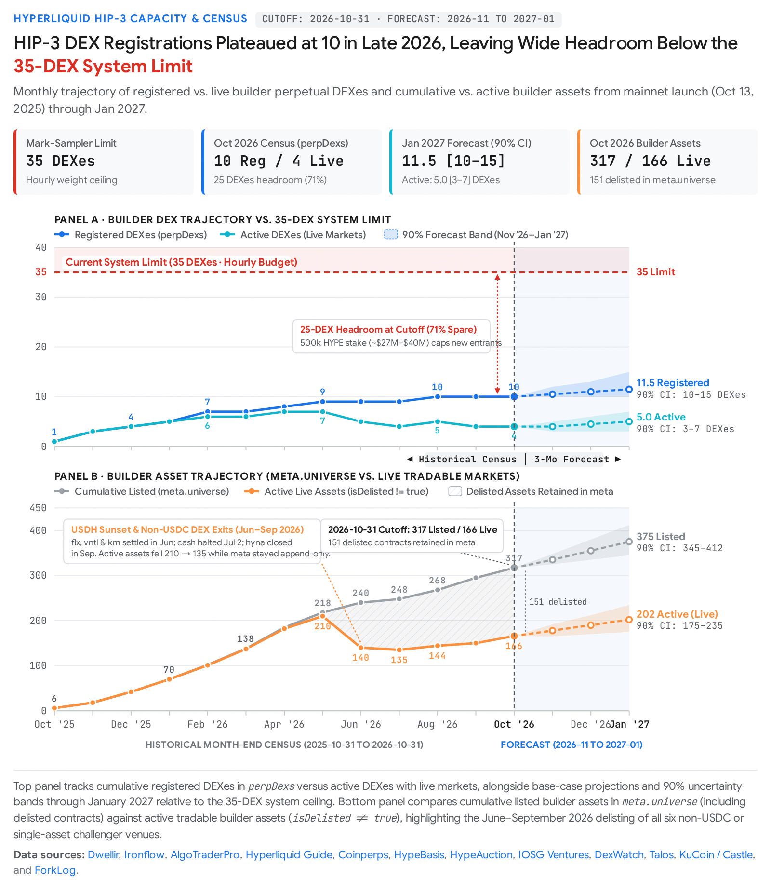

Gemini 4 Argon Deep Research (web), 2026-11-07, research prompt 2 of the advisor's eight; converted from the human's exported `Hyperliquid HIP-3 Growth and Limits.docx` by pandoc, figures in `2026-11-07-argon-hip3-growth/media/`. Model output: citations unverified.

# Hyperliquid HIP-3 Builder DEX Capacity, Growth Trajectory, and API Weight Scaling Brief

Your forecasting system's **35-DEX design limit will not bind during the 2026-11 through 2027-01 forecast window, nor at any point in H1 2027** (**Confidence: High**). As of **2026-10-31**, only **10 builder-deployed perpetual DEXes** have ever been registered on Hyperliquid mainnet since HIP-3 launched on **2025-10-13**, and only **4 of those 10 DEXes (xyz, para, io, mkts) operate live markets**, while the remaining **6 DEXes (flx, vntl, hyna, km, abcd, cash) have delisted 100% of their markets**¹. Across all 10 registered DEXes on 2026-10-31, there were **166 active (live) builder assets** and **151 delisted builder assets**, totaling **317 cumulative listed builder assets** in meta.universe¹. Over the five months from June through October 2026, only **one new builder DEX** (io, launched 2026-08-19) registered on mainnet (0.20 new DEXes/month), as the **500,000 HYPE staking requirement** (~$`42M–`$43M at October 2026 prices), the wind-down of non-USDC settlement stablecoins (USDH), and liquidity concentration on trade.xyz (xyz, which holds ~97% of HIP-3 volume and open interest) deterred new challengers².

Even if your system polls all registered entries in perpDexs (including defunct DEXes), reaching 35 registered DEXes requires **25 additional deployments** (locking an incremental 12.5 million HYPE under current rules)¹¹. Under our base-case projection of **0.33 to 0.50 new registered DEXes per month**, total registered DEXes will reach **10–11 by 2026-11-30**, **11 by 2026-12-31**, and **11–12 by 2027-01-31** (90% uncertainty interval: **10 to 15 registered DEXes** and **3 to 7 active DEXes** by 2027-01-31)⁴. At the trailing 6-month pace (0.33 DEXes/month), the 35-DEX ceiling would not bind until **Q1 2033 (~75 months)**; at the all-time 13-month average (0.77 DEXes/month), it would not bind until **mid-2029 (~32.5 months)**; and even under an aggressive bull-case regime change (if Hyperliquid lowers the 500,000 HYPE stake or enables multi-DEX deployments per stake alongside institutional HIP-3\* launches at 2.5 DEXes/month), the 35-DEX limit would not bind before **Q4 2027**⁴. Furthermore, because metaAndAssetCtxs costs **weight 20 per DEX** against Hyperliquid's **1,200 weight/minute per-IP limit**, simply filtering out the 6 fully delisted DEXes or inspecting universes via the single-call allPerpMetas endpoint (**flat weight 20**, O(1) scaling) immediately reclaims 55% to 95% of your hourly polling budget¹.

### Summary of Conclusions & Confidence Ratings

| **Question / Analytical Dimension** | **Core Conclusion (as of 2026-10-31 Cutoff)** | **Primary Evidence Base** | **Confidence** |
|----|----|----|----|
| **Binding Timeline for 35-DEX System Limit** | Will **not** bind in 2026-11 to 2027-01 (projected 11–12 registered / 4–5 active DEXes by 2027-01-31). Earliest plausible binding under aggressive rule changes is Q4 2027; under current rules, 2029–2033. | [*Hyperliquid Info API Docs*](https://hyperliquid.gitbook.io/hyperliquid-docs/for-developers/api/info-endpoint/perpetuals)¹², [*HIP-3 Spec*](https://hyperliquid.gitbook.io/hyperliquid-docs/hyperliquid-improvement-proposals-hips/hip-3-builder-deployed-perpetuals)¹¹, empirical 13-month deployment cadence¹. | **High** |
| **Q1: HIP-3 Mechanics & Protocol Limits** | Permissionless for any address staking **500,000 HYPE** (locked ≥183 days; 1 DEX per deployer). First 3 assets/DEX are free; assets ≥4 share a **31-hour Dutch auction** (500 HYPE floor) plus reserve slots. Asset ID schema caps capacity at **10,000 assets/DEX** and **9,990 builder DEXes**. | Primary: [*HIP-3 Spec*](https://hyperliquid.gitbook.io/hyperliquid-docs/hyperliquid-improvement-proposals-hips/hip-3-builder-deployed-perpetuals)¹¹, [*HIP-3 Deployer Actions*](https://hyperliquid.gitbook.io/hyperliquid-docs/for-developers/api/hip-3-deployer-actions)¹⁴, [*Asset IDs Docs*](https://hyperliquid.gitbook.io/hyperliquid-docs/for-developers/api/asset-ids)¹⁵, [*HIP-1 Spec*](https://hyperliquid.gitbook.io/hyperliquid-docs/hyperliquid-improvement-proposals-hips/hip-1-native-token-standard)¹⁰. | **High** |
| **Q2: Month-End Counts (2025-10 to 2026-10) & Projections** | On 2026-10-31: **10 registered DEXes** (**4 active**), **166 active assets**, and **317 cumulative listed assets** (151 delisted). Exact API snapshots exist for Aug–Oct 2026 and Nov 2025; Dec 2025–Jul 2026 asset counts are reconstructed from candle/archive timestamps and auction bounds. | Primary API structure¹ + practitioner snapshots ([*Ironflow*](https://ironflow.sh/guides/hyperliquid-stock-perps-hip3)¹, [*Dwellir*](https://www.dwellir.com/blog/hyperliquid-hip-3-explained)¹⁶, [*AlgoTraderPro*](https://algotraderpro.io/hip3/delisted/)⁶, [*Coinperps*](https://www.coinperps.com/learn/hyperliquid-hip-3-statistics)²). | **High** (DEX counts & Aug–Oct 2026 assets) / **Medium** (Dec 2025–Jul 2026 interpolated asset counts) |
| **Q3: API Endpoints & Weight Scaling** | REST budget is **1,200 weight/min/IP**. perpDexs (weight 20) and allPerpMetas (weight 20) scale as **O(1)**. Per-DEX meta (weight 20) and metaAndAssetCtxs (weight 20, returns markPx) scale as **O(N)** (20 + 20N weight). allMids (returns midPx) costs **weight 2** (O(N), 20 + 2N weight). | Primary: [*Rate Limits & User Limits Docs*](https://hyperliquid.gitbook.io/hyperliquid-docs/for-developers/api/rate-limits-and-user-limits)¹³, [*Perpetuals Info Endpoint Docs*](https://hyperliquid.gitbook.io/hyperliquid-docs/for-developers/api/info-endpoint/perpetuals)¹², [*General Info Endpoint Docs*](https://hyperliquid.gitbook.io/hyperliquid-docs/for-developers/api/info-endpoint)¹⁷. | **High** |
| **Q4: Announced Rule & Fee Changes** | \(1\) **HIP-3\* allowlisted venues** on testnet (Sept 3 / Oct 26, 2026) with ICE/trade.xyz and Payward/Bitnomial U.S. filings pending; (2) **2x HIP-3 volume credit toward L1 user rate limits** (announced Oct 23, 2026); (3) **Spec-stated future stake reduction & multi-DEX per stake** (unscheduled). | Primary: [*HIP-3 Spec*](https://hyperliquid.gitbook.io/hyperliquid-docs/hyperliquid-improvement-proposals-hips/hip-3-builder-deployed-perpetuals)¹¹, [*HIP-3 Deployer Actions*](https://hyperliquid.gitbook.io/hyperliquid-docs/for-developers/api/hip-3-deployer-actions)¹⁴, [*Trading Fees Docs*](https://hyperliquid.gitbook.io/hyperliquid-docs/trading/fees)¹⁸; Practitioner news ([*TokenPost*](https://www.tokenpost.com/tag/hip-3)⁸). | **High** |

## 1. HIP-3 Architecture, Deployment Mechanics, and Protocol Limits

**Conclusion (Confidence: High):** HIP-3 decentralizes perpetual contract listings on HyperCore by allowing any address that stakes **500,000 HYPE** (locked for at least 183 days) to deploy and operate **one independent perpetual DEX**¹¹. Each DEX receives **3 auction-free asset listings**, after which all HIP-3 deployers compete in a **shared 31-hour Dutch auction** (with a 500 HYPE floor) and may utilize a reserve deployment allowance¹⁰. At the protocol level, HyperCore's integer Asset ID encoding enforces a hard ceiling of **10,000 assets per builder DEX** and **9,990 builder DEXes** network-wide, meaning economic staking requirements and the shared 31-hour Dutch auction cadence (~23.2 to 24.0 auction slots per month across all DEXes) are the practical constraints on growth⁴.

### Deployer Eligibility, Staking, and Slashing Rules

According to the primary [*HIP-3: Builder-deployed perpetuals specification*](https://hyperliquid.gitbook.io/hyperliquid-docs/hyperliquid-improvement-proposals-hips/hip-3-builder-deployed-perpetuals)¹¹ and [*Hyperliquid's official HIP-3 overview*](https://hyperliquid.xyz/article/hip-3)²⁰, HIP-3 separates exchange infrastructure from market operation: HyperCore provides the matching engine, clearinghouse, order books, and deterministic liquidation waterfall, while the third-party builder defines contract specifications, pushes oracle prices, sets leverage and open interest (OI) caps, and manages market settlement¹¹. To initialize a perpetual DEX on mainnet via the registerAsset2 L1 action, a deployer must stake **500,000 HYPE** (500k HYPE), which must be maintained for a minimum of **183 days** after DEX deployment¹¹. Even after the 183-day lockup expires, the required stake remains locked until **all listed assets on that DEX are settled** via haltTrading¹¹. If the protocol lowers the staking requirement in the future, any amount staked above the updated requirement can be unstaked immediately¹¹.

The primary specification states that any deployer meeting the staking requirement can deploy **one perp DEX**, where each DEX operates an isolated margin pool, independent order books, and a dedicated on-chain backstop liquidator at address 0x4000000000000000000000000000000000000000 + {dex_index}¹¹. While the spec notes that a future upgrade may allow multiple DEXes to share a single deployer and stake, practitioner analytics surfaces ([*HypeBasis*](https://hypebasis.io/hip-3)²¹, [*UnderHyper*](https://underhyper.com/data/hip-3/)²², and [*Cipher Intelligence*](https://cipher-intelligence.io/blog/hyperliquid-hip-3/)¹⁹, marked as anecdotal/practitioner) document one operational exception already on mainnet: deployer address 0x71f0019cc7fa79e4f42587fb7b9a817d8d2429ec (Markets by Kinetiq) operated km (USDH collateral) and subsequently deployed mkts (USDC collateral) under the same address after settling km in June 2026⁹. Any permissionless quote asset can serve as a DEX's collateral token (collateralToken integer in PerpDexSchemaInput)¹¹. If a quote asset loses status via an on-chain validator vote, DEXes using that collateral are disabled, though deployers are not slashed for quote-asset failures¹¹.

Deployer stake serves as a protocol security bond rather than a trader insurance fund¹¹. Mainnet validators can slash a deployer's stake via stake-weighted vote—including during the **7-day unstaking queue**—for technical misbehavior regardless of whether caused by malice, incompetence, or key compromise¹¹. Penalty guidelines specify up to **100% slashing** for irregular inputs causing invalid state transitions or prolonged downtime, up to **50%** for brief network downtime, and up to **20%** for network degradation, with all slashed HYPE **burned**¹¹. Additionally, enabling cross margin on a HIP-3 asset is irreversible and requires validator standards for liquidity and manipulation resistance; if a cross-margined asset's externalPerpPx moves more than **50% relative to start-of-day price**, validators conduct a mandatory slashing review¹¹.

### Asset Listing Mechanics: Free Slots, Shared Dutch Auction, and Reserve Deployments

The rate at which builders can add assets to a HIP-3 DEX is governed by three mechanisms documented in the [*HIP-3 Specification*](https://hyperliquid.gitbook.io/hyperliquid-docs/hyperliquid-improvement-proposals-hips/hip-3-builder-deployed-perpetuals)¹¹ and [*HIP-3 Deployer Actions*](https://hyperliquid.gitbook.io/hyperliquid-docs/for-developers/api/hip-3-deployer-actions)¹⁴. First, the initial **3 assets** deployed in any perp DEX bypass the auction entirely, allowing a newly staked builder to bootstrap three markets immediately upon initializing the DEX¹¹. Second, starting with the 4th asset on a DEX, deployments must win a slot in a **Dutch auction shared across all HIP-3 perpetual DEXes**¹¹. The auction inherits the exact hyperparameters of the [*HIP-1 Native Token Standard*](https://hyperliquid.gitbook.io/hyperliquid-docs/hyperliquid-improvement-proposals-hips/hip-1-native-token-standard) auction¹⁰: each cycle lasts **31 hours** (durationSeconds: 111600), with gas denominated in HYPE¹⁰. The opening price (startGas) is set to **2x the previous winning gas price** (or 500 HYPE if the prior auction failed to clear) and decays linearly over 31 hours down to a minimum floor (endGas) of **500 HYPE**¹⁰.

Third, to allow time-sensitive listings without waiting for the 31-hour timer, each deployer receives a reserve deployment allowance defined in the primary specification as¹¹:

where  is the number of regular auction slots won by the deployer¹¹. In the RegisterAsset2 API payload, omitting maxGas or setting maxGas: 0 consumes one reserve deployment at the prevailing auction price¹⁴. Deployers can also call haltTrading ({ coin: string, isHalted: boolean }) to cancel all resting orders and settle open positions at the current mark price¹¹. Calling haltTrading again to resume trading recycles the existing asset slot (for example, to list rolling dated contracts) without participating in a new deployment auction¹¹. However, when a market is permanently halted or delisted, it **remains permanently in the DEX's meta.universe array** with "isDelisted": true so that integer asset indices never shift¹.

### Protocol Limits on DEXes and Assets

While the [*HIP-3 Specification*](https://hyperliquid.gitbook.io/hyperliquid-docs/hyperliquid-improvement-proposals-hips/hip-3-builder-deployed-perpetuals) does not state an arbitrary governance cap on the number of builder DEXes or assets, hard architectural bounds are enforced by HyperCore's integer Asset ID schema¹⁵ and string validation rules¹⁴:

| **Limit Category** | **Governing Mechanism / Rule** | **Hard / Effective Ceiling** | **Primary Source** |
|----|----|----|----|
| **Max Assets per Builder DEX** | Multiplier of 10,000 on perp_dex_index in the builder perp Asset ID formula | **10,000 assets per DEX** (index_in_meta from 0 to 9,999, including delisted assets) | [*Asset IDs Docs*](https://hyperliquid.gitbook.io/hyperliquid-docs/for-developers/api/asset-ids)¹⁵ |
| **Max Builder DEXes (Integer ID Space)** | Builder perp IDs occupy 100,000 to 99,999,999 before Outcome Asset IDs begin at 100,000,000 | **9,990 builder DEXes** (perp_dex_index from 1 to 9,989) | [*Asset IDs Docs*](https://hyperliquid.gitbook.io/hyperliquid-docs/for-developers/api/asset-ids)¹⁵ |
| **Max Builder DEXes (Lexical Namespace)** | RegisterAsset2.dex must be **2 to 4 lowercase characters** (\[a-z\]{2,4}) | **475,228 names** (non-binding vs. 9,990 integer ID cap) | [*HIP-3 Deployer Actions*](https://hyperliquid.gitbook.io/hyperliquid-docs/for-developers/api/hip-3-deployer-actions)¹⁴ |
| **Per-Asset Size & Notional OI Caps** | Constant size-denominated OI cap per asset; custom notional OI cap floor | **1,000,000,000 units/asset** size cap; custom notional cap ≥ max(1,000,000, 0.5 × current OI) | [*HIP-3 Deployer Actions*](https://hyperliquid.gitbook.io/hyperliquid-docs/for-developers/api/hip-3-deployer-actions)¹⁴ |
| **Network-Wide Auction Throughput** | Shared 31-hour Dutch auction (24 / 31 ≈ 0.7742 auctions/day) + 0.2x reserve multiplier | **23.23–24.00 auction slots/month** (~27.9–28.8/mo with 0.2x reserve bonus) + 3 free & 7 base reserve slots per new DEX | [*HIP-3 Spec*](https://hyperliquid.gitbook.io/hyperliquid-docs/hyperliquid-improvement-proposals-hips/hip-3-builder-deployed-perpetuals)⁴ |

## 2. Historical Census (2025-10-31 to 2026-10-31), Growth Trend, and 3-Month Projections

**Conclusion (Confidence: High for DEX counts and Aug–Oct 2026 asset counts; Medium for Dec 2025–Jul 2026 interpolated asset counts):** From launch on **2025-10-13** through **2026-10-31**, cumulative registered HIP-3 DEXes grew from **1** to **10**, while active DEXes (those with at least one non-delisted market) peaked at **7** in April–May 2026 before consolidating to **4** (xyz, para, io, mkts) following the June–September 2026 shutdown of all five non-USDC-margined venues (flx, vntl, km, cash, hyna) and single-market abcd¹. As of **2026-10-31**, there were **166 active builder assets** and **151 delisted builder assets** (**317 cumulative listed assets** in meta.universe)¹. We project **10–11 registered DEXes (4 active)** in 2026-11, **11 registered DEXes (4–5 active)** in 2026-12, and **11–12 registered DEXes (5 active)** in 2027-01, keeping the ecosystem more than 20 DEXes below your 35-DEX threshold⁴.

### Methodological Note on Data Vintage and Reconstruction

As documented by practitioner data providers ([*HyperliquidGuide*](https://hyperliquidguide.com/markets/hip-3)⁵ and [*Dwellir*](https://www.dwellir.com/blog/hyperliquid-hip-3-explained)¹⁶), the Hyperliquid /info API does not publish a creation timestamp on DEX objects in perpDexs or on asset objects in meta.universe⁵. However, because perpDexs appends new DEXes strictly in registration order (perp_dex_index 1 through 10: xyz, flx, vntl, hyna, km, abcd, cash, para, mkts, io)¹⁶, we can pair the exact index order with first-candle timestamps from [*Dwellir's Hyperliquid Index*](https://www.dwellir.com/blog/hyperliquid-hip-3-explained)¹⁶, archive start dates from [*0xArchive*](https://0xarchive.io/data/markets/hip3/abcd-usa500-wpte)²⁶, venue profiles from [*DexWatch*](https://dexwatch.com/new-dexes/index.html)⁹, settlement guides from [*Felix Docs*](https://usefelix.gitbook.io/perps)²⁹, and dated API censuses from [*HypeBasis*](https://hypebasis.io/research/state-of-hip-3)³⁰, [*HyperliquidGuide*](https://hyperliquidguide.com/ecosystem/hip-3-builder-codes)³, [*HypeScanIn*](https://hypescanin.com/articles/hyperliquid-weekly-data-report-oct-5-11-2026.html)³¹, [*Ironflow*](https://ironflow.sh/guides/hyperliquid-stock-perps-hip3)¹, and [*AlgoTraderPro*](https://algotraderpro.io/hip3/delisted/)⁶. In the month-end table below, exact dated snapshots are distinguished from reconstructed month-end ranges (marked Est.).

### Month-End Census Table: HIP-3 DEXes and Builder Assets (2025-10-31 to 2026-10-31)

| **Month-End Date** | **Registered DEXes (perpDexs)** | **Active DEXes (≥1 Live Asset)** | **Cumulative Listed Builder Assets (meta.universe)** | **Active (Live) Builder Assets (!isDelisted)** | **Key Month-in-Review Deployments, Delistings & Data Vintage Notes** | **Primary & Practitioner Sources** |
|----|----|----|----|----|----|----|
| **2025-10-31** | **1** | **1** | **4–10** *(Est. ~6)* | **4–10** *(Est. ~6)* | HIP-3 mainnet launch on **2025-10-13**; xyz (trade.xyz) launches first market xyz:XYZ100 (12:24 UTC, reaching ~\$70M OI in 2 weeks) plus initial US mega-cap equities using 3 free slots + early Oct auctions. | [*Hyperliquid HIP-3 Overview*](https://hyperliquid.xyz/article/hip-3)²⁰; [*Dwellir*](https://www.dwellir.com/blog/hyperliquid-hip-3-explained) (anecdotal/indexer)¹⁶; [*Coinperps*](https://www.coinperps.com/learn/hyperliquid-hip-3-statistics) (anecdotal)² |
| **2025-11-30** | **3** | **3** | **16–22** *(Est. ~18)* | **16–22** *(Est. ~18)* | **Growth Mode** activates (cutting fees ≥90%). vntl (Ventuals, USDH) launches **2025-11-13** (vntl:SPACEX 14:05 UTC, OPENAI, ANTHROPIC). flx (Felix, USDH) launches by **2025-11-26** (CRCL, TSLA, COIN). xyz lists XYZ100 + 9 equities (NVDA, GOOGL, TSLA, PLTR, META, AMZN, AAPL, MSFT, COIN). | [*Trading Fees Docs*](https://hyperliquid.gitbook.io/hyperliquid-docs/trading/fees)¹⁸; [*Dwellir*](https://www.dwellir.com/blog/hyperliquid-hip-3-explained) (anecdotal)¹⁶; [*ForkLog*](https://forklog.com/en/hyperliquids-custom-markets-surpass-500-million-in-daily-turnover/) (anecdotal, 2025-11-26 census)³³ |
| **2025-12-31** | **4** | **4** | **36–46** *(Est. ~42)* | **36–46** *(Est. ~42)* | hyna (HyENA, USDe) launches **2025-12-08** (hyna:ETH 04:22 UTC), listing crypto & metals perps outside Growth Mode. flx expands into commodities (flx:GOLD 2025-12-12 14:26 UTC). HIP-3 OI reaches ~$`250M–`$260M. | [*Dwellir*](https://www.dwellir.com/blog/hyperliquid-hip-3-explained) (anecdotal)¹⁶; [*Datawallet*](https://www.datawallet.com/crypto/hip-3-explained-hyperliquid-upgrade) (anecdotal)¹⁰; [*Binance Square*](https://www.binance.com/en/square/post/305313708833985) (anecdotal)³⁴ |
| **2026-01-31** | **5** *(or 6)* | **5** | **62–76** *(Est. ~70)* | **62–76** *(Est. ~70)* | km (Markets by Kinetiq, USDH) launches **2026-01-12** (km:GOLD candle 2026-01-28 11:59 UTC). abcd (ABCDEx, perp_dex_index=6) registers between mid-Jan and Feb 5. Precious metals rally drives OI past \$790M; median auction price hits 1,750 HYPE. | [*DexWatch*](https://dexwatch.com/new-dexes/index.html) (anecdotal)⁹; [*Dwellir*](https://www.dwellir.com/blog/hyperliquid-hip-3-explained) (anecdotal)¹⁶; [*Datawallet*](https://www.datawallet.com/crypto/hip-3-explained-hyperliquid-upgrade) (anecdotal)¹⁰ |
| **2026-02-28** | **7** | **6** *(or 7)* | **95–110** *(Est. ~102)* | **94–108** *(Est. ~101)* | cash (dreamcash, USDT0, perp_dex_index=7) launches **2026-02-05** (cash:GOLD 17:00 UTC). Seven DEXes (xyz, flx, vntl, hyna, km, abcd, cash) registered in perpDexs. Builder OI crosses \$1.0B. | [*Dwellir*](https://www.dwellir.com/blog/hyperliquid-hip-3-explained) (anecdotal)¹⁶; [*Bitwise Report*](https://bitwiseinvestments.eu/blog/special-reports/hyper-liquid-deep-dive/pdf/HyperLiquid_Deep_Dive_WEB.pdf) (anecdotal)³⁵; [*DefiLlama Research*](https://defillama.com/research/spotlight/hyperliquid-and-the-rwa-onboarding-question-what-the-data-shows) (anecdotal)³⁶ |
| **2026-03-31** | **7** | **6** *(+abcd)* | **130–145** *(Est. ~138)* | **128–143** *(Est. ~137)* | xyz launches officially licensed **S&P 500** (xyz:SP500) perp on **2026-03-18**. abcd:USA500 active in archive from **2026-03-11**. Six main active DEXes (xyz, cash, hyna, km, flx, vntl) hit \$1.8B combined OI on Mar 23. | [*Hyperliquid HIP-3 Overview*](https://hyperliquid.xyz/article/hip-3)²⁰; [*0xArchive*](https://0xarchive.io/data/markets/hip3/abcd-usa500-wpte) (anecdotal)²⁶; [*Datawallet*](https://www.datawallet.com/crypto/tradexyz-explained) (anecdotal)¹⁰; [*Binance Square*](https://www.binance.com/en/square/post/305313708833985) (anecdotal)³⁴ |
| **2026-04-30** | **8** *(or 9)* | **7** | **175–195** *(Est. ~185)* | **170–190** *(Est. ~182)* | para (Paragon, USDC, perp_dex_index=8) launches **2026-04-01 / 2026-04-02**. By **2026-05-03**, [*HypeAuction*](https://hypeauction.xyz/) records **9 DEXes** (including mkts registration at perp_dex_index=9), **176 auctions**, and **170 auction deployments** (+ ~25 free slots, ~195 total assets). | [*0xArchive*](https://0xarchive.io/data/markets/hip3/para-others-dbuh) (anecdotal)²⁷; [*DexWatch*](https://dexwatch.com/new-dexes/index.html) (anecdotal)⁹; [*HypeAuction Explorer*](https://hypeauction.xyz/) (anecdotal, 2026-05-03 snapshot)³⁷ |
| **2026-05-31** | **9** | **7** | **210–225** *(Est. ~218)* | **200–215** *(Est. ~210)* | xyz launches first Pre-IPO Perpetual (xyz:CBRS) on **2026-05-01**. Coinbase becomes official USDC deployer on **2026-05-14**; USDH begins winding down. mkts fee schedule verified **2026-05-11**. Median auction price hits 500 HYPE floor. | [*SEC Comment Letter / XYZ Ltd.*](https://www.sec.gov/comments/CLL-16/cll16-1007099-3207347.pdf)³⁸; [*DefiLlama*](https://defillama.com/rwa/perps/venue/markets-by-kinetiq) (anecdotal)³⁹; [*Coinperps*](https://www.coinperps.com/learn/hyperliquid-hip-3-statistics) (anecdotal)²; [*Datawallet*](https://www.datawallet.com/crypto/hip-3-explained-hyperliquid-upgrade) (anecdotal)¹⁰ |
| **2026-06-30** | **9** | **5** | **235–245** *(Est. ~240)* | **135–145** *(Est. ~140)* | **USDH DEX Sunset**: flx settles all 16 markets on **2026-06-19**; vntl closes all 15 markets; km settles all 23 USDH markets to migrate to mkts (54 markets delisted across the 3 USDH DEXes). xyz reaches **92 launched markets** as of June 2026. | [*Felix Sunset Guide*](https://usefelix.gitbook.io/perps)²⁹; [*Coinperps*](https://www.coinperps.com/learn/hyperliquid-hip-3-statistics) (anecdotal)²; [*DexWatch*](https://dexwatch.com/new-dexes/index.html) (anecdotal)⁹; [*KuCoin / Castle Report*](https://www.kucoin.com/news/flash/trade-xyz-builds-92-markets-and-98-hip-3-volume-on-hyperliquid-in-8-months) (anecdotal)⁴⁰ |
| **2026-07-31** | **9** | **4** | **245–250** *(Est. ~248)* | **130–140** *(Est. ~135)* | cash (dreamcash, USDT0) halts trading on **2026-07-02** (delisting 17 markets). mkts launches USDC pairs (**2026-07-01 / 2026-07-23**). USDH redeemed 1:1 for USDC on **2026-07-17**. By early Aug, xyz has **103 deployed / 88 active markets**. | [*IOSG Report*](https://www.bit.fan/en/news/list/iosg-hip-3-hyperliquid-perps-moat-analysis-96919f5e-en-keyName-de27c151) (anecdotal)⁷; [*DexWatch*](https://dexwatch.com/new-dexes/index.html) (anecdotal)⁹; [*0xArchive / Blockworks*](https://0xarchive.io/resources/research/price-discovery-in-hyperliquids-weekend-markets) (anecdotal)⁴¹ |
| **2026-08-31** | **10** | **5** | **265–275** *(Est. ~268)* | **144** *(Exact API)* | io (EntropyIO, USDC, perp_dex_index=10) launches **2026-08-19** with 9 markets. By mid-Aug (Aug 18), [*Talos*](https://www.talos.com/insights/trade-xyzs-role-in-hyperliquid) counts **252 total HIP-3 markets** (108 xyz + 144 others). Exact API census on **2026-08-31**: **10 registered DEXes (5 active: xyz, para \[22\], io, mkts, and hyna \[12, sunsetting\])**, **144 live markets**. | [*HyperliquidGuide*](https://hyperliquidguide.com/ecosystem/hip-3-builder-codes) (anecdotal, exact 2026-08-31 API census)³; [*Talos Research*](https://www.talos.com/insights/trade-xyzs-role-in-hyperliquid) (anecdotal, 2026-08-18)²⁴; [*DexWatch*](https://dexwatch.com/new-dexes/index.html) (anecdotal)⁹ |
| **2026-09-30** | **10** | **4** | **290–300** *(Est. ~295)* | **150** *(Exact API)* | hyna completes shutdown by **2026-09-07 / 2026-09-09** (all 25 markets delisted). On **2026-09-20**, [*HypeScanIn*](https://hypescanin.com/articles/hyperliquid-weekly-data-report-sep-14-20-2026.html) counts **147 live markets** (xyz: 108, para: 27, io: 8, mkts: 4). Exact [*HypeBasis*](https://hypebasis.io/research/state-of-hip-3) **September 2026** snapshot: **10 registered DEXes (4 active)**, **150 live markets**. | [*HypeBasis State of HIP-3*](https://hypebasis.io/research/state-of-hip-3) (anecdotal, Sep 2026 frozen API snapshot)³⁰; [*HypeScanIn*](https://hypescanin.com/articles/hyperliquid-weekly-data-report-sep-14-20-2026.html) (anecdotal)³²; [*AlgoTraderPro*](https://algotraderpro.io/hip3/delisted/) (anecdotal)⁶ |
| **2026-10-31** | **10** | **4** | **317** *(Exact API)* | **166** *(Exact API)* | Live markets rise from **158** (Oct 4 & Oct 11: xyz 114, para 30, io 9, mkts 5) to **162** (Oct 20, of which 310 cumulative listed), **169** (Oct 28, with 147 delisted = 316 listed), **167** (Oct 29, when mkts delisted 4 markets), and **166 live / 151 delisted = 317 cumulative listed** on **2026-10-31** (xyz: 120/141, para: 33/39, io: 12/16, mkts: 1/24, plus 97 delisted on flx, vntl, hyna, km, abcd, cash). | [*Ironflow*](https://ironflow.sh/guides/hyperliquid-stock-perps-hip3) (anecdotal, 2026-10-31 snapshot)¹; [*HyperliquidGuide*](https://hyperliquidguide.com/markets/hip-3) (anecdotal, 166 live)⁵; [*AlgoTraderPro*](https://algotraderpro.io/hip3/delisted/) (anecdotal)⁶; [*HypeScanIn*](https://hypescanin.com/articles/hyperliquid-weekly-data-report-oct-5-11-2026.html)³¹; [*Coinperps*](https://www.coinperps.com/learn/hyperliquid-hip-3-statistics)²; [*TokenPost*](https://www.tokenpost.com/tag/hip-3)⁴ |

### Registry Breakdown by Builder DEX as of 2026-10-31

To show the exact composition of the 10 registered DEXes at the **2026-10-31** cutoff, the table below reconciles the perpDexs registry order (perp_dex_index 1 through 10) with per-DEX active and delisted asset counts from [*Ironflow*](https://ironflow.sh/guides/hyperliquid-stock-perps-hip3)¹, [*AlgoTraderPro*](https://algotraderpro.io/hip3/delisted/)⁶, [*HypeBasis*](https://hypebasis.io/hip-3)²¹, [*UnderHyper*](https://underhyper.com/data/hip-3/)²², and [*Coinperps*](https://www.coinperps.com/learn/hyperliquid-hip-3-statistics)²:

| **perp_dex_index** | **DEX Prefix & Name** | **Deployer Address** | **Collateral** | **Launch / First-Candle Date** | **Operational Status on 2026-10-31** | **Active Assets (2026-10-31)** | **Delisted Assets (≤2026-10-31)** | **Cumulative Listed (meta.universe)** |
|----|----|----|----|----|----|----|----|----|
| **1** | **xyz** (Trade\[XYZ\]) | 0x8880…0888 | USDC | 2025-10-13 | **Active** (~97% of HIP-3 OI & vol) | **120** | **21** | **141** |
| **2** | **flx** (Felix Exchange) | 0x2fab…6352 | USDH | Nov 2025 (flx:GOLD 2025-12-12) | **Delisted** (settled 2026-06-19) | **0** | **16** | **16** |
| **3** | **vntl** (Ventuals) | 0x8888…beda | USDH | 2025-11-13 (vntl:SPACEX) | **Delisted** (closed June 2026) | **0** | **15** | **15** |
| **4** | **hyna** (HyENA) | 0x53e6…0637 | USDe | 2025-12-08 (hyna:ETH) | **Delisted** (closed Sept 2026) | **0** | **25** | **25** |
| **5** | **km** (Markets by Kinetiq) | 0x71f0…29ec | USDH | 2026-01-12 (km:GOLD 2026-01-28) | **Delisted** (settled June 2026; moved to mkts) | **0** | **23** | **23** |
| **6** | **abcd** (ABCDEx) | 0x372c…857c | USDC | Jan/Feb 2026 (USA500 2026-03-11) | **Delisted** (abcd:USA500 delisted) | **0** | **1** | **1** |
| **7** | **cash** (dreamcash) | 0xffa8…eef7 | USDT0 | 2026-02-05 (cash:GOLD) | **Delisted** (halted 2026-07-02) | **0** | **17** | **17** |
| **8** | **para** (Paragon) | 0x8888…6ed3 | USDC | 2026-04-01 / 2026-04-02 | **Active** (stocks, crypto indices, rates) | **33** | **6** | **39** |
| **9** | **mkts** (Markets By Kinetiq) | 0x71f0…29ec | USDC | Reg. ≤May 2026; live July 2026 | **Active** (1 live market: mkts:BVIV after 4 delisted Oct 29) | **1** | **23** | **24** |
| **10** | **io** (EntropyIO) | 0x320c…cac6 | USDC | 2026-08-19 | **Active** (pre-IPO, memory/AI equities) | **12** | **4** | **16** |
| **Total** | **10 Registered DEXes** | **9 Unique Deployers** | **4 USDC Active** | **Oct 2025 – Aug 2026** | **4 Active / 6 Fully Delisted** | **166** | **151** | **317** |

### Structural Growth Trend Analysis: Two-Regime Bifurcation

Analyzing the 13-month series from October 2025 through October 2026 reveals a pronounced bifurcation between **DEX creation** (which stalled in mid-2026) and **asset creation on incumbent USDC DEXes** (which continued near the pace of the 31-hour Dutch auction). In the first 8 months (Oct 2025 – May 2026), 9 DEXes registered (~1.13 DEXes/month), whereas in the subsequent 5 months (June – Oct 2026), only **1 DEX** (io on Aug 19, 2026) registered (**0.20 DEXes/month**), and **zero DEXes** registered in September or October 2026⁴. Practitioner studies by [*IOSG Ventures*](https://www.bit.fan/en/news/list/iosg-hip-3-hyperliquid-perps-moat-analysis-96919f5e-en-keyName-de27c151) (anecdotal, Sept 2026)⁷ and [*Blockworks Research*](https://bitcoinfoundation.org/news/altcoins/hyperliquid-hype-all-time-high-5-catalysts/) (anecdotal, June–Aug 2026)⁴¹ attribute this plateau to three structural forces. First, **collateral determinism** drove the mid-2026 shakeout: every single HIP-3 DEX that selected a non-USDC collateral asset (flx, vntl, and km on USDH; cash on USDT0; hyna on USDe) shut down and delisted all markets between June and September 2026 after Coinbase became Hyperliquid's official USDC deployer on May 14, 2026 and USDH wound down on July 17, 2026². All 4 surviving DEXes (xyz, para, io, mkts) settle exclusively in USDC².

Second, **challenger unit economics** turned sharply negative relative to passive staking. Locking 500,000 HYPE required ~$`40M–`$45M in capital in Aug–Oct 2026⁷. According to IOSG Ventures' on-chain analysis, excluding trade.xyz, all other 9 HIP-3 DEXes combined earned only **~\$747,000 in lifetime deployer fees** against **~\$167M in staked HYPE**—generating less than one-fifth of the **~\$3.67M/year (2.2% APR)** that passive HYPE staking yields⁷. Across 136 paid auction listings analyzed by Blockworks Research in June 2026, only 44 recouped their auction cost, with a median payback period of **4 years** for non-xyz markets versus ~5 months for xyz¹⁰. Third, because Growth Mode reduced taker fees by ≥90% to 0.0045%–0.009% across 151 of 162 live markets on Oct 20 (and 155 of 167 on Oct 29), challengers could not undercut xyz on fees, leaving xyz with **97.1%–97.8%** of HIP-3 volume and open interest².

Conversely, **cumulative listed builder assets (meta.universe)** increased by **24.4 assets/month** on average since launch, tracking near the theoretical throughput of the shared 31-hour Dutch auction (**23.23 to 24.00 auctions/month** plus reserve slots) as xyz, para, and io bid at or near the 500 HYPE floor (~$`39,900–`$46,000 per slot in Sept–Oct 2026, such as io acquiring xiaomi for 569.98 HYPE on Oct 10 and MOONSHOT for ~\$46,000 on Oct 19)⁴. Active (live) assets (isDelisted != true) grew more moderately (+6 net in Sept 2026 and +16 net in Oct 2026) because active deployers regularly prune illiquid tickers or settle completed pre-IPO markets; in October 2026 alone, xyz delisted 8 tickers, mkts delisted 4 (SMALL2000, US500, USBOND, USTECH on Oct 29), io delisted 3 (H100, MOONSHOT, SKHX), and para delisted 1 (PAPER)⁴.

### 3-Month Projections (2026-11 through 2027-01) and Stated Assumptions

To forecast DEX and asset counts for 2026-11-30, 2026-12-31, and 2027-01-31, we parameterize three explicit scenarios:

- **Base Case Assumptions**: The 500,000 HYPE stake and 1-DEX-per-deployer rule remain unchanged on mainnet through January 2027¹¹. New DEX registrations follow the trailing 6-month mean of **0.33 to 0.50 DEXes/month** (1–2 new entrants over the 3-month window, such as an early HIP-3\* institutional deployment or a venture-backed specialist like io)⁴. Active DEX count stays at **4–5** (mkts, down to 1 live market on 2026-10-31, may either remain at 1 market or go dormant, offset by 1 new live DEX)¹. Gross new asset listings average **18–20/month** (~80% of the 23.2–24.0 monthly Dutch auction cycles), while monthly delistings average **6–8/month**, yielding **+12 net live assets/month**⁴.

- **Low Bound (5th Percentile / Consolidation Case) Assumptions**: Zero new DEX registrations occur (continuing the Sept–Oct 2026 freeze); mkts delists its final market (BVIV), reducing active DEXes to **3**; slower auction bidding (+10 gross listings/month) and elevated pruning (-7 delistings/month) yield **+3 net live assets/month**¹.

- **High Bound (95th Percentile / Accelerated Institutional & Upgrade Case) Assumptions**: Mainnet activation of HIP-3\* in Q4 2026 plus either an initial reduction in the 500,000 HYPE stake or multi-DEX-per-stake support drives **1.5–2.0 new DEX registrations/month** (reaching 15 registered and 7 active DEXes by 2027-01-31); 100% Dutch auction utilization (24 slots/month) plus reserve-slot drawdowns and 3 free slots per new DEX adds **30–32 gross listings/month** (~23 net live assets/month)⁴.

| **Forecast Month-End** | **Registered DEXes (perpDexs) Base \[90% Interval\]** | **Active DEXes (Live Markets) Base \[90% Interval\]** | **Cumulative Listed Assets (meta.universe) Base \[90% Interval\]** | **Active (Live) Builder Assets (!isDelisted) Base \[90% Interval\]** | **Distance to 35-DEX System Limit (Base / High Bound)** |
|----|----|----|----|----|----|
| **Actual Baseline (2026-10-31)** | **10** | **4** | **317** | **166** | **25 DEXes below limit** (28.6% of cap) |
| **2026-11-30 (Projected)** | **10–11** *(10.5)* **\[10 – 12\]** | **4** **\[3 – 5\]** | **335** **\[325 – 348\]** | **178** **\[165 – 192\]** | **24.5 DEXes below** (High bound: **23 below**) |
| **2026-12-31 (Projected)** | **11** **\[10 – 13\]** | **4–5** *(4.5)* **\[3 – 6\]** | **355** **\[335 – 380\]** | **190** **\[170 – 212\]** | **24.0 DEXes below** (High bound: **22 below**) |
| **2027-01-31 (Projected)** | **11–12** *(11.5)* **\[10 – 15\]** | **5** **\[3 – 7\]** | **375** **\[345 – 412\]** | **202** **\[175 – 235\]** | **23.5 DEXes below** (High bound: **20 below**) |

## 3. API Endpoint Specifications, Request Weight Scaling, and Polling Optimization

**Conclusion (Confidence: High):** All Hyperliquid REST /info requests share an aggregated rate limit of **1,200 weight per minute per IP**¹³. While DEX discovery (perpDexs) and all-DEX metadata discovery (allPerpMetas) carry a flat weight of **20** and scale as **O(1)**, fetching per-DEX mark prices via metaAndAssetCtxs costs **weight 20 per DEX** and scales linearly as **O(N)** (consuming 20 + 20N weight when preceded by perpDexs)¹². Your system's **35-DEX ceiling corresponds to a 720-weight single-burst budget** (20 + 35 × 20 = 720, or 60% of the 1,200/minute IP cap). By filtering out inactive DEXes where all assets have isDelisted: true (reducing polled DEXes from 10 to 4 today) or using allPerpMetas (flat weight 20) or allMids (weight 2/DEX), you can expand capacity from 35 registered DEXes to **85–590+ DEXes** without increasing your weight budget¹.

### Detailed Endpoint Reference (POST https://api.hyperliquid.xyz/info)

According to the primary [*Perpetuals Info Endpoint Documentation*](https://hyperliquid.gitbook.io/hyperliquid-docs/for-developers/api/info-endpoint/perpetuals)¹², [*General Info Endpoint Documentation*](https://hyperliquid.gitbook.io/hyperliquid-docs/for-developers/api/info-endpoint)¹⁷, and [*Rate Limits and User Limits Documentation*](https://hyperliquid.gitbook.io/hyperliquid-docs/for-developers/api/rate-limits-and-user-limits)¹³, the following endpoints govern DEX discovery, asset listing discovery, and price/context retrieval:

| **Info Request Payload (type)** | **Parameters & dex Behavior** | **Returned Data & Price Fields** | **Base Request Weight** | **Weight Scaling with N Builder DEXes** |
|----|----|----|----|----|
| **{"type": "perpDexs"}** | None. | Array \[null, {name, fullName, deployer, oracleUpdater, feeRecipient, assetToStreamingOiCap, assetToFundingMultiplier}, ...\]. Index 0 is null (core DEX); indices 1..N are HIP-3 DEXes¹². *(Note: assetToStreamingOiCap is not a complete asset list; use meta or allPerpMetas)*¹⁶. | **20**¹³ | **O(1)** — Constant **20 weight** total regardless of N (not subject to per-item pagination weight)¹³. |
| **{"type": "meta", "dex": "\<dex\>"}** | dex (optional string): Builder DEX prefix (e.g., "xyz"). Defaults to "" (core DEX) if omitted¹². | Object {universe: \[{name, szDecimals, maxLeverage, onlyIsolated, isDelisted, marginMode, marginTableId, growthMode, deployerFeeScale, ...}\], marginTables: \[...\]}¹². **No live markPx**. | **20**¹³ | **O(N)** — Costs **20N weight** to query N builder DEXes individually (20 + 20N with perpDexs). |
| **{"type": "metaAndAssetCtxs", "dex": "\<dex\>"}** | dex (optional string): Builder DEX prefix (e.g., "xyz"). Defaults to "" (core DEX) if omitted¹². | 2-element array \[meta, assetCtxs\], where assetCtxs contains per-asset **markPx**, oraclePx, midPx, impactPxs, funding, openInterest, premium, prevDayPx, dayNtlVlm, dayBaseVlm¹². | **20**¹³ | **O(N)** — Costs **20N weight** to sample marks across N builder DEXes (20 + 20N with perpDexs). |
| **{"type": "allPerpMetas"}** | None. | Nested array across **all** perpetual DEXes (Index 0 = core DEX, Indices 1..N = all HIP-3 builder DEXes), returning universe, marginTables, collateralToken, and asset context details in a single call¹². | **20**¹³ | **O(1)** — Constant **20 weight** total across all N DEXes simultaneously¹². |
| **{"type": "allMids", "dex": "\<dex\>"}** | dex (optional string): Builder DEX prefix. Defaults to "" (core DEX + spot mids)¹⁷. | JSON map {"\<coin\>": "\<midPx\>"} for all coins on that DEX (falls back to last trade price if book is empty)¹⁷. *(Note: returns order-book midPx, not the clamped 3-input median markPx)*¹⁴. | **2**¹³ | **O(N) (10x lower slope)** — Costs **2N weight** across N builder DEXes (20 + 2N with perpDexs). |
| **{"type": "perpDexLimits", "dex": "\<dex\>"}** | dex (**required** non-empty string): Builder DEX name ("" is rejected)¹². | Object {totalOiCap, oiSzCapPerPerp, maxTransferNtl, coinToOiCap}¹². | **20**¹³ | **O(N)** — Costs **20N weight** across N builder DEXes. |
| **{"type": "perpDexStatus", "dex": "\<dex\>"}** | dex (**required** string; "" = core DEX)¹². | Object {totalNetDeposit}¹². | **20**¹³ | **O(N)** — Costs **20N weight** across N builder DEXes. |
| **{"type": "perpDeployAuctionStatus"}** | None. | Object {startTimeSeconds, durationSeconds, startGas, currentGas, endGas} for the shared HIP-3 Dutch auction¹². | **20**¹³ | **O(1)** — Constant **20 weight**. |
| **WebSocket allMids / Post-over-WS** | {"method": "subscribe", "subscription": {"type": "allMids", "dex": "\<dex\>"}}⁴⁷. | Real-time push stream of {mids: Record\<string, string\>} per DEX⁴⁷. | **0 REST weight** (WS limits: ≤1,000 subs, ≤2,000 msgs/min/IP)¹³ | **O(N) subscriptions** (N of 1,000 max WS subscriptions per IP; 0 REST weight)¹³. |

### Deconstructing the 35-DEX Limit and Comparing Polling Architectures

Under the primary [*Rate Limits specification*](https://hyperliquid.gitbook.io/hyperliquid-docs/for-developers/api/rate-limits-and-user-limits), REST /info endpoints share **1,200 weight per minute per IP**, and neither perpDexs, meta, metaAndAssetCtxs, allPerpMetas, nor allMids incurs per-item response length penalties (which apply only to historical/paginated endpoints: recentTrades, historicalOrders, userFills, userFillsByTime, fundingHistory, userFunding, nonUserFundingUpdates, twapHistory, userTwapSliceFills, userTwapSliceFillsByTime, delegatorHistory, delegatorRewards, validatorStats at +1 weight per 20 items, and candleSnapshot at +1 weight per 60 items)¹³. When a mark-sampling job runs once per hour in a single synchronous burst using perpDexs followed by N calls to metaAndAssetCtxs, total weight consumed is:

At **N = 35 builder DEXes**, the burst consumes **720 weight** (20 + 35 × 20 = 720, or exactly **60% of the 1,200 weight/minute IP allowance**, leaving a 480-weight safety buffer for concurrent services sharing the IP). At **N = 59**, a single-minute burst reaches **1,200 weight** (20 + 59 × 20 = 1,200), exhausting the entire IP rate limit¹³. Because delisted DEXes remain permanently in perpDexs and continue returning frozen or stale asset contexts in metaAndAssetCtxs¹, polling all 10 registered DEXes on 2026-10-31 wastes 120 weight per cycle on the 6 dead venues (flx, vntl, hyna, km, abcd, cash). The table below compares four polling architectures against your 720-weight (35-DEX) budget and the 1,200-weight/minute IP ceiling:

| **Polling Architecture** | **Weight Formula (for N Registered / Nactive​ Live DEXes)** | **Weight at 2026-10-31 State (N = 10, Nactive​ = 4)** | **Weight at N = 35 Registered DEXes (Assuming 40% Active)** | **Max Registered DEXes Supported Within 720-Weight Budget** | **Max Registered DEXes Before 1,200/min IP Cap** |
|----|----|----|----|----|----|
| **1. Naive Unfiltered metaAndAssetCtxs** (perpDexs + N × metaAndAssetCtxs) |  | **220** | **720** *(Binds)* | **35 DEXes** | **59 DEXes** |
| **2. Active-Filtered metaAndAssetCtxs** (allPerpMetas or cached meta +  × metaAndAssetCtxs) |  | **100** *(-54.5%)* | **300** *(14 active)* | **35 Active DEXes** (~87 Registered at 40% active ratio) | **59 Active DEXes** (~147 Registered) |
| **3. Lightweight allMids Polling** (perpDexs + N × allMids, if order-book midPx suffices) |  | **40** *(-81.8%)* | **90** | **350 DEXes** | **590 DEXes** |
| **4. Single-Call allPerpMetas** ({"type": "allPerpMetas"} in a single request) |  (O(1)) | **20** *(-90.9%)* | **20** | **Unlimited** (up to 9,990 protocol cap) | **Unlimited** (up to 9,990 protocol cap) |

One critical infrastructure caveat applies when querying HIP-3 endpoints: ensure that metaAndAssetCtxs and allMids calls with a non-empty dex parameter are routed to the official public Hyperliquid API (https://api.hyperliquid.xyz/info)¹⁶. Practitioner testing by [*Dwellir*](https://www.dwellir.com/blog/hyperliquid-hip-3-explained) and [*Chainstack*](https://docs.chainstack.com/reference/hyperliquid-getting-started) documents that standard open-source hl-node RPC instances serve perpDexs, meta, and allPerpMetas, but reject non-default dex parameters on metaAndAssetCtxs with the error "only the default perp dex is served"¹⁶.

## 4. Announced Protocol & Ecosystem Changes Affecting DEX Creation

**Conclusion (Confidence: High):** Four announced or documented changes as of **2026-10-31** affect the future trajectory of HIP-3 DEX and asset creation⁸. In the near term (2026-11 to 2027-01), none of these changes is expected to trigger a surge in DEX count because HIP-3\* institutional venues require CFTC regulatory approval and the spec-planned reductions to the 500,000 HYPE staking requirement have no scheduled mainnet activation date⁸. Over the medium term (H2 2027+), **enabling multiple DEXes per 500,000 HYPE stake** or **cutting the 500,000 HYPE threshold** represents the primary catalyst that could accelerate registered DEX counts toward your 35-DEX limit¹⁰.

| **Announced / Documented Change** | **Status & Announcement Date (Cutoff ≤2026-10-31)** | **Technical & Economic Mechanism** | **Directional Impact on DEX Creation Speed** | **Primary & Practitioner Sources** |
|----|----|----|----|----|
| **1. HIP-3\* Permissioned / Allowlisted Builder DEXes** | **Live on Testnet** (isStar: true announced **2026-09-03**; on-chain allowlist controls updated **2026-10-26**). Mainnet upgrade planned; no release date set. | Adds optional isStar: true flag in PerpDexSchemaInput enabling deployer-managed on-chain allowlists (modifyApproval) and proxied user actions (order \[reduce-only\], cancel, cancelAll, sendAsset, setReduceOnly, modifyBackstopLiquidatorApproval)¹⁴. | **Speeds up institutional DEX creation (Medium-Term, H1–H2 2027)**: Unlocks regulated U.S. venues. **Payward (Kraken) / Bitnomial / NinjaTrader** (announced Sept 16 / Oct 26–27, 2026) and **ICE (NYSE parent) / trade\[XYZ\]** (announced Oct 29, 2026) unveiled plans to launch CFTC-regulated HIP-3\* venues, gated by regulatory approvals³. | Primary: [*HIP-3 Deployer Actions Docs*](https://hyperliquid.gitbook.io/hyperliquid-docs/for-developers/api/hip-3-deployer-actions)¹⁴; Practitioner: [*TokenPost*](https://www.tokenpost.com/tag/hip-3)⁸, [*HyperliquidGuide*](https://hyperliquidguide.com/ecosystem/hip-3-builder-codes)³, [*Traders Magazine*](https://www.tradersmagazine.com/departments/digital-assets/ice-invests-in-tradexyz-to-build-regulated-perpetual-market/)⁵³. |
| **2. Spec-Planned Staking Reduction & Multi-DEX per Stake** | **Documented in Official Spec** (Unscheduled as of 2026-10-31). Community proposals for 100k–250k HYPE tiered stakes remain unimplemented. | Official spec states: (a) the **500k HYPE** stake *"is expected to decrease over time as the infrastructure matures"*, and (b) *"A future upgrade may support multiple dex deployments sharing the same deployer and staking requirement"*¹¹. | **Strongest Potential Accelerator (If Enacted)**: Allowing multiple DEXes per 500k HYPE stake would let existing deployers (xyz, para, io, mkts) spin up separate DEX namespaces (e.g., per asset class or HIP-3\* vs. open) at **zero marginal stake cost**¹⁰. | Primary: [*HIP-3 Spec*](https://hyperliquid.gitbook.io/hyperliquid-docs/hyperliquid-improvement-proposals-hips/hip-3-builder-deployed-perpetuals)¹¹; Practitioner: [*Datawallet*](https://www.datawallet.com/crypto/hip-3-explained-hyperliquid-upgrade)¹⁰, [*Cipher Intelligence*](https://cipher-intelligence.io/blog/hyperliquid-hip-3/)¹⁹. |
| **3. Doubling of HIP-3 Volume Counted Toward L1 User Rate Limits** | **Announced 2026-10-23** for implementation in the next network upgrade. | Updates L1 user action rate-limit formula to count the **full fee** generated by HIP-3 trades rather than only the protocol's fee share, roughly **doubling L1 rate-limit volume credit** on most HIP-3 markets (fee-tier math unchanged)⁸. | **Modestly Positive for Market-Maker Retention**: Relieves L1 order/cancel throttling on Growth Mode HIP-3 markets (where L1 rate-limit credit was previously cut by ≥90%), improving book depth on challenger DEXes without altering the 500k HYPE entry barrier⁸. | Primary: [*Trading Fees Docs*](https://hyperliquid.gitbook.io/hyperliquid-docs/trading/fees)¹⁸, [*Rate Limits Docs*](https://hyperliquid.gitbook.io/hyperliquid-docs/for-developers/api/rate-limits-and-user-limits)¹³; Practitioner: [*TokenPost (2026-10-23)*](https://www.tokenpost.com/news/technology/39256)⁸. |
| **4. Continuous Per-Asset Fee Scale (0–300%) & AQAv2 USDC Alignment** | **Implemented Aug–Oct 2026** (Fee scale upgrade Aug 2026; AQAv2 USDC yield sharing enabled late Aug / early Oct 2026). | Allows per-asset deployerFeeScale from 0.0 to 3.0 standard (or 0.0 to 1.0 fee share in Growth Mode, with a 30-day cooldown)¹¹. AQAv2 shares 90% of Circle USDC reserve yield with Hyperliquid following USDH wind-down⁷. | **Slows Speculative / Non-USDC DEX Creation**: Growth Mode competition pinned 93% of live markets to ~0.4–0.9 bps taker fees, while AQAv2 and USDH's exit eliminated stablecoin-subsidized DEXes (flx, vntl, km, cash, hyna), raising the bar for new entrants². | Primary: [*Trading Fees Docs*](https://hyperliquid.gitbook.io/hyperliquid-docs/trading/fees)¹⁸, [*HIP-3 Deployer Actions*](https://hyperliquid.gitbook.io/hyperliquid-docs/for-developers/api/hip-3-deployer-actions)¹⁴; Practitioner: [*IOSG Report*](https://www.bit.fan/en/news/list/iosg-hip-3-hyperliquid-perps-moat-analysis-96919f5e-en-keyName-de27c151)⁷. |

### Actionable Engineering Checklist for Your Forecasting System

1.  **Filter Out 100%-Delisted DEXes Immediately**: Modify your hourly mark-sampling pipeline to skip any DEX in perpDexs where every asset in meta.universe has "isDelisted": true¹. As of 2026-10-31, this cuts your hourly metaAndAssetCtxs calls from **10 registered DEXes to 4 active DEXes** (xyz, para, io, mkts), reducing weight consumption from **220 to 100** per hour¹.

2.  **Use allPerpMetas (Weight 20, O(1)) for Universe Discovery**: Replace per-DEX meta polling with a single {"type": "allPerpMetas"} request (flat weight 20 across all perpetual DEXes) to inspect active versus delisted universes across the entire network in one call¹².

3.  **Monitor Governance for Multi-DEX-per-Stake Activation**: Track Hyperliquid release notes for the spec-planned upgrade permitting **multiple DEX deployments per 500,000 HYPE stake** or **mainnet activation of HIP-3\***¹¹. If enacted, pacing per-DEX metaAndAssetCtxs requests across two 60-second windows (or relying on allPerpMetas) will let your system scale well past 35 DEXes without hitting the 1,200 weight/minute IP limit¹².

#### Works cited

1.  Hyperliquid stock perps and HIP-3 market data API - Ironflow, [*https://ironflow.sh/guides/hyperliquid-stock-perps-hip3*](https://ironflow.sh/guides/hyperliquid-stock-perps-hip3)

2.  HIP-3 Statistics on Hyperliquid by Volume, OI and Deployer, [*https://www.coinperps.com/learn/hyperliquid-hip-3-statistics*](https://www.coinperps.com/learn/hyperliquid-hip-3-statistics)

3.  HIP-3: Builder-Deployed Perpetuals Explained - Hyperliquid Guide, [*https://hyperliquidguide.com/ecosystem/hip-3-builder-codes*](https://hyperliquidguide.com/ecosystem/hip-3-builder-codes)

4.  [*unknown_url*](http://docs.google.com/unknown_url)

5.  The State of HIP-3: Every Builder-Deployed Market on Hyperliquid, [*https://hyperliquidguide.com/markets/hip-3*](https://hyperliquidguide.com/markets/hip-3)

6.  [*https://algotraderpro.io/hip3/delisted/*](https://algotraderpro.io/hip3/delisted/)

7.  [*https://www.htx.com/news/iosg-in-depth-review-of-the-hyperliquid-builder-market-90-of-OfAjxnRA/*](https://www.htx.com/news/iosg-in-depth-review-of-the-hyperliquid-builder-market-90-of-OfAjxnRA/)

8.  HIP-3 News - TokenPost, [*https://www.tokenpost.com/tag/hip-3*](https://www.tokenpost.com/tag/hip-3)

9.  New DEXes 2026: 26 newly launched perp & spot exchanges, [*https://dexwatch.com/new-dexes/index.html*](https://dexwatch.com/new-dexes/index.html)

10. Hyperliquid HIP-3 Explained: How It Works, Latest Stats & Risks, [*https://www.datawallet.com/crypto/hip-3-explained-hyperliquid-upgrade*](https://www.datawallet.com/crypto/hip-3-explained-hyperliquid-upgrade)

11. HIP-3: Builder-deployed perpetuals - Hyperliquid Docs - GitBook, [*https://hyperliquid.gitbook.io/hyperliquid-docs/hyperliquid-improvement-proposals-hips/hip-3-builder-deployed-perpetuals*](https://hyperliquid.gitbook.io/hyperliquid-docs/hyperliquid-improvement-proposals-hips/hip-3-builder-deployed-perpetuals)

12. Perpetuals - Hyperliquid Docs - GitBook, [*https://hyperliquid.gitbook.io/hyperliquid-docs/for-developers/api/info-endpoint/perpetuals*](https://hyperliquid.gitbook.io/hyperliquid-docs/for-developers/api/info-endpoint/perpetuals)

13. Rate limits and user limits - Hyperliquid Docs - GitBook, [*https://hyperliquid.gitbook.io/hyperliquid-docs/for-developers/api/rate-limits-and-user-limits*](https://hyperliquid.gitbook.io/hyperliquid-docs/for-developers/api/rate-limits-and-user-limits)

14. HIP-3 deployer actions - Hyperliquid Docs - GitBook, [*https://hyperliquid.gitbook.io/hyperliquid-docs/for-developers/api/hip-3-deployer-actions*](https://hyperliquid.gitbook.io/hyperliquid-docs/for-developers/api/hip-3-deployer-actions)

15. Asset IDs - Hyperliquid Docs - GitBook, [*https://hyperliquid.gitbook.io/hyperliquid-docs/for-developers/api/asset-ids*](https://hyperliquid.gitbook.io/hyperliquid-docs/for-developers/api/asset-ids)

16. What Is HIP-3? Hyperliquid Builder-Deployed Perps - Dwellir, [*https://www.dwellir.com/blog/hyperliquid-hip-3-explained*](https://www.dwellir.com/blog/hyperliquid-hip-3-explained)

17. Info endpoint \| Hyperliquid Docs - GitBook, [*https://hyperliquid.gitbook.io/hyperliquid-docs/for-developers/api/info-endpoint*](https://hyperliquid.gitbook.io/hyperliquid-docs/for-developers/api/info-endpoint)

18. Fees - Hyperliquid Docs - GitBook, [*https://hyperliquid.gitbook.io/hyperliquid-docs/trading/fees*](https://hyperliquid.gitbook.io/hyperliquid-docs/trading/fees)

19. What Is HIP-3? Hyperliquid Builder Perps, Live Markets (2026), [*https://cipher-intelligence.io/blog/hyperliquid-hip-3/*](https://cipher-intelligence.io/blog/hyperliquid-hip-3/)

20. HIP-3 - Hyperliquid – Infrastructure to House All Finance, [*https://hyperliquid.xyz/article/hip-3*](https://hyperliquid.xyz/article/hip-3)

21. Hyperliquid HIP-3 Docs Summary: Builder-Deployed Perps, [*https://hypebasis.io/hip-3*](https://hypebasis.io/hip-3)

22. [*https://underhyper.com/markets/*](https://underhyper.com/markets/)

23. [*https://hypebasis.io/hip-3/mkts*](https://hypebasis.io/hip-3/mkts)

24. Trade.xyz's Role in Hyperliquid \| State of the Network - Talos, [*https://www.talos.com/insights/trade-xyzs-role-in-hyperliquid*](https://www.talos.com/insights/trade-xyzs-role-in-hyperliquid)

25. [*https://www.bit.fan/en/news/list/iosg-hip-3-hyperliquid-perps-moat-analysis-96919f5e-en-keyName-de27c151*](https://www.bit.fan/en/news/list/iosg-hip-3-hyperliquid-perps-moat-analysis-96919f5e-en-keyName-de27c151)

26. USA500-USD \| Hyperliquid \| HIP-3 abcd \| Data Export - 0xArchive, [*https://0xarchive.io/data/markets/hip3/abcd-usa500-wpte*](https://0xarchive.io/data/markets/hip3/abcd-usa500-wpte)

27. OTHERS-USD \| Hyperliquid \| HIP-3 para \| Data Export - 0xArchive, [*https://0xarchive.io/data/markets/hip3/para-others-dbuh*](https://0xarchive.io/data/markets/hip3/para-others-dbuh)

28. EWY-USD \| Hyperliquid \| HIP-3 Dreamcash \| Data Export - 0xArchive, [*https://0xarchive.io/data/markets/hip3/cash-ewy-wddp*](https://0xarchive.io/data/markets/hip3/cash-ewy-wddp)

29. FLX HIP-3 Sunset Guide \| Felix-deployed Perps, [*https://usefelix.gitbook.io/perps*](https://usefelix.gitbook.io/perps)

30. State of HIP-3: Monthly Hyperliquid Builder-Perp Report \| HypeBasis, [*https://hypebasis.io/research/state-of-hip-3*](https://hypebasis.io/research/state-of-hip-3)

31. Hyperliquid Weekly Data Report — Week of October 5–11, 2026, [*https://hypescanin.com/articles/hyperliquid-weekly-data-report-oct-5-11-2026.html*](https://hypescanin.com/articles/hyperliquid-weekly-data-report-oct-5-11-2026.html)

32. Hyperliquid Weekly Data Report — Week of September 14–20, [*https://hypescanin.com/articles/hyperliquid-weekly-data-report-sep-14-20-2026.html*](https://hypescanin.com/articles/hyperliquid-weekly-data-report-sep-14-20-2026.html)

33. Hyperliquid's Custom Markets Surpass \$500 Million in Daily Turnover, [*https://forklog.com/en/hyperliquids-custom-markets-surpass-500-million-in-daily-turnover/*](https://forklog.com/en/hyperliquids-custom-markets-surpass-500-million-in-daily-turnover/)

34. Perp Volume and Open Interest Both Hit ATH - Binance, [*https://www.binance.com/en/square/post/305313708833985*](https://www.binance.com/en/square/post/305313708833985)

35. HyperLiquid Deep Dive - Bitwise, [*https://bitwiseinvestments.eu/blog/special-reports/hyper-liquid-deep-dive/pdf/HyperLiquid_Deep_Dive_WEB.pdf*](https://bitwiseinvestments.eu/blog/special-reports/hyper-liquid-deep-dive/pdf/HyperLiquid_Deep_Dive_WEB.pdf)

36. Hyperliquid and the RWA onboarding question: what the data shows, [*https://defillama.com/research/spotlight/hyperliquid-and-the-rwa-onboarding-question-what-the-data-shows*](https://defillama.com/research/spotlight/hyperliquid-and-the-rwa-onboarding-question-what-the-data-shows)

37. HIP-3 Auction Timeline, [*https://hypeauction.xyz/*](https://hypeauction.xyz/)

38. August 18, 2026 - SEC.gov, [*https://www.sec.gov/comments/CLL-16/cll16-1007099-3207347.pdf*](https://www.sec.gov/comments/CLL-16/cll16-1007099-3207347.pdf)

39. Markets by Kinetiq RWA Perps Dashboard & Analytics - DefiLlama, [*https://defillama.com/rwa/perps/venue/markets-by-kinetiq*](https://defillama.com/rwa/perps/venue/markets-by-kinetiq)

40. Trade\[XYZ\] has established 92 markets and captured 98% of HIP-3, [*https://www.kucoin.com/news/flash/trade-xyz-builds-92-markets-and-98-hip-3-volume-on-hyperliquid-in-8-months*](https://www.kucoin.com/news/flash/trade-xyz-builds-92-markets-and-98-hip-3-volume-on-hyperliquid-in-8-months)

41. [*https://www.htx.com/news/tradexyz-is-growing-larger-is-hype-the-ultimate-winner-6FutDnF5/*](https://www.htx.com/news/tradexyz-is-growing-larger-is-hype-the-ultimate-winner-6FutDnF5/)

42. [*https://0xarchive.io/resources/research/price-discovery-in-hyperliquids-weekend-markets*](https://0xarchive.io/resources/research/price-discovery-in-hyperliquids-weekend-markets)

43. Hyperliquid Weekly Data Report — Week of September 28–October, [*https://hypescanin.com/articles/hyperliquid-weekly-data-report-sep-28-oct-4-2026.html*](https://hypescanin.com/articles/hyperliquid-weekly-data-report-sep-28-oct-4-2026.html)

44. Is Hyperliquid (HYPE) Price Ready for a New All-Time High?, [*https://bitcoinfoundation.org/news/altcoins/hyperliquid-hype-all-time-high-5-catalysts/*](https://bitcoinfoundation.org/news/altcoins/hyperliquid-hype-all-time-high-5-catalysts/)

45. Hyperliquid Growth Mode: Which HIP-3 Markets Have 90% Lower, [*https://hyperliquidguide.com/guides/trading/hyperliquid-growth-mode-markets*](https://hyperliquidguide.com/guides/trading/hyperliquid-growth-mode-markets)

46. perpDexs \| Hyperliquid Info API - GoldRush API Documentation, [*https://goldrush.dev/docs/api-reference/hyperliquid-info/perp-dexs*](https://goldrush.dev/docs/api-reference/hyperliquid-info/perp-dexs)

47. Subscriptions - Hyperliquid Docs - GitBook, [*https://hyperliquid.gitbook.io/hyperliquid-docs/for-developers/api/websocket/subscriptions*](https://hyperliquid.gitbook.io/hyperliquid-docs/for-developers/api/websocket/subscriptions)

48. Hyperliquid API Guide: Endpoints, Keys, Limits and Code, [*https://hydromancer.xyz/blog/hyperliquid-api*](https://hydromancer.xyz/blog/hyperliquid-api)

49. Hyperliquid funding rates for RPC and index consumers - Dwellir, [*https://www.dwellir.com/blog/hyperliquid-funding-rates-for-rpc-consumers*](https://www.dwellir.com/blog/hyperliquid-funding-rates-for-rpc-consumers)

50. HIP-3 dexes: registry, volume and market share (2026) - UnderHyper, [*https://underhyper.com/data/hip-3/*](https://underhyper.com/data/hip-3/)

51. Hyperliquid API reference: HyperCore and HyperEVM RPC, [*https://docs.chainstack.com/reference/hyperliquid-getting-started*](https://docs.chainstack.com/reference/hyperliquid-getting-started)

52. ICE Plans US Hyperliquid Perpetual Futures Venue, [*https://bitcoinfoundation.org/news/altcoins/nyse-owner-ice-plans-24-7-us-venue-for-hyperliquid-perpetual-futures/*](https://bitcoinfoundation.org/news/altcoins/nyse-owner-ice-plans-24-7-us-venue-for-hyperliquid-perpetual-futures/)

53. ICE Invests in TradeXYZ to Build Regulated Perpetual Market, [*https://www.tradersmagazine.com/departments/digital-assets/ice-invests-in-tradexyz-to-build-regulated-perpetual-market/*](https://www.tradersmagazine.com/departments/digital-assets/ice-invests-in-tradexyz-to-build-regulated-perpetual-market/)
