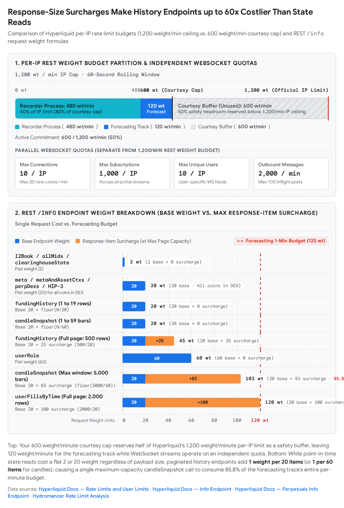
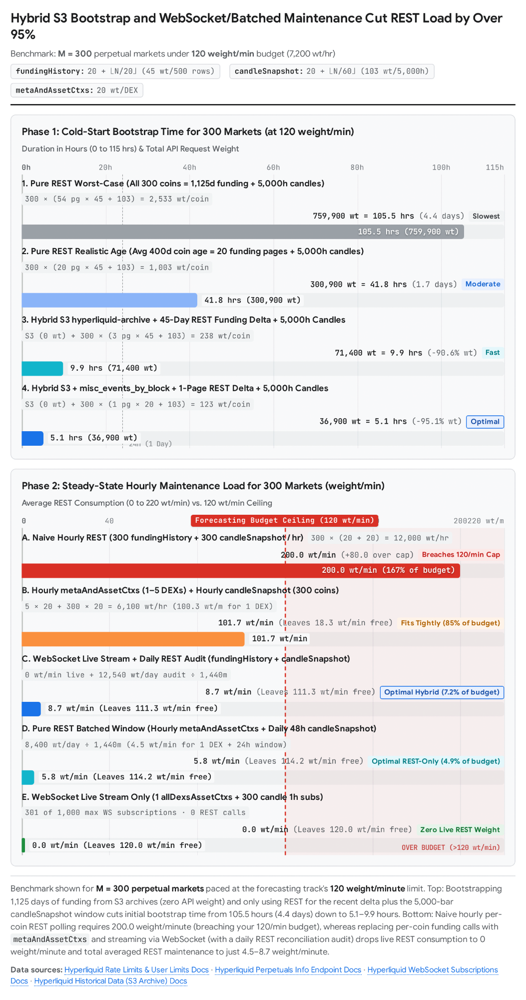

Gemini 4 Argon Deep Research (web), 2026-11-07, research prompt 1 of the advisor's eight; converted from the human's exported `Hyperliquid API Rate Limit Analysis.docx` by pandoc, figures in `2026-11-07-argon-hyperliquid-rate-limits/media/`. Model output: citations unverified.

# Hyperliquid Public Info API Rate Limits, Historical Data Mechanics, and Optimal Cache Architecture

Operating a high-coverage market research and forecasting pipeline on Hyperliquid behind a single IP address requires navigating a strict asymmetry in the exchange's public API design: point-in-time state snapshots and real-time WebSocket streams are inexpensive or weight-free, whereas paginated historical REST queries carry steep base weights and response-length surcharges¹. Under your self-imposed courtesy budget of 600 request-weight per minute (half of the documented 1,200 weight/minute per-IP limit, partitioned into 480 weight/minute for your recorder and 120 weight/minute for your forecasting track), naive per-market REST polling or on-demand cold backfills of 1,125-day histories will rapidly exhaust your forecasting allocation¹. Furthermore, while fundingHistory can paginate back to market genesis in 500-row increments, candleSnapshot enforces a hard retention ceiling of the 5,000 most recent candles per interval (~208.3 days of 1-hour bars), meaning multi-year hourly candle histories cannot be retrieved via the REST API alone⁴.

By decoupling historical bootstrap from live maintenance—combining Hyperliquid's official requester-pays S3 archives (s3://hyperliquid-archive and s3://hl-mainnet-node-data) for bulk history, a single allDexsAssetCtxs WebSocket subscription plus per-coin candle WebSocket subscriptions for zero-weight live updates, and batched-window REST reconciliation—you can maintain full hourly funding and candle caches for 300+ markets at an average REST cost of 4.5 to 8.9 weight/minute, leaving over 92% of your 120 weight/minute forecasting budget free for ad-hoc research¹.

## Executive Summary

- **Per-IP vs. Per-Address Rate Limits \[Confidence: High\]:** Hyperliquid enforces an aggregated REST limit of **1,200 weight per minute per IP address** across /info and /exchange combined ([*Rate limits and user limits*](https://hyperliquid.gitbook.io/hyperliquid-docs/for-developers/api/rate-limits-and-user-limits))¹. Per-address limits (10,000 initial buffer + 1 request per 1 USDC traded cumulatively, throttled to 1 request per 10 seconds when depleted) **apply exclusively to signed /exchange actions and do not restrict read-only /info queries**¹.

- **Endpoint Weight Formulas and Pagination Surcharges \[Confidence: High\]:** Most /info endpoints—including meta, metaAndAssetCtxs, allPerpMetas, perpDexs, perpDexLimits, and perpDexStatus—carry a flat weight of **20** ([*Rate limits and user limits*](https://hyperliquid.gitbook.io/hyperliquid-docs/for-developers/api/rate-limits-and-user-limits), [*Perpetuals Info endpoint*](https://hyperliquid.gitbook.io/hyperliquid-docs/for-developers/api/info-endpoint/perpetuals))¹. Paginated history endpoints bill dynamically based on returned payload size: fundingHistory costs  (capped at 500 rows/page = **45 weight**), and candleSnapshot costs  (capped at 5,000 candles/call = **103 weight**) ([*Info endpoint*](https://hyperliquid.gitbook.io/hyperliquid-docs/for-developers/api/info-endpoint))¹.

- **Reset Window and HTTP 429 Behavior \[Confidence: Medium-High\]:** While official documentation specifies "1200 per minute" without detailing the limiter algorithm or HTTP 429 headers ([*Error responses*](https://hyperliquid.gitbook.io/hyperliquid-docs/for-developers/api/error-responses))¹, practitioner benchmarks (anecdotal) report that the limit operates on a **rolling 60-second window** and returns HTTP 429 Too Many Requests with an **empty body and no Retry-After or quota headers** ([*Gerard Wu*](https://gerardwu.com/p/free-data-short-memory-building-a-long-term-hyperliquid-candle-archive/), [*Hydromancer*](https://hydromancer.xyz/blog/hyperliquid-rate-limits), [*PapaProxy*](https://papaproxy.net/blog/hyperliquid-leaderboard-api.php))⁶. Overages are soft-throttled and recover within ~1.5–5 seconds when callers back off exponentially with jitter, though sustained retry storms risk temporary IP bans⁹.

- **WebSocket Budget Independence and Channel Capabilities \[Confidence: High\]:** Passive WebSocket connections and subscriptions (wss://api.hyperliquid.xyz/ws) **do not consume the 1,200/minute REST weight budget**; they are governed by a separate per-IP quota of **10 connections, 30 new connections/minute, 1,000 total subscriptions, 10 unique users on user-specific channels, 2,000 outbound messages/minute, and 100 inflight post messages** ([*Rate limits and user limits*](https://hyperliquid.gitbook.io/hyperliquid-docs/for-developers/api/rate-limits-and-user-limits))¹. WebSocket channels (candle, allDexsAssetCtxs, activeAssetCtx) stream live updates and current-bar snapshots but cannot backfill multi-month history ([*WebSocket Subscriptions*](https://hyperliquid.gitbook.io/hyperliquid-docs/for-developers/api/websocket/subscriptions))².

- **Hard Retention Cap on candleSnapshot vs. S3 Bulk Archives \[Confidence: High\]:** The /info candleSnapshot endpoint retains **only the most recent 5,000 candles** per coin and interval (~208.3 days of 1h candles) ([*Info endpoint*](https://hyperliquid.gitbook.io/hyperliquid-docs/for-developers/api/info-endpoint))⁵. Official requester-pays S3 buckets provide historical asset contexts and funding rates in s3://hyperliquid-archive/asset_ctxs/\[date\].csv.lz4 (updated monthly) and hourly block-batched funding events and trade fills in s3://hl-mainnet-node-data/misc_events_by_block and node_fills_by_block ([*Historical data*](https://hyperliquid.gitbook.io/hyperliquid-docs/historical-data))⁷. Pre-built candles are not on S3, so 1h candles older than 5,000 hours must be aggregated from S3 fills⁷.

- **Non-Validating Node Practicality \[Confidence: High\]:** Running a non-validating node is **explicitly permissionless** under an Apache-2.0 license ([*Foundation non-validating node*](https://hyperliquid.gitbook.io/hyperliquid-docs/for-developers/nodes/foundation-non-validating-node), [*hyperliquid-dex/node*](https://github.com/hyperliquid-dex/node))¹⁵. However, it is **impractical** solely for 1h funding and candles: it requires 16 vCPUs, 128 GB RAM, and 100–700 GB/day of disk I/O, does not backfill history prior to sync, and its local --serve-info HTTP server **does not support fundingHistory or candleSnapshot**¹⁴.

- **Terms of Use on Automation, Caching, and Multiple IPs \[Confidence: High\]:** The [*Hyperliquid Terms of Use*](https://app.hyperliquid.xyz/terms) (last updated June 15, 2026) and official docs permit automated API access within rate limits and explicitly encourage users to record and cache historical datasets via the API ([*Historical data*](https://hyperliquid.gitbook.io/hyperliquid-docs/historical-data))⁷. Section 3.1.8 strictly prohibits bots that *"exceed reasonable usage, bypass rate limits, cause denial-of-service conditions,"* and Section 3.1.5 prohibits VPNs or proxies used to conceal location or circumvent geographic restrictions¹⁸.

- **Optimal 120 Weight/Min Fetch Plan for 300 Markets \[Confidence: High\]:** Naive hourly REST polling of fundingHistory and candleSnapshot across 300 markets consumes **200 weight/minute**, breaching your 120 weight/minute budget³. By bootstrapping via S3 + REST delta (5.1–9.9 hours at 120 weight/minute) and maintaining the cache via **1 allDexsAssetCtxs WebSocket subscription + 300 candle (1h) WebSocket subscriptions** (or 1 hourly metaAndAssetCtxs REST call per DEX + daily 48-bar candleSnapshot sweeps), steady-state REST consumption drops to **0 live weight/minute** (**4.5 to 8.9 weight/minute** including daily REST reconciliation)¹.

## 1. Hyperliquid API Rate Limits, Endpoint Weights, Pagination, and 429 Mechanics

### Official Per-IP and Per-Address Rate Limits (Quotations and Dates)

Hyperliquid governs API traffic through a dual-metering architecture documented on the official [*Rate limits and user limits*](https://hyperliquid.gitbook.io/hyperliquid-docs/for-developers/api/rate-limits-and-user-limits) page (marked "Last updated 6 days ago" in the documentation snapshot; October 2026 documentation revision)¹. Every REST request draws from a shared per-IP weight pool, while state-changing trading actions additionally draw from a per-address cumulative volume allowance¹.

Regarding **per-IP rate limits**, the official [*Rate limits and user limits*](https://hyperliquid.gitbook.io/hyperliquid-docs/for-developers/api/rate-limits-and-user-limits) documentation states verbatim:

> *"The following rate limits apply per IP address:*
>
> *- REST requests share an aggregated weight limit of 1200 per minute.*

- - All documented exchange API requests have a weight of 1 + floor(batch_length / 40). For example, unbatched actions have weight 1 and a batched order request of length 79 has weight 2. Here, batch_length is the length of the array in the action, e.g. the number of orders in a batched order action.\*

- - The following info requests have weight 2: l2Book, allMids, clearinghouseState, orderStatus, spotClearinghouseState, exchangeStatus.\*

- - The following info requests have weight 60: userRole.\*

- - All other documented info requests have weight 20.\*

- - The following info endpoints have an additional rate limit weight per 20 items returned in the response: recentTrades, historicalOrders, userFills, userFillsByTime, fundingHistory, userFunding, nonUserFundingUpdates, twapHistory, userTwapSliceFills, userTwapSliceFillsByTime, delegatorHistory, delegatorRewards, validatorStats.\*

- - The candleSnapshot info endpoint has an additional rate limit weight per 60 items returned in the response.\*

- - All explorer API requests have a weight of 40. blockList has an additional rate limit of 1 per block. Note that older blocks which have not been recently queried may be weighted more heavily. For large batch requests, use the S3 bucket instead.\* *- Maximum of 100 EVM JSON-RPC requests per minute for rpc.hyperliquid.xyz/evm. Note that other JSON-RPC providers have more sophisticated rate limiting logic and archive node functionality."*¹

Regarding **per-address (user) rate limits**, the same primary document states verbatim:

> *"Address-based limits apply per user, with sub-accounts treated as separate users. The rate limiting logic allows 1 request per 1 USDC traded cumulatively since address inception. For example, with an order value of 100 USDC, this requires a fill rate of 1%. Each address starts with an initial buffer of 10000 requests. When rate limited, an address is allowed one request every 10 seconds.* *Cancels have a cumulative limit of min(limit + 100000, limit \* 2) where limit is the default limit for other actions. That way, hitting the rate limit will still allow open orders to be canceled. Note that this rate limit only applies to actions, not info requests."*¹

For your research system, the critical operational rule is the final sentence quoted above: **per-address limits apply exclusively to signed /exchange actions and do not throttle read-only /info queries** (\[Confidence: High\])¹. Your recorder and forecasting processes are constrained solely by the per-IP limit of 1,200 REST weight per minute (and your internal 600 weight/minute courtesy ceiling)¹.

### Request Weight Computation for Your Target Info Endpoints

All read queries are sent via POST https://api.hyperliquid.xyz/info with header Content-Type: application/json ([*Info endpoint*](https://hyperliquid.gitbook.io/hyperliquid-docs/for-developers/api/info-endpoint), [*Perpetuals Info endpoint*](https://hyperliquid.gitbook.io/hyperliquid-docs/for-developers/api/info-endpoint/perpetuals), marked "Last updated 1 month ago" / October 2026)⁴. Based on the primary rate-limit rules, weights for the specific endpoints you use are computed as follows (\[Confidence: High\]):

For **fundingHistory** ({"type": "fundingHistory", "coin": "\<coin\>", "startTime": \<ms\>, "endTime": \<ms\>}), the request weight is governed by a base cost of 20 plus 1 weight unit per 20 returned items:

Because fundingHistory is a time-range endpoint, it returns at most **500 elements** per response⁵. A full 500-row page costs  weight¹². An empty response (0 rows) or a partial response of 1 to 19 rows costs the base weight of **20**⁹. For HIP-3 builder-deployed perpetuals, you pass the DEX-prefixed coin name (e.g., "coin": "xyz:XYZ100"), and the exact same weight formula and 500-row cap apply¹.

For **candleSnapshot** ({"type": "candleSnapshot", "req": {"coin": "\<coin\>", "interval": "\<interval\>", "startTime": \<ms\>, "endTime": \<ms\>}}), the request weight is governed by a base cost of 20 plus 1 weight unit per 60 returned candles:

The endpoint retains and returns at most the **5,000 most recent candles** for any supported interval ("1m", "3m", "5m", "15m", "30m", "1h", "2h", "4h", "8h", "12h", "1d", "3d", "1w", "1M")⁵. A maximum 5,000-candle response costs  weight³. Any response returning between 0 and 59 candles incurs zero surcharge and costs exactly **20** weight⁶. (Note: Practitioner testing in [*ccxt/ccxt#23243*](https://github.com/ccxt/ccxt/issues/23243) and [*Hydromancer*](https://hydromancer.xyz/blog/hyperliquid-api) shows candleSnapshot occasionally returns 5,104–5,112 bars on 1m intervals, which costs  weight²²).

For **meta, metaAndAssetCtxs, and allPerpMetas**, none of these endpoints appear in the weight-2 list (l2Book, allMids, clearinghouseState, orderStatus, spotClearinghouseState, exchangeStatus), the weight-60 list (userRole), or the per-item surcharge list¹. Consequently, each call to meta, metaAndAssetCtxs, or allPerpMetas costs a **flat weight of 20**, regardless of how many perpetual contracts are returned in the response array¹. Both meta and metaAndAssetCtxs accept an optional "dex": "\<dex_name\>" parameter (defaulting to "" for the first validator-operated perp DEX)⁴.

For **perpDexs and HIP-3 Builder-DEX Endpoints** (perpDexLimits, perpDexStatus, perpsAtOpenInterestCap, allMids, clearinghouseState), the standard /info weight tiers apply¹. Specifically, perpDexs ({"type": "perpDexs"}), perpDexLimits ({"type": "perpDexLimits", "dex": "\<dex\>"}), perpDexStatus ({"type": "perpDexStatus", "dex": "\<dex\>"}), and perpsAtOpenInterestCap ({"type": "perpsAtOpenInterestCap", "dex": "\<dex\>"}) are standard /info requests without response-item surcharges and each cost a **flat weight of 20**¹. Meanwhile, allMids and clearinghouseState also accept the optional "dex": "\<dex\>" parameter for HIP-3 builder DEXs and retain their lightweight cost of **2 weight** per call¹.

### How Pagination Interacts with Weight

The official [*Info endpoint*](https://hyperliquid.gitbook.io/hyperliquid-docs/for-developers/api/info-endpoint) documentation defines pagination as follows:

> *"Pagination: Responses that take a time range will only return 500 elements or distinct blocks of data. To query larger ranges, use the last returned timestamp as the next startTime for pagination."*⁵

Three mechanical interactions govern how pagination consumes your weight budget (\[Confidence: High\]):

1.  **Billing by Returned Items, Not Requested Window:** The surcharge (+1 per 20 or +1 per 60) is computed strictly on the number of elements in the HTTP response array¹. If you query a time range that contains no data (e.g., querying before a coin's listing date or after the final page), the API returns an empty array \[\] and bills the **20 base weight**¹².

2.  **Inclusive Timestamp Boundaries (startTime and endTime):** Both startTime and endTime are inclusive in epoch milliseconds⁴. In fundingHistory, which is **oldest-anchored** (returning up to 500 records forward from startTime), setting the next page's startTime equal to the exact time of the 500th record repeats that boundary row on the next page (yielding 499 net new rows per subsequent page)²⁰. Setting next_startTime = last_record_time + 1 (or + 1000 ms, since funding settles hourly) eliminates the duplicate row, yielding a full 500 net new rows per 45-weight page³.

3.  **Opposite Anchor Direction on candleSnapshot (endTime-Anchored):** Unlike fundingHistory, practitioner testing (anecdotal: [*Gerard Wu*](https://gerardwu.com/p/free-data-short-memory-building-a-long-term-hyperliquid-candle-archive/)) demonstrates that candleSnapshot is **newest-anchored**: if \[startTime, endTime\] spans more candles than the endpoint returns, it returns the candles closest to endTime and truncates the oldest portion⁶. However, because candleSnapshot can return all 5,000 retained candles in a single request (103 weight), you do not need to paginate candleSnapshot unless you intentionally request smaller chunks; if you do paginate within the 5,000-bar window, you must step endTime backward (next_endTime = oldest_open_time - interval_ms)⁵. Requesting a window older than the 5,000 most recent candles returns 0 candles (\[\]) and wastes 20 weight⁹.

### Reset Window, Exceeding Limits (429s, Bans), and Backoff Expectations

The primary Hyperliquid documentation ([*Rate limits and user limits*](https://hyperliquid.gitbook.io/hyperliquid-docs/for-developers/api/rate-limits-and-user-limits) and [*Error responses*](https://hyperliquid.gitbook.io/hyperliquid-docs/for-developers/api/error-responses), last updated 6 months ago) specifies the 1,200 weight/minute IP limit and the 1-request-per-10-seconds address throttle, but **does not formally document** whether the 1-minute IP window is rolling or fixed, what HTTP headers accompany a 429 response, or the exact threshold for an IP ban¹.

Synthesizing secondary infrastructure documentation and empirical practitioner measurements (marked as **anecdotal** where derived from practitioner tests) yields the following operational rules (\[Confidence: Medium-High\]):

First, regarding the **reset window**, empirical tests by [*Gerard Wu*](https://gerardwu.com/p/free-data-short-memory-building-a-long-term-hyperliquid-candle-archive/), [*QuickNode*](https://www.quicknode.com/docs/hyperliquid/error-references), and [*OnFinality*](https://onfinality.io/en/learn/hyperliquid-api-rate-limits-guide) (anecdotal) report that the 1,200 weight/minute limit is enforced over a **rolling 60-second window**⁶. A critical pitfall identified in production is initializing a client-side token bucket with a full burst capacity (e.g., 1,000 tokens starting full + 1,000 tokens/minute refill), which allows the client to spend up to 2,000 weight inside the first rolling 60 seconds and trigger HTTP 429s⁶. Your client-side rate limiter for the forecasting track should enforce a strict rolling 60-second sliding window capped at 120 weight (or a token bucket with refill_rate = 2.0 weight/sec and a small max_burst \<= 103 so a single full candleSnapshot call can execute without exceeding 120 weight in any 60-second window)³.

Second, regarding **HTTP 429 response format and missing headers**, practitioner measurements ([*Hydromancer*](https://hydromancer.xyz/blog/hyperliquid-rate-limits), [*PapaProxy*](https://papaproxy.net/blog/hyperliquid-leaderboard-api.php), [*HyperliquidTax*](https://hyperliquidtax.com/guides/hyperliquid-rate-limits/), [*HyperBooks*](https://hyperbooks.xyz/api/rate-limits/) — anecdotal) report that when the 1,200 weight/minute IP budget is exceeded, api.hyperliquid.xyz returns **HTTP 429 Too Many Requests with an empty response body**, **no X-RateLimit-Remaining header**, and **no Retry-After header**⁹.

Third, regarding **transient recovery, IP bans, and backoff expectations**, practitioner tests show that standard 429 responses are soft-throttles rather than immediate long-duration bans: [*HyperliquidTax*](https://hyperliquidtax.com/guides/hyperliquid-rate-limits/) (anecdotal) measured recovery within **~1.5 seconds** during deep pagination crawls¹², and [*Hydromancer*](https://hydromancer.xyz/blog/hyperliquid-rate-limits) (anecdotal) measured recovery after **~5 seconds** following a burst of 15 consecutive full userFills calls⁹. However, practitioners warn that sustained, unthrottled retry storms can trigger temporary IP bans¹². Because no Retry-After header is provided, best practice is to pause all callers sharing the IP upon any 429 and apply **exponential backoff with random jitter** (e.g., base delay 1.5s–2s, doubling on consecutive 429s up to 60s) before re-requesting the identical pagination window⁶.

### Notable API and Rate-Limit Changes During 2025–2026

While the headline **1,200 weight/minute per-IP limit** and the base weight tiers (2 for l2Book/allMids/clearinghouseState and 20 for general /info calls) were already in place by late 2024 (documented in [*ccxt/ccxt#24100*](https://github.com/ccxt/ccxt/issues/24100))²⁹, four notable rate-limit and endpoint evolutions occurred across 2025–2026 (\[Confidence: High\]):

1.  **Expansion of Response-Length Surcharges & Weight-60 Tier (2025–2026):** The per-20-item response surcharge was extended to cover newly introduced TWAP and staking history endpoints (twapHistory, userTwapSliceFills, userTwapSliceFillsByTime, delegatorHistory, delegatorRewards, validatorStats) alongside fundingHistory and userFills, while userRole was placed into its own **weight 60** tier¹. In August 2026, CCXT merged four follow-up commits (73fd43d, 077d70d, f2f6c7c, 38c67a4) updating its Hyperliquid endpoint cost weights²⁹.

2.  **HIP-3 Builder-Deployed Perpetual DEXs and "Growth Mode" Rate-Limit Scaling (Late 2025–2026):** Hyperliquid launched permissionless builder-deployed perpetual DEXs (HIP-3), adding perpDexs, perpDexLimits, perpDexStatus, allPerpMetas, and the optional "dex" field across /info and WebSocket endpoints². Crucially, Hyperliquid introduced **HIP-3 Growth Mode**, which cuts all-in fees by ≥90% and specifies in the official [*Fees documentation*](https://hyperliquid.gitbook.io/hyperliquid-docs/trading/fees) that: *"When growth mode is activated for an HIP-3 perp, protocol fees, rebates, volume contributions, and L1 user rate limit contributions are reduced by 90%."*³⁰ High-congestion block-space rate limiting (capping an address at 2x its previous UTC day's maker share scaled by fee-tier volume contribution) was also added¹.

3.  **Paid Address Action Quota (reserveRequestWeight) and expiresAfter Penalty (2025–2026):** On /exchange, Hyperliquid introduced the reserveRequestWeight action allowing trading accounts to purchase additional address-based action quota for **0.0005 USDC per request** from their Perps balance³¹, added a **5x address rate-limit penalty** when actions are canceled due to a stale expiresAfter timestamp³¹, and capped Unified/Portfolio Margin accounts at 50,000 user actions per day²⁰.

4.  **WebSocket webData3, allDexsAssetCtxs, fastAssetCtxs, and HIP-4 Outcome Endpoints (2025–2026):** In the official [*WebSocket Subscriptions*](https://hyperliquid.gitbook.io/hyperliquid-docs/for-developers/api/websocket/subscriptions) documentation, webData3 replaced webData2 to support multi-DEX state (perpDexStates), allDexsAssetCtxs was added to stream asset contexts across all DEXs in a single subscription, raw-DEFLATE compressed fastAssetCtxs was introduced, and HIP-4 outcome metadata (outcomeMeta, outcomeMetaUpdates) was added².

## 2. WebSocket Subscriptions: Budget Separation, Channels, and Limits

### Do WebSocket Subscriptions Count Against the 1,200/Min REST Weight Budget?

**No \[Confidence: High\].** Opening a WebSocket connection (wss://api.hyperliquid.xyz/ws), sending subscribe, unsubscribe, or ping messages, and receiving continuous inbound data frames **consume zero REST request weight** and do not draw from your 1,200/minute (or 600/minute courtesy) REST budget ([*Rate limits and user limits*](https://hyperliquid.gitbook.io/hyperliquid-docs/for-developers/api/rate-limits-and-user-limits), [*WebSocket*](https://hyperliquid.gitbook.io/hyperliquid-docs/for-developers/api/websocket))¹.

Instead, WebSockets are governed by an independent set of per-IP limits quoted verbatim from [*Rate limits and user limits*](https://hyperliquid.gitbook.io/hyperliquid-docs/for-developers/api/rate-limits-and-user-limits):

> *"- Maximum of 10 websocket connections.* *- Maximum of 30 new websocket connections per minute.* *- Maximum of 1000 websocket subscriptions.* *- Maximum of 10 unique users across user-specific websocket subscriptions.* *- Maximum of 2000 messages sent to Hyperliquid per minute across all websocket connections.* *- Maximum of 100 simultaneous inflight post messages across all websocket connections."*¹

Two technical nuances require attention when mixing REST and WebSocket transports:

1.  **WebSocket {"method": "post"} Requests:** In addition to streaming subscriptions, the WebSocket API allows tunneling standard HTTP /info and /exchange requests over the socket via {"method": "post", "id": \<number\>, "request": {"type": "info" \| "action", "payload": {...}}} ([*WebSocket Post requests*](https://hyperliquid.gitbook.io/hyperliquid-docs/for-developers/api/websocket/post-requests), marked "Last updated 17 days ago" / October 2026)³⁵. While the post-requests documentation page does not explicitly state whether tunneled post requests deduct from the 1,200/minute IP weight pool, it notes that error responses mirror the exact HTTP status code and description that would have been returned over HTTP³⁵, and both transports hit the same API server state engine³⁶. Therefore, treat {"method": "post"} requests as consuming standard REST/action weight in addition to the 100-inflight-post and 2,000-outbound-message/minute WebSocket caps, whereas **{"method": "subscribe"} streams are completely free of REST weight** (\[Confidence: High\])¹.

2.  **Default SDK Connection Consumption:** If your processes use the official hyperliquid-python-sdk ([*hyperliquid/info.py*](https://github.com/hyperliquid-dex/hyperliquid-python-sdk/blob/master/hyperliquid/info.py)), instantiating Info() without passing skip_ws=True automatically initializes and starts a background WebsocketManager connection, consuming 1 of your 10 per-IP WebSocket connection slots³⁷. Any REST-only worker process should always initialize Info(..., skip_ws=True)³⁷.

### WebSocket Channels for Funding and Candles (History vs. Updates)

All subscription schemas are documented on the official [*WebSocket Subscriptions*](https://hyperliquid.gitbook.io/hyperliquid-docs/for-developers/api/websocket/subscriptions) page².

WebSocket channels **cannot deliver multi-year history** (\[Confidence: High\])². They are live state and event streams, not historical backfill interfaces². As documented on the [*WebSocket Subscriptions*](https://hyperliquid.gitbook.io/hyperliquid-docs/for-developers/api/websocket/subscriptions) page: *"Time-series data subscriptions provide an initial snapshot tagged with "isSnapshot": true. Subsequent streaming updates are tagged with "isSnapshot": false."*² Furthermore, Hyperliquid WebSocket streams carry no sequence numbers or resume cursors⁴⁰; if a connection drops, the [*WebSocket overview*](https://hyperliquid.gitbook.io/hyperliquid-docs/for-developers/api/websocket) (marked "Last updated 20 days ago" / October 2026) notes: *"Disconnection from API servers may happen periodically and without announcement. Missed data during the reconnect will be present in the snapshot ack on reconnect. Users can also manually query any missed data using the corresponding info request."*¹³

For **live candle updates**, the **candle** channel ({"method": "subscribe", "subscription": {"type": "candle", "coin": "\<coin_symbol\>", "interval": "\<candle_interval\>"}}) supports intervals "1m", "3m", "5m", "15m", "30m", "1h", "2h", "4h", "8h", "12h", "1d", "3d", "1w", and "1M"². It emits Candle\[\] objects with schema { t: number (open millis), T: number (close millis), s: string (coin), i: string (interval), o: number (open), c: number (close), h: number (high), l: number (low), v: number (base volume), n: number (trades) }². Subscribing delivers the current in-progress bar and pushes in-place updates as trades occur until the candle closes². Each (coin, interval) subscription counts as **1 subscription** toward the **1,000 subscriptions per IP** limit and does not count toward the 10-unique-user cap¹.

For **funding rate updates**, there is no subscription type literally named "funding"². Instead, funding data is delivered via three channel families (\[Confidence: High\]):

1.  **allDexsAssetCtxs ({"method": "subscribe", "subscription": {"type": "allDexsAssetCtxs"}}) — Optimal for Multi-Market Tracking:** Emits WsAllDexsAssetCtxs { ctxs: Array\<\[string, Array\<PerpsAssetCtx\>\]\> }, where each tuple contains the DEX name ("" for the first perp DEX, or the builder DEX name for HIP-3 DEXs) and an ordered array of PerpsAssetCtx objects containing funding: number, openInterest: number, oraclePx: number, markPx: number, midPx?: number, dayNtlVlm: number, and prevDayPx: number². This channel **consumes only 1 subscription out of 1,000** to stream real-time funding rates, mark prices, and oracle prices for **every perpetual market across the main DEX and all HIP-3 builder DEXs simultaneously**². Because the PerpsAssetCtx array is positional and omits the coin symbol inside each entry, your client maps array indices to coin names using the universe order from allPerpMetas (or meta) fetched at startup⁴³.

2.  **activeAssetCtx ({"method": "subscribe", "subscription": {"type": "activeAssetCtx", "coin": "\<coin_symbol\>"}}) — Per-Coin Market Context:** Streams WsActiveAssetCtx { coin: string, ctx: PerpsAssetCtx } (funding, openInterest, oraclePx, markPx, midPx) for a single coin, consuming **1 subscription per coin** toward the 1,000/IP cap¹.

3.  **userFundings and userEvents — User-Specific Settled Funding Payments (Not Suitable for Market-Wide History):** Subscribing to {"type": "userFundings", "user": "\<address\>"} sends a snapshot of recent user funding payments (isSnapshot: true) followed by hourly settled payment records (WsUserFunding { time: number, coin: string, usdc: string, szi: string, fundingRate: string }), while {"type": "userEvents", "user": "\<address\>"} emits {"funding": WsUserFunding} on "channel": "user"². These channels only emit funding rates for markets in which the specified user address holds a non-zero position at the hourly settlement, and each distinct user address counts against the hard limit of **10 unique users per IP**¹.

Finally, all WebSocket connections are subject to a **60-second idle timeout** documented on [*Timeouts and heartbeats*](https://hyperliquid.gitbook.io/hyperliquid-docs/for-developers/api/websocket/timeouts-and-heartbeats): *"The server will close any connection if it hasn't sent a message to it in the last 60 seconds. If you are subscribing to a channel that doesn't receive messages every 60 seconds, you can send heartbeat messages to keep your connection alive. The format for these messages are: { "method": "ping" }"*⁴⁵. Sending {"method": "ping"} every 30–50 seconds costs ~1.2–2 outbound messages per minute per connection, well inside the 2,000 messages/minute limit¹.

## 3. Official Bulk/Historical Data Sources and Non-Validating Node Feasibility

### Official S3 Archives (hyperliquid-archive and hl-mainnet-node-data)

Hyperliquid provides two official AWS S3 buckets documented on the [*Historical data*](https://hyperliquid.gitbook.io/hyperliquid-docs/historical-data) page (marked "Last updated 5 months ago" / June 2026)⁷. The documentation states verbatim:

> *"Note that the requester of the data must pay for transfer costs.* *- **Asset data.** Historical data is uploaded to the bucket hyperliquid-archive approximately once a month. There is no guarantee of timely updates and data may be missing. L2 book snapshots are available in market_data and asset contexts are available in asset_ctxs. No other historical data sets are provided via S3 (e.g. candles or spot asset data). You can use the API to record additional historical data sets yourself. Format: s3://hyperliquid-archive/market_data/\[date\]/\[hour\]/\[datatype\]/\[coin\].lz4 or s3://hyperliquid-archive/asset_ctxs/\[date\].csv.lz4.* *- **Trade data.** s3://hl-mainnet-node-data/node_fills_by_block has fills which are streamed via --write-fills --batch-by-block from a non-validating node. Older data is in a different format at s3://hl-mainnet-node-data/node_fills and s3://hl-mainnet-node-data/node_trades. node_fills matches the API format, while node_trades does not.* *- **Historical node data.** s3://hl-mainnet-node-data/explorer_blocks and s3://hl-mainnet-node-data/replica_cmds contain historical explorer blocks and L1 transactions. s3://hl-mainnet-node-data/misc_events_by_block contains non-trade events such as transfers, staking, and funding."*⁷

Three rules govern the coverage, schemas, and terms of use for these archives (\[Confidence: High\]):

1.  **Terms of Use and Cost:** Both buckets are public **AWS Requester Pays** buckets (--request-payer requester in AWS CLI, hosted in ap-northeast-1)⁷. Hyperliquid charges no licensing fee and imposes no API rate limits on S3 downloads; the requester pays AWS directly for data-transfer egress, and the archives are provided without completeness or timeliness guarantees⁷.

2.  **Historical Funding Rates via S3:** Daily LZ4-compressed CSV snapshots of asset contexts (mark price, funding rate, open interest) across all markets dating back to May 2023 are stored in s3://hyperliquid-archive/asset_ctxs/\[date\].csv.lz4¹⁴. Practitioner measurements ([*CodeArmo*](https://www.codearmo.com/blog/download-hyperliquid-aws-data-cli-tool) — anecdotal) show that as of April 22, 2026, the entire asset_ctxs/ prefix across 1,059 daily files totaled **about 8 GB compressed** (a few dollars or less in AWS transfer costs to sync completely)⁴⁸. Because hyperliquid-archive is only updated roughly once a month, more recent hourly block-batched non-trade events can be pulled from s3://hl-mainnet-node-data/misc_events_by_block (published ~1 hour after each hour closes, with bucket prefix coverage starting late September 2025)⁷. As documented in [*L1 data schemas*](https://hyperliquid.gitbook.io/hyperliquid-docs/for-developers/nodes/l1-data-schemas) (marked "Last updated 5 days ago"), MiscEventInner includes Funding records with the TypeScript schema type Funding = { coin: string; usdc: number; szi: number; fundingRate: number; nSamples: number; }⁴⁹.

3.  **Historical Candles via S3:** **No pre-computed OHLCV candles exist on S3** ("No other historical data sets are provided via S3 (e.g. candles or spot asset data)")⁷. Because /info candleSnapshot only retains the most recent 5,000 candles (~208.3 days of 1h candles)⁵, obtaining 1h candles for days 209 to 1,125 from official sources requires downloading s3://hl-mainnet-node-data/node_fills_by_block (and node_fills / node_trades for pre-May 2025 history) and aggregating trade prices (px) and sizes (sz) by (coin, hour) offline⁷. When aggregating node_fills_by_block for volume, you must deduplicate by the 50-bit trade ID tid ((block_time, coin, tid)) because each match writes two fill rows (one buyer/taker and one seller/maker)²⁰.

### Officially Referenced / Endorsed Third-Party Sources

Hyperliquid references external data and peering providers in two primary documentation locations (\[Confidence: High\]):

First, for **user trade exports**, the [*Historical data*](https://hyperliquid.gitbook.io/hyperliquid-docs/historical-data) page links to the Enigma team's export interface (https://trade-export.hypedexer.com/?v=1), noting: *"This is an independently maintained third-party integration."*⁷

Second, for **node peering and archive infrastructure**, the [*Foundation non-validating node for infra providers*](https://hyperliquid.gitbook.io/hyperliquid-docs/for-developers/nodes/foundation-non-validating-node-for-infra-providers) page (marked "Last updated 27 days ago" / October 2026) lists **16 vetted infrastructure providers** that have committed to the Hyper Foundation to offer 99.9% uptime and open, non-discriminatory peering access (\<\$1k/month benchmark for raw peering): **0xArchive, Alchemy, Allium, Altitude, ASXN, DoubleZero, Dwellir, Hydromancer, Hypedexer, Hyperdash, HyperTracker (CoinMarketMan), Luganodes, Proof Group, Quicknode, Spectrum, and ZAN**⁵⁰. Several of these providers (such as Hydromancer, 0xArchive, Allium, and Quicknode, alongside third-party indexers such as GoldRush, Ironflow, and CryptoHFTData) also offer commercial or freemium indexed historical REST/SQL/Parquet APIs that remove the 1,200/minute IP limit and the 5,000-candle retention cap⁹.

### Running a Non-Validating Node: Permission vs. Practicality

Running a local non-validating node is **explicitly permissionless \[Confidence: High\]**, as stated verbatim in both the [*Foundation non-validating node*](https://hyperliquid.gitbook.io/hyperliquid-docs/for-developers/nodes/foundation-non-validating-node) (last updated 1 year ago) and [*Running a validator*](https://hyperliquid.gitbook.io/hyperliquid-docs/validators/running-a-validator) (last updated 2 months ago) documentation: *"Running validating and non-validating nodes is permissionless, meaning anyone can choose to do so."*¹⁵ The official [*hyperliquid-dex/node*](https://github.com/hyperliquid-dex/node) repository is open-source under the **Apache-2.0 License**¹⁶, and any machine can join the public p2p gossip network permissionlessly using root peer IPs returned by POST /info {"type": "gossipRootIps"}¹⁴. (Note: Peering directly with the Hyper Foundation's own AWS apne1-az1 sentry node requires staking 10,000 HYPE, \>0.5% 14-day maker volume, 98% uptime, and non-restricted jurisdiction¹⁵, which is only needed for ultra-low-latency HFT, not research data).

However, running a non-validating node is **not practical for obtaining 1h funding history and 1h candles \[Confidence: High\]** for three documented technical reasons:

1.  **Local --serve-info Does Not Support fundingHistory or candleSnapshot:** While passing --serve-info to hl-visor starts a local unthrottled HTTP server at http://localhost:3001/info, the official [*hyperliquid-dex/node README*](https://github.com/hyperliquid-dex/node) explicitly states under *Limitations*:*"Historical time-series queries, WebSockets, and l2Book requests are **not** supported (use --write-\* flags or standard APIs)."*¹⁷ Specifically, --serve-info only serves point-in-time state (meta, spotMeta, clearinghouseState, spotClearinghouseState, openOrders, exchangeStatus, frontendOpenOrders, liquidatable, activeAssetData, maxMarketOrderNtls, vaultSummaries, userVaultEquities, leadingVaults, extraAgents, subAccounts, userFees, userRateLimit, spotDeployState, perpDeployAuctionStatus, delegations, delegatorSummary, maxBuilderFee, userToMultiSigSigners, userRole, perpsAtOpenInterestCap, validatorL1Votes, marginTable, perpDexs, webData2)¹⁷.

2.  **No Historical Backfill:** A non-validating node boots from a recent ABCI state snapshot (~940 MB) and streams blocks forward from the moment it finishes syncing (10–30 minutes); it does not backfill past history¹⁴.

3.  **High Hardware and Storage Overhead:** The official [*hyperliquid-dex/node README*](https://github.com/hyperliquid-dex/node) and [*L1 data schemas*](https://hyperliquid.gitbook.io/hyperliquid-docs/for-developers/nodes/l1-data-schemas) specify that a non-validator node requires **Ubuntu 24.04, 16 vCPUs, 128 GB RAM, 500 GB–2 TB NVMe SSD**, public TCP ports 4001 and 4002 open (~5 TB/month inbound gossip traffic), and writes **100 GB to 700 GB of logs per day** (~/hl/data), requiring hourly pruning cron jobs plus a custom stream-processing pipeline to build candles from --write-fills and funding from --write-misc-events¹⁴. Because those exact --write-fills and --write-misc-events files are already uploaded hourly to s3://hl-mainnet-node-data⁷, running a node solely for 1h candles and funding is operationally redundant.

## 4. Terms of Service and API Documentation: Automated Access, Caching, and Multiple IPs

The legal and technical framework governing API usage is defined in the **Hyperliquid Corp. Terms of Use** ([*https://app.hyperliquid.xyz/terms*](https://app.hyperliquid.xyz/terms), version last updated June 15, 2026)¹⁸ and the official developer documentation (hyperliquid.gitbook.io)¹.

### 1. Automated Access

**Explicitly permitted within documented rate limits \[Confidence: High\].** Hyperliquid is architected for programmatic access: it publishes official MIT-licensed Python (hyperliquid-python-sdk) and Rust (hyperliquid-rust-sdk) SDKs ([*GitHub: hyperliquid-dex*](https://github.com/orgs/hyperliquid-dex/repositories))¹⁶, provides dedicated API/Agent Wallet key delegation at [*https://app.hyperliquid.xyz/API*](https://app.hyperliquid.xyz/API)⁵³, and states in **Section 1.1** of the Terms of Use that the web application *"is not the exclusive means of accessing Hyperliquid"*¹⁸.

The boundary between permitted automation and prohibited conduct is defined verbatim in **Section 3.1.8** (and **Section 3.1.2**) of the [*Terms of Use*](https://app.hyperliquid.xyz/terms):

> *"3. PROHIBITED ACTIVITIES* *3.1 You agree not to engage in, or attempt to engage in, or assist any other person to engage in, any of the following categories of prohibited activity in relation to your, or such other person's access and use of the Interface: ...* *2. **Cyberattack.** Activity that seeks to interfere with or compromise the integrity, security, or proper functioning of any computer, server, network, personal device, or other information technology system, including, but not limited to, the deployment of viruses and denial of service attacks, phishing schemes or malicious code. ...* *8. **Automated or High-Frequency Abuses.** Activity that employs bots, scripts, or other automated methods to interact with the Interface in ways that exceed reasonable usage, bypass rate limits, cause denial-of-service conditions, or disrupt the normal functioning of Hyperliquid or related systems."*¹⁹

Your research system's automated read polling—paced at or below 600 weight/minute (50% of the documented 1,200 weight/minute per-IP limit)—complies with §3.1.8¹.

### 2. Caching and Storing Data Locally

**Explicitly permitted and recommended by the official documentation \[Confidence: High\].** In the [*Historical data*](https://hyperliquid.gitbook.io/hyperliquid-docs/historical-data) documentation, Hyperliquid explicitly instructs developers to record and store historical datasets (specifically citing candles) from the API:

> *"No other historical data sets are provided via S3 (e.g. candles or spot asset data). **You can use the API to record additional historical data sets yourself.**"*⁷

Furthermore, the official SDKs cache exchange metadata (meta, spotMeta) locally in memory³⁷, and the official node software provides --write-\* flags and local file snapshot commands (fileSnapshot) specifically to persist L1 market data to local storage¹⁷. While **Section 3.1.1** of the Terms of Use prohibits infringing Hyperliquid Corp.'s intellectual property in the frontend interface and **Section 3.1.4** prohibits misusing confidential/non-public information¹⁹, public market data returned by /info, WebSockets, and the S3 buckets is public blockchain state explicitly intended for local caching and archival⁷.

### 3. Using Multiple IPs and Geographic Restrictions

**Bypassing rate limits or geographic restrictions via multiple IPs/proxies is strictly prohibited; legitimate single-IP or node operation is permitted \[Confidence: High\].** Because **Section 3.1.8** explicitly forbids automated methods that **"bypass rate limits"**¹⁹, using proxy rotation or multiple outbound IPs to circumvent the 1,200 weight/minute per-IP ceiling violates the Terms of Use. Your commitment to stay on a single IP at ≤600 weight/minute adheres strictly to this rule.

Additionally, **Section 1.6** of the [*Terms of Use*](https://app.hyperliquid.xyz/terms) prohibits access to the Interface by **Restricted Persons**, defined verbatim as:

> *"(a) persons or entities who reside in, are located in, are incorporated in, or have a registered office in the United States of America or Ontario, Canada; (b) persons or entities who reside in, are located in, are incorporated in, or have a registered office in jurisdictions subject to applicable economic and trade sanctions or export control laws and regulations (collectively, “Restricted Territories”); and (c) citizens of Restricted Territories, regardless of their location. Restricted Persons are strictly prohibited from accessing or using the Interface described herein."*¹⁸

**Section 3.1.5** (**Circumvention of Restrictions**) explicitly forbids:

> *"(a) using technologies such as VPNs, proxies, or other methods to conceal your location; (b) making false statements or misrepresentations about your residency, citizenship, or compliance with applicable laws; or (c) engaging in any other activity designed to evade the restrictions."*¹⁸

Outside of rate-limit evasion and geographic circumvention, Hyperliquid's protocol documentation supports multi-server architectures where required by protocol mechanics—for example, validator operators are required to run at least two non-validator sentry nodes on static elastic IP addresses ("sentry_ips", max 2 per validator)¹⁷, and on-chain gossip priority auctions state that *"Any address may bid on behalf of any IP address"*⁵⁶.

## 5. Practitioner Reports: Empirical Limits Hit and Production Patterns (Anecdotal)

All findings in this section are drawn from developer GitHub issues, production engineering post-mortems, and open-source trading adapters; per your instructions, **every finding below is explicitly marked as anecdotal**.

### Empirical Limits and Failure Modes Practitioners Hit (Anecdotal)

1.  **Default Client Throttlers Under-Counting /info Weights (Anecdotal):** In [*ccxt/ccxt#24100*](https://github.com/ccxt/ccxt/issues/24100), developer krasnyd reported repeatedly hitting HTTP 429 rate limits when calling fetch_ohlcv (candleSnapshot) because CCXT's Hyperliquid adapter originally assigned cost: 1 (with rateLimit = 50 ms, allowing 1,200 requests/minute) to publicPostInfo, ignoring that candleSnapshot costs 20 base weight plus 1 per 60 candles (up to 103 weight)²⁹. Similarly, the official hyperliquid-python-sdk includes **no built-in rate limiter at all** ([*CCXT vs. Hyperliquid API*](https://docs.ccxt.com/docs/comparisons/ccxt-vs-hyperliquid-api), [*hyperliquid/api.py*](https://github.com/hyperliquid-dex/hyperliquid-python-sdk/blob/master/hyperliquid/api.py)), immediately raising a ClientError when an unpaced loop triggers a 429⁵⁷.

2.  **The Rolling-Minute Token-Bucket Burst Trap (Anecdotal):** In a June 2026 production write-up on archiving 1-minute Hyperliquid candles into ClickHouse ([*Gerard Wu — Building a Long-Term Hyperliquid Candle Archive*](https://gerardwu.com/p/free-data-short-memory-building-a-long-term-hyperliquid-candle-archive/)), the author configured a token bucket with a capacity of 1,000 weight and a refill rate of 1,000 weight/minute (seemingly safe below the 1,200/minute IP limit)⁶. However, because the token bucket started full at the beginning of each 30-minute sweep cycle, the collector spent its initial 1,000 burst balance immediately *plus* 1,000 newly refilled tokens—totaling **2,000 weight inside the first rolling 60 seconds**—which triggered 7 symbol-level HTTP 429 errors across 6 cycles⁶. To guarantee zero 429s under a rolling-minute gate, initial burst capacity plus 60 seconds of refill must never exceed the target minute budget⁶.

3.  **Measured HTTP 429 Behavior: Empty Body, No Quota Headers, 1.5s–5s Recovery (Anecdotal):** In an August 2026 benchmark ([*Hydromancer — Hyperliquid API Rate Limits Explained*](https://hydromancer.xyz/blog/hyperliquid-rate-limits)), firing full 2,000-row userFills requests (120 weight each) in under one second triggered rate limiting on the 15th request; the server returned an **HTTP 429 status code with an empty body**, and normal responses resumed after **~5 seconds**⁹. In an October 2026 deep-crawl study of an 80,000+ fill wallet ([*HyperliquidTax — Rate Limits & 429s Explained*](https://hyperliquidtax.com/guides/hyperliquid-rate-limits/)) and an August 2026 measurement run ([*PapaProxy*](https://papaproxy.net/blog/hyperliquid-leaderboard-api.php)), practitioners documented that Hyperliquid responses include **no X-RateLimit-Remaining or Retry-After headers**, and mid-crawl 429 failures recovered when retrying the identical time window after **~1.5 seconds**¹¹. In a separate benchmark ([*FinCodeLabs*](https://fincodelabs.com/en/blog/funding-rate-history-api)), pacing 61 consecutive full pages of fundingHistory (45 weight each) at **2.5 seconds per request** (24 pages/min = 1,080 weight/min) completed in 176 seconds with **zero HTTP 429s**²¹.

4.  **Pagination & Historical Data Traps on candleSnapshot and fundingHistory (Anecdotal):** Practitioner testing ([*Gerard Wu*](https://gerardwu.com/p/free-data-short-memory-building-a-long-term-hyperliquid-candle-archive/), [*ccxt/ccxt#23243*](https://github.com/ccxt/ccxt/issues/23243), [*Hydromancer*](https://hydromancer.xyz/blog/hyperliquid-api)) found that candleSnapshot anchors responses to endTime (truncating older bars when the window is too wide) and empirically returns **5,104 to 5,112** candles on 1m intervals despite the documented 5,000 cap, while returning 0 candles (\[\]) for any window older than the 5,000-bar horizon⁶. Conversely, in [*ccxt/ccxt#24144*](https://github.com/ccxt/ccxt/issues/24144) and [*Hydromancer*](https://hydromancer.xyz/blog/hyperliquid-api), practitioners confirmed fundingHistory returns exactly 500 hourly rows forward from startTime²³. Crucially, practitioner repository [*alpenmilch411/hyperliquid-archive-notes*](https://github.com/alpenmilch411/hyperliquid-archive-notes/blob/main/README.md) documents that **fundingHistory returns an 8-hour funding rate prior to June 2023** rather than the 1-hour rate (1/8th of the 8-hour rate) returned after that date⁶⁰.

5.  **Cloud NAT IP Contention and Background SDK WebSockets (Anecdotal):** Practitioners deploying on multi-tenant PaaS clouds ([*QuotaGuard*](https://www.quotaguard.com/blog/hyperliquid-trading-bot-static-ip-cloud)) report inheriting pre-throttled NAT IPs from other tenants⁶², and Python developers ([*Supanode*](https://supanode.xyz/blog/hyperliquid-api)) report hitting the 10-WebSocket-connection limit when short-lived scripts instantiate Info() without skip_ws=True³⁸.

### Proven Practitioner Patterns (Anecdotal)

To operate reliably within these constraints, practitioners have converged on three architectural patterns (\[Confidence: High\]):

First is **"Page Until Empty, Never Page Until Error"** (anecdotal — [*HyperliquidTax*](https://hyperliquidtax.com/guides/hyperliquid-rate-limits/), [*Hydromancer*](https://hydromancer.xyz/blog/hyperliquid-rate-limits/)): because an HTTP 429 or timeout is a transient billing refusal rather than the end of history, production crawlers only terminate pagination when a call returns a clean 200 OK with \[\] (or fewer than 500 items for forward pagination reaching endTime), and persist checkpoints only *after* a page is committed to storage⁹.

Second is **Database Watermarks with a 5-Bar Safety Overlap and Idempotent Upserts** (anecdotal — [*Gerard Wu*](https://gerardwu.com/p/free-data-short-memory-building-a-long-term-hyperliquid-candle-archive/)): instead of maintaining fragile local state files, collectors query max(open_time) directly from their time-series table (e.g., ClickHouse ReplacingMergeTree), request from watermark - 5 \* interval_ms to last_closed_bar_ms (flooring current time to the last completed interval so incomplete bars are never archived as final), and deduplicate on (coin, open_time)⁶.

Third is **WebSocket Streaming Primary with Targeted REST Recovery on Reconnect** (anecdotal — [*NautilusTrader*](https://github.com/nautechsystems/nautilus_trader/blob/develop/docs/integrations/hyperliquid.md), [*KonScanner*](https://github.com/KonScanner/hyperliquid-trader-tracker/blob/main/docs/hyperliquid-api-map.md), [*CryptoHFTData*](https://www.cryptohftdata.com/datasets/hyperliquid-funding-rate-data)): production frameworks subscribe to allDexsAssetCtxs (or activeAssetCtx) and candle over WebSocket for ongoing updates (sending {"method": "ping"} every 30–50 seconds and triggering reconnect if no frame arrives within 90 seconds), and only issue REST /info calls at startup or across the exact disconnected time window upon WebSocket reconnection⁸.

## Summary Table: Hyperliquid Endpoints, Weights, Maximum Items, and Notes

| **Endpoint / Channel (type)** | **Transport** | **Base Weight** | **Surcharge Formula** | **Max Weight / Call** | **Max Items Returned / Retained** | **Key Mechanics & Pagination Notes** |
|----|----|----|----|----|----|----|
| **fundingHistory** | REST POST /info | 20 | +1 per 20 items () | **45** (at 500 rows) | **500 rows / page** (Full history retained to genesis) | Oldest-anchored (startTime forward). Use "coin": "xyz:COIN" for HIP-3. Advance startTime = last_time + 1 ms to avoid 1-row boundary overlap¹. |
| **candleSnapshot** | REST POST /info | 20 | +1 per 60 items () | **103** (at 5,000 bars; ~105 if ~5,112 returned) | **5,000 candles max returned & retained** (~208.3d of 1h bars) | Newest-anchored (endTime backward). Windows \<60 bars cost flat 20 weight. History older than 5,000 bars returns \[\] (20 weight)¹. |
| **meta** | REST POST /info | 20 | None | **20** | All coins in DEX universe + marginTables | Optional "dex" param (defaults to "" for main perp DEX; pass builder DEX name for HIP-3)¹. |
| **metaAndAssetCtxs** | REST POST /info | 20 | None | **20** | \[meta, \[assetCtxs...\]\] for all coins in DEX | **High-leverage optimization:** Returns current funding, premium, oraclePx, markPx, openInterest for **all coins in a DEX** in one 20-weight call¹. |
| **allPerpMetas** | REST POST /info | 20 | None | **20** | Array of \[meta, ...\] across **all** registered perp DEXs | Returns universe and margin tables for native DEX + all HIP-3 builder DEXs in one call¹. |
| **perpDexs** | REST POST /info | 20 | None | **20** | List of all registered perpetual DEXs | Returns deployer, oracle updater, assetToStreamingOiCap, and assetToFundingMultiplier¹. |
| **perpDexLimits / perpDexStatus** | REST POST /info | 20 | None | **20** | Single HIP-3 DEX limit / deposit object | HIP-3 builder-DEX endpoints; perpDexLimits requires non-empty "dex" string¹. |
| **perpsAtOpenInterestCap** | REST POST /info | 20 | None | **20** | Array of coin symbols at OI cap | Supports optional "dex" parameter for HIP-3 builder DEXs¹. |
| **predictedFundings** | REST POST /info | 20 | None | **20** | All coins on first perp DEX | Returns predicted funding (HlPerp, BinPerp, BybitPerp); supported **only** for the first perp DEX¹. |
| **l2Book / allMids / clearinghouseState / orderStatus / spotClearinghouseState / exchangeStatus** | REST POST /info | 2 | None | **2** | 20 book levels / all mids / user state | Lightweight tier (2 weight). allMids and clearinghouseState accept optional "dex" param¹. |
| **userRole** | REST POST /info | 60 | None | **60** | Single role object | Highest base weight among /info endpoints (user, agent, vault, subAccount, missing)¹. |
| **userFills / userFillsByTime** | REST POST /info | 20 | +1 per 20 items () | **120** (at 2,000 fills) | **2,000 fills / page** (**10,000 most recent fills** retained) | Paginate userFillsByTime forward via startTime. Older than 10,000 fills requires S3 node_fills_by_block¹. |
| **userFunding / nonUserFundingUpdates** | REST POST /info | 20 | +1 per 20 items () | **45** (at 500 rows) | **500 rows / page** | Per-user ledger history; paginates forward via startTime¹. |
| **WS allDexsAssetCtxs** | WS subscribe | **0** | None | **0 REST weight** | All perp coins across **all** DEXs | Consumes **1 WS subscription** (of 1,000/IP). Streams live funding, oraclePx, markPx, openInterest positional arrays¹. |
| **WS activeAssetCtx** | WS subscribe | **0** | None | **0 REST weight** | 1 coin per subscription | Consumes **1 WS subscription / coin** (of 1,000/IP). Streams funding, openInterest, oraclePx, markPx¹. |
| **WS candle** | WS subscribe | **0** | None | **0 REST weight** | 1 (coin, interval) per subscription | Consumes **1 WS subscription / coin** (of 1,000/IP). Sends current bar snapshot + live updates until bar close¹. |

## 6. Recommended Fetch Plan and Complete Arithmetic (Within 120 Weight/Min)

### Verification of Your Context Arithmetic (Why Cold Fetches Fail In-Session)

In your context, the forecasting track is budgeted at 120 weight/minute and sometimes needs a market's full funding history (~1,125 days × 24 hours/day = **27,000 hourly rows** per leg across **two legs**) plus hourly candles³.

For **fundingHistory** over 1,125 days (27,000 hours) per leg, the maximum return is 500 rows per call at a cost of  weight per full page¹. Using non-overlapping forward pagination (next_startTime = last_time + 1 ms), fetching 27,000 rows requires:

(If advancing next_startTime = last_time inclusive without adding 1 ms, the 1-row boundary overlap yields 499 net new rows after page 1, requiring  pages = 2,452 to 2,475 weight per leg³). Across a **two-leg market**, fundingHistory alone costs  weight (108 requests)³.

For **hourly candles (candleSnapshot, "1h")** per leg, although 1,125 days equals 27,000 hours, candleSnapshot **only retains the most recent 5,000 candles** (5,000 hours ≈ **208.33 days**)⁵. Fetching all 5,000 available hourly candles in a single request costs:

(Across two legs, this is  weight³).

This confirms your observation that four cold markets take over 100 minutes at 120 weight/minute: if a caller attempted to paginate 27,000 hours of candleSnapshot (5 pages of 5,000 bars at 103 weight + 1 page of 2,000 bars at 53 weight = 568 weight/leg) alongside 55 pages of fundingHistory (2,475 weight/leg), each leg would cost 3,043 weight, so **4 single-leg markets (or 2 two-leg pairs = 4 legs)** would cost ³. Conversely, if "four cold markets" means **4 two-leg pairs (8 distinct legs)** fetching 27,000 hours of fundingHistory plus the 5,000 available 1h candles, the cost is:

In either interpretation, cold-fetching 4 markets on demand cannot complete within a 1-hour session at 120 weight/minute³.

### Recommended Permitted Architecture for a Few Hundred Markets (M = 200 to 500)

Below is the most efficient permitted two-phase plan, worked out explicitly for **M = 300 perpetual markets** (with scaling figures also shown for M = 200 and M = 500)³.

#### Phase 1: Cold-Start Cache Bootstrap (Two Permitted Paths)

**Path 1A (Recommended — Fastest & Complete \>208d Candles): S3 Bulk Bootstrap + REST Delta \[Confidence: High\]**

To avoid spending days paging through fundingHistory and to obtain candles older than the 5,000-hour REST ceiling, combine S3 bulk downloads with a short REST delta:

1.  **Seed Bulk Funding History from S3 (0 API Weight):** Run aws s3 sync s3://hyperliquid-archive/asset_ctxs/ ./asset_ctxs --request-payer requester (~8 GB total across all 1,059+ daily .csv.lz4 files; costs a few dollars or less in AWS egress and **0 API weight**) to load historical funding rates from May 2023 through the latest monthly upload⁷. Ensure pre-June 2023 rows are normalized if expressed as 8-hour rates⁶⁰.

2.  **Bridge the Recent Funding Gap via S3 misc_events_by_block or REST fundingHistory:** If you bridge the ~30–45 day gap since the last monthly hyperliquid-archive upload purely via REST fundingHistory (up to 1,080 hours), each market requires  pages × 45 weight = **135 weight/market**³. Alternatively, if you pull the recent days' hourly files from s3://hl-mainnet-node-data/misc_events_by_block (filtering MiscEventInner for Funding records¹⁴, **0 API weight**), you only need **1 REST call** to fundingHistory per market for the latest \<19 hours (**20 weight/market**).

3.  **Fetch the 5,000-Hour Candle Window via REST and Reconstruct Older Candles from S3 Fills:** For the most recent 5,000 hours (~208.3 days), issue **1 call** to candleSnapshot ("interval": "1h", startTime = now - 5000h, endTime = last_closed_hour) per market, which costs  **weight/market**³. If your forecasting models also require 1h candles older than 208.3 days (hours 5,001 to 27,000), construct them offline (**0 API weight**) by streaming s3://hl-mainnet-node-data/node_fills_by_block (and node_fills for pre-May 2025), deduplicating fills by (block_time, coin, tid) and aggregating OHLCV by (coin, hour)⁷.

**Total Phase 1A Bootstrap Arithmetic (at 120 weight/minute):** With the 45-day REST funding delta (135 + 103 = **238 weight/market**), bootstrapping M = 200 markets costs 47,600 weight (**396.7 minutes / 6.61 hours**); M = 300 markets costs 71,400 weight (**595.0 minutes / 9.92 hours**); and M = 500 markets costs 119,000 weight (**991.7 minutes / 16.53 hours**)³. With misc_events_by_block plus a 1-page REST funding delta (20 + 103 = **123 weight/market**), bootstrapping M = 300 markets costs just  weight (**307.5 minutes / 5.13 hours**).

**Path 1B (Zero S3 Dependency): Pure REST Background Bootstrap \[Confidence: High\]** If you prefer not to use AWS S3 and only need the 5,000 available 1h candles plus full 1,125-day fundingHistory via REST, pass startTime = now - 1125 days on page 1 of fundingHistory. Because fundingHistory is oldest-anchored, for any market listed more recently than 1,125 days ago, Hyperliquid automatically starts page 1 at that coin's first-ever funding timestamp (zero wasted empty pages prior to listing) and advances forward until a page returns fewer than 500 items²³.

In the **worst-case upper bound** where all M markets were 1,125 days old (54 funding pages/market), each market costs  weight; for M = 300 markets, that is  (**105.5 hours / 4.40 days**)³. In a **realistic fleet age** scenario where the average coin across 300 markets is ~400 days old (9,600 hours = 20 funding pages/market), each market costs  weight, so M = 300 markets require  (**41.8 hours / 1.74 days**).

#### Phase 2: Ongoing Hourly Maintenance (Keeping the Cache Topped Up)

Once the cache is warm, **do not poll fundingHistory per coin every hour**. Issuing 1 fundingHistory call (20 weight) + 1 candleSnapshot call (20 weight) per coin every hour across M = 300 markets costs:

which exceeds your 120 weight/minute budget by 67%³. Instead, deploy **Architecture C (WebSocket Primary + Daily REST Audit)** or **Architecture D (Batched-Window REST-Only)** (\[Confidence: High\]):

**Architecture C (Recommended Best Practice): WebSocket Live Ingestion + Daily REST Audit**

1.  **Maintain a Zero-Weight Live WebSocket Stream (0 REST weight/minute):** Open 1 WebSocket connection to wss://api.hyperliquid.xyz/ws (consuming 1 of 10 connections/IP; send {"method": "ping"} every 45 seconds = 1.33 outbound messages/minute of 2,000/minute allowed)¹. At startup, call POST /info {"type": "allPerpMetas"} once (20 weight) to map (dex, asset_index) to coin names⁴. Subscribe to **1 allDexsAssetCtxs stream** ({"type": "allDexsAssetCtxs"}) to receive live funding, oraclePx, markPx, and openInterest across all 300+ markets on all DEXs², and subscribe to **300 candle streams** ({"type": "candle", "coin": "\<coin\>", "interval": "1h"})—using 301 of your 1,000 allowed subscriptions/IP—to capture every 1h candle as it closes¹.

2.  **Run a Low-Rate Daily REST Reconciliation Audit (8.67 to 8.88 weight/minute average for M = 300):** To guarantee 100% cache integrity against unannounced WebSocket drops¹³ and capture exact settled fundingHistory rows (which include both fundingRate and premium⁴), run a staggered background REST sweep once per day across all M = 300 markets, plus 1 hourly allPerpMetas call (24 × 20 = 480 weight/day) to detect newly listed coins⁴. Because candleSnapshot costs , querying the last **48 hours (****)** of 1h candles per coin incurs zero surcharge and costs exactly **20 weight/market** ( weight/day)¹. For fundingHistory (), querying an **18-hour window (****)** costs **20 weight/market** ( weight/day), whereas querying a full **24-hour window (****)** costs  **weight/market** ( weight/day)¹. Thus, total daily REST audit weight for M = 300 markets is:  
      
    

**Architecture D (Fallback if You Prefer REST-Only Without WebSockets)** If you prefer a pure REST architecture without maintaining WebSocket state, exploit the flat-weight metaAndAssetCtxs endpoint and the 59-bar zero-surcharge window on candleSnapshot¹:

1.  **Hourly All-Market Funding Poll via metaAndAssetCtxs (0.33 to 1.67 weight/minute):** At the top of every hour, call metaAndAssetCtxs once for the main DEX (20 weight) plus once for each active HIP-3 builder DEX you track (e.g., 4 HIP-3 DEXs = 80 weight), totaling **20 to 100 weight/hour** (480 to 2,400 weight/day) to record funding, premium, markPx, and oraclePx for all 300 markets simultaneously³.

2.  **Batched-Window or Hourly candleSnapshot Poll:** Because fetching 24 to 48 hourly candles in a single candleSnapshot call () costs the exact same **20 weight** as fetching 1 candle¹, refreshing each market's 1h candles once per day (with a 48-hour overlap window) costs  weight/day (**4.17 weight/minute**), bringing total REST usage to **4.50 weight/minute** (for 1 DEX) or **5.83 weight/minute** (for 5 DEXs)³. Even if your forecasting track requires fresh 1h candles via REST **every single hour** for all 300 markets, calling metaAndAssetCtxs (1 to 5 DEXs = 20 to 100 weight) plus 300 candleSnapshot calls ( weight) costs **6,020 to 6,100 weight/hour = 100.3 to 101.7 weight/minute**, which still fits inside your 120 weight/minute budget³.

### Summary Comparison of Maintenance Architectures (M = 200, 300, 500 Markets)

| **Architecture** | **Live Update Latency** | **REST Weight / Hour (M = 300)** | **Avg REST Weight / Min (M = 200)** | **Avg REST Weight / Min (M = 300)** | **Avg REST Weight / Min (M = 500)** | **Fits 120 wt/min Budget?** |
|----|----|----|----|----|----|----|
| **A. Naive Hourly Per-Coin REST** (fundingHistory + candleSnapshot every hr) | 1 hour | 12,000 wt/hr | 133.3 wt/min | 200.0 wt/min | 333.3 wt/min | **No** (Breaches at M \> 180)³ |
| **B. Hourly metaAndAssetCtxs (5 DEXs) + Hourly candleSnapshot** | 1 hour | 6,100 wt/hr | 68.3 wt/min | 101.7 wt/min | 168.3 wt/min | **Yes for M ≤ 350** (Tight at M = 300)³ |
| **C. Recommended: WS (allDexsAssetCtxs + candle) + Daily REST Audit** (fundingHistory + candleSnapshot) | **Real-time** (\<1 sec) | 520–533 wt/hr (0 live + daily audit) | 5.9–6.0 wt/min | **8.7–8.9 wt/min** | 14.2–14.6 wt/min | **Yes** (\>87–95% budget free)¹ |
| **D. Pure REST Batched Window** (Hourly metaAndAssetCtxs \[1–5 DEXs\] + Daily 48h candleSnapshot) | 1h funding / 24h candle batch | 270–350 wt/hr | 3.1–4.4 wt/min | **4.5–5.8 wt/min** | 7.3–8.6 wt/min | **Yes** (\>92% budget free)³ |

#### Works cited

1.  Rate limits and user limits - Hyperliquid Docs - GitBook, [*https://hyperliquid.gitbook.io/hyperliquid-docs/for-developers/api/rate-limits-and-user-limits*](https://hyperliquid.gitbook.io/hyperliquid-docs/for-developers/api/rate-limits-and-user-limits)

2.  Subscriptions - Hyperliquid Docs - GitBook, [*https://hyperliquid.gitbook.io/hyperliquid-docs/for-developers/api/websocket/subscriptions*](https://hyperliquid.gitbook.io/hyperliquid-docs/for-developers/api/websocket/subscriptions)

3.  [*unknown_url*](http://docs.google.com/unknown_url)

4.  [*https://hyperliquid.gitbook.io/hyperliquid-docs/for-developers/api/info-endpoint/perpetuals*](https://hyperliquid.gitbook.io/hyperliquid-docs/for-developers/api/info-endpoint/perpetuals)

5.  Info endpoint \| Hyperliquid Docs - GitBook, [*https://hyperliquid.gitbook.io/hyperliquid-docs/for-developers/api/info-endpoint*](https://hyperliquid.gitbook.io/hyperliquid-docs/for-developers/api/info-endpoint)

6.  Free Data, Short Memory: Building a Long-Term Hyperliquid Candle, [*https://gerardwu.com/p/free-data-short-memory-building-a-long-term-hyperliquid-candle-archive/*](https://gerardwu.com/p/free-data-short-memory-building-a-long-term-hyperliquid-candle-archive/)

7.  Historical data \| Hyperliquid Docs - GitBook, [*https://hyperliquid.gitbook.io/hyperliquid-docs/historical-data*](https://hyperliquid.gitbook.io/hyperliquid-docs/historical-data)

8.  [*https://github.com/KonScanner/hyperliquid-trader-tracker/blob/main/docs/hyperliquid-api-map.md*](https://github.com/KonScanner/hyperliquid-trader-tracker/blob/main/docs/hyperliquid-api-map.md)

9.  Hyperliquid API Rate Limits Explained (With Fixes) - Hydromancer, [*https://hydromancer.xyz/blog/hyperliquid-rate-limits*](https://hydromancer.xyz/blog/hyperliquid-rate-limits)

10. Error responses \| Hyperliquid Docs - GitBook, [*https://hyperliquid.gitbook.io/hyperliquid-docs/for-developers/api/error-responses*](https://hyperliquid.gitbook.io/hyperliquid-docs/for-developers/api/error-responses)

11. Hyperliquid Leaderboard API — The Undocumented Endpoint, [*https://papaproxy.net/blog/hyperliquid-leaderboard-api.php*](https://papaproxy.net/blog/hyperliquid-leaderboard-api.php)

12. Hyperliquid Rate Limits: API Weights & 429s Explained (2026), [*https://hyperliquidtax.com/guides/hyperliquid-rate-limits/*](https://hyperliquidtax.com/guides/hyperliquid-rate-limits/)

13. Websocket - Hyperliquid Docs - GitBook, [*https://hyperliquid.gitbook.io/hyperliquid-docs/for-developers/api/websocket*](https://hyperliquid.gitbook.io/hyperliquid-docs/for-developers/api/websocket)

14. Hyperliquid historical data: API, S3 archive and Python - Ironflow, [*https://ironflow.sh/guides/hyperliquid-historical-data*](https://ironflow.sh/guides/hyperliquid-historical-data)

15. Foundation non-validating node - Hyperliquid Docs - GitBook, [*https://hyperliquid.gitbook.io/hyperliquid-docs/for-developers/nodes/foundation-non-validating-node*](https://hyperliquid.gitbook.io/hyperliquid-docs/for-developers/nodes/foundation-non-validating-node)

16. Repositories - hyperliquid-dex - GitHub, [*https://github.com/orgs/hyperliquid-dex/repositories*](https://github.com/orgs/hyperliquid-dex/repositories)

17. [*https://github.com/hyperliquid-dex/node*](https://github.com/hyperliquid-dex/node)

18. Is Hyperliquid Available in the US? (2026) Terms Explained, [*https://underhyper.com/guides/is-hyperliquid-available-in-the-us/*](https://underhyper.com/guides/is-hyperliquid-available-in-the-us/)

19. Terms of Use - Hyperliquid, [*https://app.hyperliquid.xyz/terms*](https://app.hyperliquid.xyz/terms)

20. Data: historical, node and explorer - HyperBooks, [*https://hyperbooks.xyz/api/data/*](https://hyperbooks.xyz/api/data/)

21. Funding rate history API: open interest, liquidation data - Fincode, [*https://fincodelabs.com/en/blog/funding-rate-history-api*](https://fincodelabs.com/en/blog/funding-rate-history-api)

22. Hyperliquid fetch_ohlcv limit issue · Issue \#23243 · ccxt/ccxt - GitHub, [*https://github.com/ccxt/ccxt/issues/23243*](https://github.com/ccxt/ccxt/issues/23243)

23. Hyperliquid API Guide: Endpoints, Keys, Limits and Code, [*https://hydromancer.xyz/blog/hyperliquid-api*](https://hydromancer.xyz/blog/hyperliquid-api)

24. [*https://goldrush.dev/docs/goldrush-hyperliquid/info-api/overview/*](https://goldrush.dev/docs/goldrush-hyperliquid/info-api/overview/)

25. Hyperliquid Error Code Reference \| Quicknode Docs, [*https://www.quicknode.com/docs/hyperliquid/error-references*](https://www.quicknode.com/docs/hyperliquid/error-references)

26. Hyperliquid API Rate Limits: Info vs Exchange \| OnFinality, [*https://onfinality.io/en/learn/hyperliquid-api-rate-limits-guide*](https://onfinality.io/en/learn/hyperliquid-api-rate-limits-guide)

27. Crypto Exchange API Rate Limits: Weights, 429s, WebSocket and FIX, [*https://lyra-terminal.com/guides/crypto-exchange-api-rate-limits*](https://lyra-terminal.com/guides/crypto-exchange-api-rate-limits)

28. Hyperliquid API Rate Limits and Best Practices - OneKey Blog, [*https://onekey.so/blog/ecosystem/hyperliquid-rate-limits-best-practices/*](https://onekey.so/blog/ecosystem/hyperliquid-rate-limits-best-practices/)

29. adjust rate limit endpoint costs · Issue \#24100 - Hyperliquid - GitHub, [*https://github.com/ccxt/ccxt/issues/24100*](https://github.com/ccxt/ccxt/issues/24100)

30. Fees - Hyperliquid Docs - GitBook, [*https://hyperliquid.gitbook.io/hyperliquid-docs/trading/fees*](https://hyperliquid.gitbook.io/hyperliquid-docs/trading/fees)

31. Exchange endpoint - Hyperliquid Docs - GitBook, [*https://hyperliquid.gitbook.io/hyperliquid-docs/for-developers/api/exchange-endpoint*](https://hyperliquid.gitbook.io/hyperliquid-docs/for-developers/api/exchange-endpoint)

32. Hyperliquid Gasless Trading – Deep Comparison, Fees, and 20, [*https://vadim.blog/hyperliquid-gasless-trading-strategies/*](https://vadim.blog/hyperliquid-gasless-trading-strategies/)

33. \[RFC\] Hyperliquid HIP-4 outcome markets integration \#4031 - GitHub, [*https://github.com/nautechsystems/nautilus_trader/issues/4031*](https://github.com/nautechsystems/nautilus_trader/issues/4031)

34. Hyperliquid API: Endpoints, Leaderboard, User Fills & Python SDK, [*https://hyperliquidguide.com/guides/trading/hyperliquid-api-guide*](https://hyperliquidguide.com/guides/trading/hyperliquid-api-guide)

35. Post requests - Hyperliquid Docs - GitBook, [*https://hyperliquid.gitbook.io/hyperliquid-docs/for-developers/api/websocket/post-requests*](https://hyperliquid.gitbook.io/hyperliquid-docs/for-developers/api/websocket/post-requests)

36. API servers - Hyperliquid Docs - GitBook, [*https://hyperliquid.gitbook.io/hyperliquid-docs/hypercore/api-servers*](https://hyperliquid.gitbook.io/hyperliquid-docs/hypercore/api-servers)

37. [*https://github.com/hyperliquid-dex/hyperliquid-python-sdk/blob/master/hyperliquid/info.py*](https://github.com/hyperliquid-dex/hyperliquid-python-sdk/blob/master/hyperliquid/info.py)

38. [*https://supanode.xyz/blog/hyperliquid-api*](https://supanode.xyz/blog/hyperliquid-api)

39. Hyperliquid Historical Data: API, S3, and Backtesting - Supanode, [*https://supanode.xyz/blog/hyperliquid-historical-data*](https://supanode.xyz/blog/hyperliquid-historical-data)

40. WebSocket Workbench for Hyperliquid - hl-tools, [*https://hltools.tech/tools/websocket*](https://hltools.tech/tools/websocket)

41. Hyperliquid Websocket (Grade A) - Claude Skill \| Skills Directory, [*https://www.skillsdirectory.com/skills/galleonlabs-hyperliquid-websocket*](https://www.skillsdirectory.com/skills/galleonlabs-hyperliquid-websocket)

42. allDexsAssetCtxs - Hyperliquid, [*https://nktkas.gitbook.io/hyperliquid/api-reference/subscription-methods/alldexsassetctxs*](https://nktkas.gitbook.io/hyperliquid/api-reference/subscription-methods/alldexsassetctxs)

43. Hyperliquid Historical Funding Rate Data \| CryptoHFTData, [*https://www.cryptohftdata.com/datasets/hyperliquid-funding-rate-data*](https://www.cryptohftdata.com/datasets/hyperliquid-funding-rate-data)

44. HyperliquidHttpClient in nautilus_hyperliquid::http::client - Docs.rs, [*https://docs.rs/nautilus-hyperliquid/latest/nautilus_hyperliquid/http/client/struct.HyperliquidHttpClient.html*](https://docs.rs/nautilus-hyperliquid/latest/nautilus_hyperliquid/http/client/struct.HyperliquidHttpClient.html)

45. Timeouts and heartbeats - Hyperliquid Docs - GitBook, [*https://hyperliquid.gitbook.io/hyperliquid-docs/for-developers/api/websocket/timeouts-and-heartbeats*](https://hyperliquid.gitbook.io/hyperliquid-docs/for-developers/api/websocket/timeouts-and-heartbeats)

46. [*https://github.com/nautechsystems/nautilus_trader/blob/develop/docs/integrations/hyperliquid.md*](https://github.com/nautechsystems/nautilus_trader/blob/develop/docs/integrations/hyperliquid.md)

47. Hyperliquid (HyperCore) Market-Data Sources for Backtesting · GitHub, [*https://gist.github.com/jonthnoz/9e18a5469ecd7759b435c8493c31c2f8*](https://gist.github.com/jonthnoz/9e18a5469ecd7759b435c8493c31c2f8)

48. Download Hyperliquid Data with AWS CLI Tool - CodeArmo, [*https://www.codearmo.com/blog/download-hyperliquid-aws-data-cli-tool*](https://www.codearmo.com/blog/download-hyperliquid-aws-data-cli-tool)

49. L1 data schemas - Hyperliquid Docs - GitBook, [*https://hyperliquid.gitbook.io/hyperliquid-docs/for-developers/nodes/l1-data-schemas*](https://hyperliquid.gitbook.io/hyperliquid-docs/for-developers/nodes/l1-data-schemas)

50. Foundation non-validating node for infra providers - Hyperliquid Docs, [*https://hyperliquid.gitbook.io/hyperliquid-docs/for-developers/nodes/foundation-non-validating-node-for-infra-providers*](https://hyperliquid.gitbook.io/hyperliquid-docs/for-developers/nodes/foundation-non-validating-node-for-infra-providers)

51. Running a validator \| Hyperliquid Docs - GitBook, [*https://hyperliquid.gitbook.io/hyperliquid-docs/validators/running-a-validator*](https://hyperliquid.gitbook.io/hyperliquid-docs/validators/running-a-validator)

52. Hyperliquid - GitHub, [*https://github.com/hyperliquid-dex*](https://github.com/hyperliquid-dex)

53. Hyperliquid API Wallets, [*https://app.hyperliquid.xyz/API*](https://app.hyperliquid.xyz/API)

54. HyperliquidWebSocketClient in nautilus_hyperliquid::websocket::client, [*https://nautilustrader.io/docs/rust-api-latest/nautilus_hyperliquid/websocket/client/struct.HyperliquidWebSocketClient.html*](https://nautilustrader.io/docs/rust-api-latest/nautilus_hyperliquid/websocket/client/struct.HyperliquidWebSocketClient.html)

55. Delegation program - Hyperliquid Docs - GitBook, [*https://hyperliquid.gitbook.io/hyperliquid-docs/validators/delegation-program*](https://hyperliquid.gitbook.io/hyperliquid-docs/validators/delegation-program)

56. Priority fees \| Hyperliquid Docs - GitBook, [*https://hyperliquid.gitbook.io/hyperliquid-docs/for-developers/api/priority-fees*](https://hyperliquid.gitbook.io/hyperliquid-docs/for-developers/api/priority-fees)

57. [*https://docs.ccxt.com/docs/comparisons/ccxt-vs-hyperliquid-api*](https://docs.ccxt.com/docs/comparisons/ccxt-vs-hyperliquid-api)

58. hyperliquid-python-sdk/hyperliquid/api.py at master - GitHub, [*https://github.com/hyperliquid-dex/hyperliquid-python-sdk/blob/master/hyperliquid/api.py*](https://github.com/hyperliquid-dex/hyperliquid-python-sdk/blob/master/hyperliquid/api.py)

59. Hyperliquid fetch_funding_rate_history not honoring limit parameter, [*https://github.com/ccxt/ccxt/issues/24144*](https://github.com/ccxt/ccxt/issues/24144)

60. Funding - Hyperliquid Docs - GitBook, [*https://hyperliquid.gitbook.io/hyperliquid-docs/trading/funding*](https://hyperliquid.gitbook.io/hyperliquid-docs/trading/funding)

61. hyperliquid-archive-notes/README.md at main · alpenmilch411, [*https://github.com/alpenmilch411/hyperliquid-archive-notes/blob/main/README.md*](https://github.com/alpenmilch411/hyperliquid-archive-notes/blob/main/README.md)

62. Give Your Hyperliquid Trading Bot a Static IP on Any Cloud Platform, [*https://www.quotaguard.com/blog/hyperliquid-trading-bot-static-ip-cloud*](https://www.quotaguard.com/blog/hyperliquid-trading-bot-static-ip-cloud)
